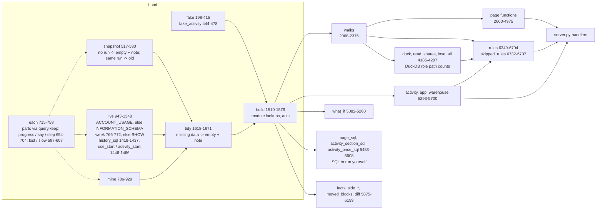
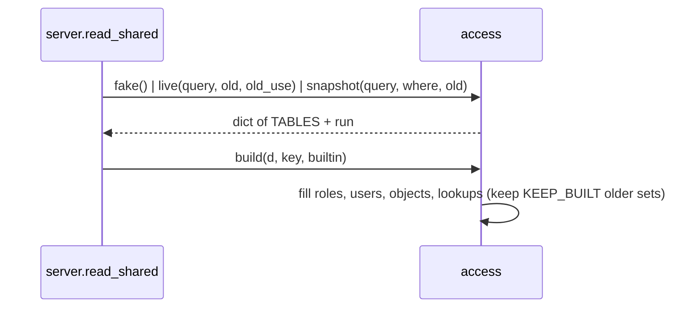

<!-- generated by darshan-singh-meel-knowledge-graph -->
# access.py

All data, walks and rules of the app (6,737 lines). Both versions call it; it imports no Streamlit or FastAPI (CLAUDE.md "Code style").

## Sections by area

| Area | Lines | What is there |
|---|---|---|
| Settings and constants | access.py:1-200 | `gc.set_threshold(700, 10, 1000)`: full collections wait for far more allocations on a loaded account (access.py:30-33); `.env` load (access.py:37), `in_snowflake` / `INSIDE` (access.py:45-59), `ADMIN` (access.py:61), `BUILTIN` patterns (access.py:68-70), `MAX_HOPS`, `FUNC`/`TECH`/`BUILD`, `TABLES` (access.py:74-82), sensitive tags, dormancy, `MAX_PATHS` (access.py:123-133), `RULES` titles (access.py:139-179), `SEVERITY` (access.py:180); activity settings `OPTIONAL`, `ACTIVITY_DAYS`, `QUERY_TAG` (env, default access-explorer, access.py:107), `APP_ST` (env STREAMLIT_APP, default ST_ACCESS_EXPLORER, access.py:108), `INTERACTIVE`, `CLIENTS`, `SPIKE`, `NEW_DAYS` (access.py:82-121), `WORK_HOURS` default business hours 7-19 (access.py:118-119); read settings `STATEMENT_TIMEOUT` (300), `WORKERS` (3), `ACTIVITY_ON` / `HIERARCHY_ON` (env ACTIVITY / HIERARCHY, default on), `SKIP_ACTIVITY` / `SKIP_HIERARCHY` texts (access.py:109-113) |
| Fake data | access.py:201-543 | `SCHEMAS`, `CHAIN`, `FIN_USERS` (access.py:203-215), `fake()` (access.py:218-440), `fake_use()` (access.py:443-470), `fake_activity()` one finding per rule 24-28, HOURS per row, SUPPORT_01's use of the Streamlit app (access.py:473-507); the demo app SALES.MART.ST_CUSTOMER_LOOKUP (access.py:205, access.py:221, access.py:244-245, access.py:286), `fake_previous()` for What changed (access.py:532-543) |
| Snapshot loader | access.py:546-615 | `snapshot(query, where, old=None)`: last OK run of `TBL_ACCESS_RUN`; the same run as `old` -> `old` back (access.py:567-573); else each `TBL_ACCESS_<t>` of that run (`SELECT * EXCLUDE (RUN_ID)`, `WORKERS` at a time); `OBJECT_USE`, `ACTIVITY` optional, not read under `ACTIVITY=0`; `hours_of` parses ACTIVITY `HOURS` JSON (access.py:612-615) |
| Timeouts, progress, parallel reads | access.py:618-814 | `line`, `timed_out` / `timeout_hint` / `step_name` (STATEMENT_TIMEOUT messages, access.py:639-661), `ident`, `qualify`, `progress` / `say` / `took` (progress lines, access.py:677-718), `one`, `each` (`n` at a time, SHOW_THREADS or WORKERS, progress labels, access.py:744-787), `held_db_roles`, `info_schema` |
| My access | access.py:815-973 | `mine(query, db)`: the logged-in user's own access, read with their rights, writes nothing; one `each()` wave for the role SHOWs, user grants, DESC USER and usage (access.py:842-868) |
| Live (SOURCE=direct) | access.py:976-1794 | `READS` / `USE_COLS` / `ACT_COLS` (access.py:977-983); `live(query, old, old_use)` (access.py:1222-1656): same dict as `snapshot()`; wave 1 probes, wave 2 ACCOUNT_USAGE reads `WORKERS` at a time, SHOW fallback waves; object use + activity from one ACCESS_HISTORY read for only the weeks / days `old_use` / `old` lack (access.py:1335-1364); `use_sql(since)` (access.py:1659-1682); `activity_sql` (access.py:1685-1730); `history_sql` / `history_rows` (access.py:1733-1759); `use_start` / `activity_start` (access.py:1762-1782); `only()` demo slice (access.py:1785-1794) |
| Missing data | access.py:1907-2012 | `COLS`, `QUIET`, `NEED`, `SRC`, `LONG`, `ROW` (access.py:1907-1917); `hours` (access.py:1920-1934), `usable` (access.py:1937-1943), `tidy` (access.py:1952-2012): every table in build()'s shape, rows without names / day / action left out with a `missing_names` note, missing columns noted (`missing_columns`); `dated` (access.py:517-523) |
| DuckDB walk | access.py:4727-4857 | `rules_stamp` (access.py:4727-4731), `DUCKS` / `close_ducks` (access.py:4734-4740), `duck_table` (access.py:4743-4748), `duck` (access.py:4751-4788), `read_shares` (access.py:4791-4811), `lose_all` (access.py:4814-4853), `lose_key` (access.py:4856-4857) |
| Lookups / build | access.py:1797-2060 | `ROLE_ON` (access.py:1810), `KEEP_BUILT` (access.py:1814), `acts` ACTIVITY rows (access.py:1806), `build()` (access.py:1832-1904), `cached()` (access.py:2026-2030), `kind_of`, `role_db`, `role_kind` (access.py:2033-2058) |
| Names, classes, ladder | access.py:2061-2407 | `uid` / `UTAG` users vs roles (access.py:2061-2067), `priv_class`, `priv_cat`, `category`, `LEVELS` ladder (access.py:2082-2153), `access_objects`, `ladder*`, `reach_counts` (access.py:2157-2258), `who_has` (access.py:2295-2314), `split_name` (access.py:2388) |
| Full walks | access.py:2408-2555 | `down`, `up`, `bfs`, `ups`, `best_paths`, `starts`, `walk`, `depth`, `chains` |
| Fast walks (counted) | access.py:2556-2759 | `dag`, `loops`, `counts`, `shortest`, `listed`, `fast`, `capped_paths` |
| Counted walks to holders | access.py:2761-2864 | `holding`, `tally`, `via_role`, `via_link`, `paths_to`, `reach_without` |
| Walk up | access.py:2866-2922 | `users_on`, `up_walk` (access.py:2873-2905), `up_only_via` |
| Graph inputs | access.py:2924-3232 | `down_graph`, `object_graph`, `role_graph`; `access_of`, `admin_paths`, `account_privs`, `admin_holders`, `who_users`, `who_can` (access.py:3040-3222) |
| Users | access.py:3233-3312 | `login_days`, `is_service`, `is_disabled`, `is_dormant`, `status`, `split_users`, `used_roles` |
| Sensitive data | access.py:3314-4034 | tags (`tag_rules`..`sensitive_cols`, access.py:3316-3369), policies and masking (`clear_for`..`col_view`, access.py:3379-3578), `data_view` (access.py:3580-3600), `governance_kpis` (access.py:3661-3672), `catalog` (access.py:3782-3800), `sens_flow` (access.py:3872-3900), `review_grid` (access.py:3960-4032) |
| Page aggregations | access.py:4035-4337 | `grants`, `grant_rows`, `reach`, `held`, `loses`, `role_stats`, `grantees`, `valid_privs`, `admin_*`, `matrix`, `object_stats`, `has_lacks`, `privs_on` |
| Big accounts | access.py:4338-4615 | `finding_index`, `group_objects`, `MAX_OBJECTS` 12 (access.py:4418), `graph_input` (access.py:4421-4511), `too_big`, `summary` (access.py:4531-4586), `graph_info` |
| Removal and requests | access.py:4616-5310 | `revoke` / `fix_text` text only (access.py:4647-4678), `with_sql` (access.py:4681-4694), `losers`, `removal`, `ask_for`, `can` (access.py:5045-5083), `cut_points`, `nearest`, `suggest`, `approver` |
| Access graph (screen 4) | access.py:5311-5543 | `access_graph` (access.py:5366-5540) |
| What they see (screen 7) | access.py:5544-5568 | `seen` |
| Compare / review / search | access.py:5569-5721 | `compare` (access.py:5585-5640; `match` / `extras` pass through `with_sql`, access.py:5639-5640), `review` (access.py:5643-5649), `search` (access.py:5703-5714) |
| What if | access.py:5722-6012 | `WHAT_IF_OPS` (access.py:5724), `changes_of`, `without_cuts`, `what_if` (access.py:5821-6010) |
| Granted vs used and Activity | access.py:6013-6743 | `use_state`; Activity tab: `act_state`, `client_label`, `activity`, `used_path`, `query_sql`, `activity_graph`, `user_reads`, `app_exposure`, `app_use`, `warehouse_use`, `rule29`, `mark_sensitive`, `activity_sensitive` (access.py:6029-6526); `used_on`, `granted_used` (access.py:6531-6604) |
| SQL to run yourself | access.py:6122-6365 | `DAYS_USAGE`, `QUERIES` (access_queries folder), `NEEDS` (privilege comment) (access.py:6124-6128); `lit`, `query_file`, `plain` (access.py:6141-6162); Activity section queries `ACT_FILTER`, `ACT_BASE`, `OFF`, `ACT_SECTIONS` (access.py:6165-6235), `activity_section_sql` (access.py:6238-6248); `page_sql` (access.py:6268-6363); logic in [logic/page-sql.md](../logic/page-sql.md) |
| What changed | access.py:6744-7105 | `state` / `restore` / `loaded` (access.py:6744-6774), `facts` (access.py:6777-6792), `side_reach` .. `side_below` (access.py:6795-6836), `fact_level` (access.py:6839-6848), `moved` / `moved_blocks` (access.py:6851-6887), `EVENT_NAMES` (access.py:7008), `diff` (access.py:7016-7101) |
| Rules | access.py:7106-7639 | `rule_rows`, `checks`, `find`, `rules_model` ... `rule23`, `rules_activity` 24-28 (access.py:7567-7618), `rule29` (access.py:6458-6473), `findings` (access.py:7621-7627) |

## Load and build

- `snapshot()` reads only `WHERE STATUS = 'OK'` latest run, so a half run is never shown; no OK run, no RUN_ID or an unreadable `TBL_ACCESS_RUN` -> every table empty with NOTES `no_run` (a lost session raises, `lost()` access.py:626-631); a table that fails to read is empty, `UNAVAILABLE`, noted and listed in `UNREAD` (read again next time); the run held already (`old`) costs that one query (access.py:556-608).
- `build()` calls `tidy(d)` first and sets `memo["key"]` last, so a build that stopped half way never counts as done (access.py:1847, access.py:1904); missing, NULL or unreadable data gives empty results plus a note ([business_rule:missing_data_never_fails](../logic/rules.md)).
- `live()` must stay in step with `SP_ACCESS_SNAPSHOT` (docstring access.py:1223-1225; CLAUDE.md "Direct mode").
- `build()` skips work when `key` matches the last build; keeps older sets in `built` up to `KEEP_BUILT` (access.py:1832-1841).
- Example: the server calls `a.build(d, key, builtin)` under its lock (server.py:339).

## Rules -> functions

| Rules | Function | Lines |
|---|---|---|
| 1, 2, 3, 4, 13, 14 | `rules_model` | access.py:7253-7305 |
| 5, 9, 12 | `rules_admin` | access.py:7308-7333 |
| 6, 7, 10, 11, 15 | `rules_sensitive` | access.py:7336-7391 |
| 8, 16 | `rules_users` | access.py:7394-7406 |
| 17 | `rule17` (+ `readonly_writes` access.py:7206-7241) | access.py:7409-7431 |
| 18 | `rule18` (+ `unusual` access.py:7434-7462) | access.py:7465-7478 |
| 19 | `rule19` | access.py:7481-7495 |
| 20, 21 | `rules_operate` | access.py:7503-7514 |
| 22 | `rule22` | access.py:7517-7534 |
| 23 | `rule23` | access.py:7537-7564 |
| 24, 25, 26, 27, 28 | `rules_activity` (table activity, [logic/activity.md](../logic/activity.md)) | access.py:7567-7618 |
| 29 | `rule29` (Streamlit app exposure, via `app_exposure`) | access.py:6458-6473 |

- `findings()` runs the groups one after another, each timed ("Slowest rules: ..." in the load log), rules 24-28 through `cached("activity", rules_activity)` (access.py:7629), and sorts by rule number (access.py:7621-7637); `checks()` gives `(num, title, grantee, detail, path)` rows (access.py:7155-7157).
- `SCOPED` rules check only names passed in `only` (what_if rechecks only what a change touches) (access.py:7244-7245).

## Key functions

| Name | Does | path:line |
|---|---|---|
| `in_snowflake` | Active Snowpark session or `INSIDE=1` | access.py:45-56 |
| `fake` | Demo data set (at least one finding per rule) | access.py:218-440 |
| `fake_previous` | Earlier demo snapshot for What changed | access.py:532-543 |
| `snapshot` | Last OK run of the `TBL_ACCESS_` tables | access.py:546-609 |
| `mine` | Logged-in user's own access, live; usage from ACCOUNT_USAGE.QUERY_HISTORY, else INFORMATION_SCHEMA.QUERY_HISTORY_BY_USER (access.py:955-966) | access.py:815-973 |
| `live` | Whole account read now (SOURCE=direct): per source ACCOUNT_USAGE first, else INFORMATION_SCHEMA (query history via `week`, tag references and policies per object up to `TAG_FALLBACK_MAX`), else SHOW; `old` / `old_use` rows -> incremental activity / object use read, one shared ACCESS_HISTORY read | access.py:1222-1656 |
| `each` | Statements `n` at a time (SHOW_THREADS / WORKERS), in order, failures as exceptions, progress lines; a `cache.parted` query takes the whole wave (`keep`) | access.py:744-787 |
| `progress` / `say` / `step` | Progress sink with a heartbeat every `BEAT` s; a line; a timed build step | access.py:682-733 |
| `lost` | A lost session or no warehouse (606: every SELECT fails, SHOW works) stops a load; any other error is an unreadable table (a note) | access.py:626-631 |
| `tidy` / `usable` / `hours` | Data set in build()'s shape; row usable for the walks; HOURS as a dict | access.py:1952-2012, access.py:1937-1943, access.py:1920-1934 |
| `duck` / `read_shares` / `lose_all` | DuckDB role path counts per hop; per-role reach counts for rules 17 / 23; who loses access for many edges in one query | access.py:4751-4788, access.py:4791-4811, access.py:4814-4853 |
| `below` | `bfs([role])` once per data set (rules 3, 14) | access.py:2458-2460 |
| `rules_stamp` | Hash of access.py and its settings: rule results kept across restarts (server.kept_rules) | access.py:4727-4731 |
| `history_sql` / `history_rows` | One ACCESS_HISTORY scan for object use and activity, split by PART | access.py:1733-1759 |
| `use_start` | Object use weeks to keep and the Monday to read from | access.py:1762-1771 |
| `skipped_rules` | Rules that did not run: HIERARCHY=0 (`WALKS`), ACTIVITY=0 (24-28) | access.py:7646-7657 |
| `activity_once_sql` | Every Activity section from one base read (RESULT_SCAN) | access.py:6251-6265 |
| `activity_sql` / `activity_start` | Activity SELECT per UTC day with HOURS and APP (same text as the procedure) and its incremental window | access.py:1685-1730, access.py:1774-1782 |
| `use_sql` | ACCESS_HISTORY usage SQL from a Monday (metadata only) | access.py:1659-1682 |
| `only` | One user's slice (demo My access) | access.py:1785-1794 |
| `build` | Fill module lookups; memo by key | access.py:1832-1904 |
| `cached` | `fn()` once per data set | access.py:2026-2030 |
| `kind_of` / `role_kind` | user / admin / database / functional / technical / group / object | access.py:2033-2058 |
| `who_has` | Screen 2 entries per user / role | access.py:2295-2314 |
| `down` / `up` / `bfs` | Full path walks down / up, shortest by BFS | access.py:2418-2455 |
| `dag` / `loops` | Role links minus loop back edges; role loops | access.py:2558-2623 |
| `counts` / `shortest` / `listed` / `fast` | Exact path counts, shortest paths, capped listing | access.py:2630-2722 |
| `up_walk` | Counted walk up to holders | access.py:2873-2905 |
| `access_of` / `who_can` | Reference listings (TF parity) | access.py:3040-3042, access.py:3218-3222 |
| `who_users` | Users of an object, counted | access.py:3192-3210 |
| `admin_holders` | Users / roles holding an admin role | access.py:3148-3158 |
| `status` / `is_dormant` | disabled / never / dormant / active | access.py:3277-3291 |
| `sensitive` / `masked` / `data_view` | Sensitive tags, masking, what a role sees | access.py:3360-3363, access.py:3435-3441, access.py:3580-3600 |
| `catalog` / `sens_flow` / `review_grid` | Screens 8, 16, 6 | access.py:3782-3800, access.py:3872-3900, access.py:3960-4032 |
| `grants` / `reach` / `held` / `grantees` / `matrix` | Page rows (cached per walk) | access.py:4037-4275 |
| `has_lacks` | Privileges held vs missing on one object | access.py:4311-4324 |
| `graph_input` / `summary` | Big-account roll-up and fold | access.py:4421-4511, access.py:4531-4586 |
| `revoke` / `fix_text` | IaC + SQL text for a grant edge (never run) | access.py:4647-4678 |
| `with_sql` | A Compare / Request change dict (op grant / revoke, role or privilege + objectType + object, to, toUser) plus its `sql` (revoke via `revoke()`, grant written here with a `-- undo:` line for a role) and `roleDb` / `toDb` from `role_kind()`: the server is the only SQL writer, the web pages never write SQL or guess a role's kind from a dot (never run) | access.py:4681-4694 |
| `can` | Can they? (count, shortest, choke, options) | access.py:5045-5083 |
| `cut_points` / `removal` / `nearest` / `suggest` / `ask_for` | Where to cut, ways to remove, ways in, request roles | access.py:4874-5308 |
| `access_graph` | Screen 4 graph | access.py:5366-5540 |
| `seen` / `compare` / `review` / `search` | Screens 7, 9, review export, search ranking | access.py:5546-5714 |
| `what_if` | Simulated revokes; restores lookups | access.py:5821-6010 |
| `act_state` / `activity` | Activity tab: available or why not; per-day, by-key and per-use numbers for an object, user, role, app or scope, with UTC hours, weekend, kind | access.py:6029-6036, access.py:6043-6096 |
| `query_sql` | Copy-only SQL listing every query behind the tab (never run) | access.py:6099-6119 |
| `lit` / `plain` / `query_file` | SQL literal for a SET line; a query of our own (comments, NEEDS, SET lines, SELECT); an `access_queries/` file with its SET lines filled in (None when the file is missing) | access.py:6141-6144, access.py:6159-6162, access.py:6147-6156 |
| `activity_section_sql` | SQL behind one Activity section (`ACT_SECTIONS` key) for an object, user, role, app or scope (never run) | access.py:6238-6248 |
| `page_sql` | SQL to run yourself behind a page: list of `{title, sql}`, most useful first (never run) | access.py:6268-6363 |
| `used_path` / `activity_graph` | Grant path behind each use; the Paths diagram | access.py:6365-6383, access.py:6386-6410 |
| `user_reads` / `app_exposure` / `app_use` | Objects a user reads; what a Streamlit app shows its viewers with its owner's rights; who can open it, who did, who saw data they can't read | access.py:6413-6415, access.py:6418-6431, access.py:6434-6446 |
| `warehouse_use` | Who ran queries on a warehouse (usage read) and who can but did not | access.py:6449-6455 |
| `activity_sensitive` / `mark_sensitive` | Sensitive columns each user + role used sees; tag text for an untagged table (never run) | access.py:6501-6524, access.py:6476-6498 |
| `granted_used` | Screen 13; also `sql`: the trim of unused grants joined from `changes_of(changes)`, as What if writes it (access.py:6604) | access.py:6556-6604 |
| `facts` / `diff` | Screen 14: what a diff compares, once per data set; events capped to the first `EVENT_NAMES` (200, access.py:7008) people and objects (impact counts all), counts per filter, new / fixed findings, (user, object) pairs only with pairs=True | access.py:6777-6792, access.py:7016-7101 |
| `slow` / `week` / `span` | A timed-out statement (retry or a bigger warehouse helps); an INFORMATION_SCHEMA query history SELECT over its whole 167 h reach in 7 windows of 10,000 rows each; "45 s" / "6 min" for a step's time | access.py:634-636, access.py:795-801, access.py:712-714 |
| `admin_user_paths` | {user: admin_holders() paths} of every admin user without a walk each, once per data set | access.py:2317-2326 |
| `ups_of` / `path_roles` | Parent roles of a walk's links, kept for the last walk; every name on a path from a start to its holders | access.py:2675-2686, access.py:2725-2746 |
| `tag_index` / `governed` | TAG rows by object, once per data set (tags_of looks up three names); tables and views with a tag or a policy, the only ones data_views reads | access.py:3330-3338, access.py:3604-3615 |
| `sensitive_reach` | Sensitive data per granted role (depth 1, PUBLIC included), once per data set, rows shared | access.py:3685-3702 |
| `sens_roles` / `sens_readers` / `sens_path` / `read_path` | {role: sensitive objects it reads} once per data set; users who read one of a set of objects through a granted role; shortest path user -> object of a set; reads([role])[obj] without reading everything else | access.py:3715-3753 |
| `flow_sets` / `flow_follow` | sens_flow() with the users of every box and link; following one box: every user through it, then each user's own links (screen 16) | access.py:3828-3869, access.py:3903-3947 |
| `grant_rows` / `grant_count` | Grant rows of a walk (paths shared, built once per holder set); `len(grants())` without building its rows (the default-role banner of a big user) | access.py:4043-4089, access.py:4092-4098 |
| `loses_objects` | Objects of loses(user, user, role) counted, once per data set | access.py:4146-4154 |
| `by_first` | finding_index() edges by their first node | access.py:4377-4382 |
| `review_parts` | review() without a row per (user, object), once per data set and database | access.py:5652-5697 |
| `side_reach` / `side_tables` / `side_on` / `side_below` | What changed: reach, tables, holders per table and roles below of one facts() side, once per side (its lookups need not be loaded) | access.py:6795-6836 |
| `fact_level` | (level, privileges) on a table or view of a user holding a role tuple in one facts() side | access.py:6839-6848 |
| `moved` / `moved_blocks` | (user, object) pairs one side gives a higher level than the other; the same as blocks [(user, objects, levels)] without one pair each (diff with pairs=False) | access.py:6851-6853, access.py:6856-6887 |
| `rule_rows` / `checks` / `findings` | Rule output for pages and tests; `findings` times each group and names the slowest | access.py:7128-7157, access.py:7621-7637 |
| `rules_activity` | Rules 24-28 on table activity | access.py:7567-7618 |
| `rule29` | Rule 29: Streamlit app shows its owner's sensitive data | access.py:6458-6473 |

- Graph fragment: `function:access.py:<name>` nodes, `implements` edges to `business_rule:rule_N` (_scripts/parts/modules.*.jsonl).
- unclear: `fake()` has no docstring; its content was not inspected line by line here.
