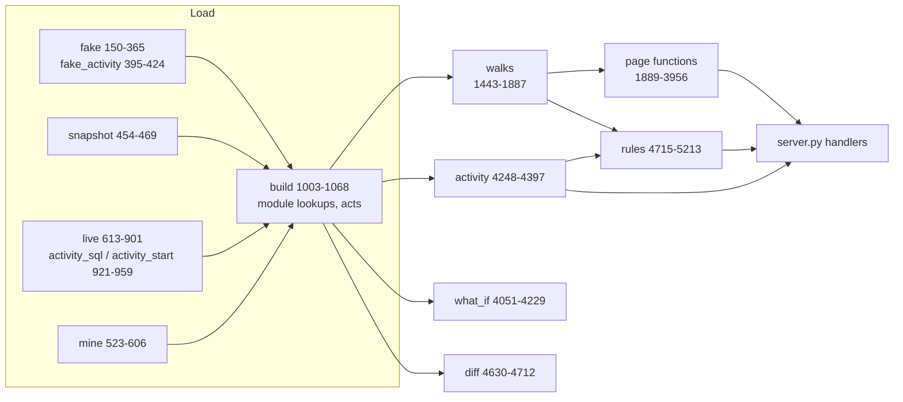
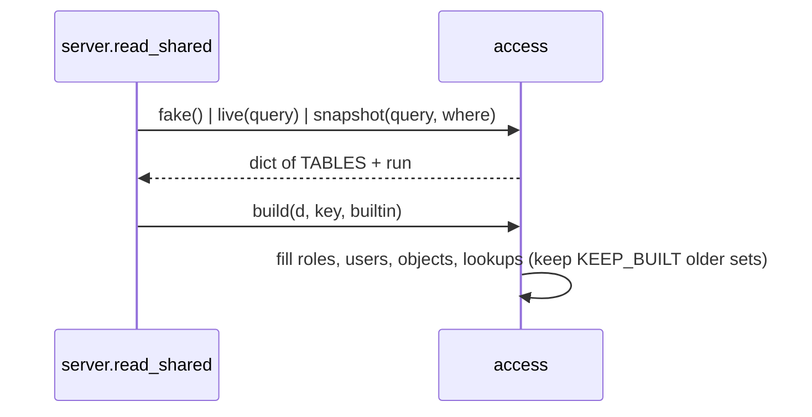

<!-- generated by darshan-singh-meel-knowledge-graph -->
# access.py

All data, walks and rules of the app (5,213 lines). Both versions call it; it imports no Streamlit or FastAPI (CLAUDE.md "Code style").

## Sections by area

| Area | Lines | What is there |
|---|---|---|
| Settings and constants | access.py:1-132 | `.env` load (access.py:21), `in_snowflake` / `INSIDE` (access.py:29-43), `ADMIN` (access.py:45), `BUILTIN` patterns (access.py:52-54), `MAX_HOPS`, `FUNC`/`TECH`/`BUILD`, `TABLES` (access.py:55-61), sensitive tags, dormancy, `MAX_PATHS` (access.py:72-82), `RULES` titles (access.py:88-126), `SEVERITY` (access.py:127); activity settings `OPTIONAL`, `ACTIVITY_DAYS`, `QUERY_TAG`, `INTERACTIVE`, `CLIENTS`, `SPIKE`, `NEW_DAYS` (access.py:61-70) |
| Fake data | access.py:133-451 | `SCHEMAS`, `CHAIN`, `FIN_USERS` (access.py:135-147), `fake()` (access.py:150-365), `fake_use()` (access.py:369-392), `fake_activity()` one finding per rule 24-28 (access.py:395-424), `fake_previous()` for What changed (access.py:440-451) |
| Snapshot loader | access.py:454-469 | `snapshot(query, where)`: last OK run of `TBL_ACCESS_RUN`, then each `TBL_ACCESS_<t>` of that run; `OBJECT_USE`, `ACTIVITY` optional |
| SHOW helpers | access.py:472-522 | `ident`, `line`, `qualify`, `each` (SHOW_THREADS at once, access.py:490-504), `held_db_roles`, `info_schema` |
| My access | access.py:523-606 | `mine(query, db)`: the logged-in user's own access, read with their rights, writes nothing |
| Live (SOURCE=direct) | access.py:609-971 | `live(query, old)` (access.py:613-901): same dict as `snapshot()`, ACCOUNT_USAGE else SHOW, ACTIVITY read only for the days `old` lacks (access.py:883-892); `use_sql` ACCESS_HISTORY (access.py:904-918); `activity_sql` / `activity_start` (access.py:921-959); `only()` demo slice (access.py:962-971) |
| Lookups / build | access.py:974-1116 | `ROLE_ON` (access.py:986), `KEEP_BUILT` (access.py:990), `acts` ACTIVITY rows (access.py:983), `build()` (access.py:1003-1068), `cached()` (access.py:1082-1086), `kind_of`, `role_db`, `role_kind` (access.py:1089-1114) |
| Names, classes, ladder | access.py:1117-1442 | `uid` / `UTAG` users vs roles (access.py:1117-1123), `priv_class`, `priv_cat`, `category`, `LEVELS` ladder (access.py:1138-1209), `access_objects`, `ladder*`, `reach_counts` (access.py:1213-1311), `who_has` (access.py:1348-1361), `split_name` (access.py:1423) |
| Full walks | access.py:1443-1558 | `down`, `up`, `bfs`, `ups`, `best_paths`, `starts`, `walk`, `depth`, `chains` |
| Fast walks (counted) | access.py:1559-1724 | `dag`, `loops`, `counts`, `shortest`, `listed`, `fast`, `capped_paths` |
| Counted walks to holders | access.py:1726-1829 | `holding`, `tally`, `via_role`, `via_link`, `paths_to`, `reach_without` |
| Walk up | access.py:1831-1887 | `users_on`, `up_walk` (access.py:1838-1870), `up_only_via` |
| Graph inputs | access.py:1889-2109 | `down_graph`, `object_graph`, `role_graph`; `access_of`, `admin_paths`, `account_privs`, `admin_holders`, `who_users`, `who_can` (access.py:2005-2099) |
| Users | access.py:2110-2180 | `login_days`, `is_service`, `is_disabled`, `is_dormant`, `status`, `split_users`, `used_roles` |
| Sensitive data | access.py:2182-2676 | tags (`tag_rules`..`sensitive_cols`, access.py:2184-2226), policies and masking (`clear_for`..`col_view`, access.py:2235-2418), `data_view` (access.py:2420-2439), `governance_kpis` (access.py:2480-2487), `catalog` (access.py:2549-2562), `sens_flow` (access.py:2574-2615), `review_grid` (access.py:2628-2674) |
| Page aggregations | access.py:2677-2924 | `grants`, `grant_rows`, `reach`, `held`, `loses`, `role_stats`, `grantees`, `valid_privs`, `admin_*`, `matrix`, `object_stats`, `has_lacks`, `privs_on` |
| Big accounts | access.py:2925-3193 | `finding_index`, `group_objects`, `MAX_OBJECTS` 12 (access.py:2997), `graph_input` (access.py:3000-3090), `too_big`, `summary` (access.py:3110-3165), `graph_info` |
| Removal and requests | access.py:3194-3604 | `revoke` / `fix_text` text only (access.py:3225-3256), `with_sql` (access.py:3259-3272), `losers`, `removal`, `ask_for`, `can` (access.py:3375-3408), `cut_points`, `nearest`, `suggest`, `approver` |
| Access graph (screen 4) | access.py:3605-3810 | `access_graph` (access.py:3660-3808) |
| What they see (screen 7) | access.py:3811-3835 | `seen` |
| Compare / review / search | access.py:3836-3956 | `compare` (access.py:3852-3906; `match` / `extras` pass through `with_sql`, access.py:3905-3906), `review` (access.py:3909-3942), `search` (access.py:3945-3954) |
| What if | access.py:3957-4231 | `WHAT_IF_OPS` (access.py:3959), `changes_of`, `without_cuts`, `what_if` (access.py:4051-4229) |
| Granted vs used and Activity | access.py:4232-4467 | `use_state`; Activity tab: `act_state`, `client_label`, `activity`, `used_path`, `activity_graph`, `mark_sensitive`, `activity_sensitive` (access.py:4248-4397); `used_on`, `granted_used` (access.py:4422-4465) |
| What changed | access.py:4468-4714 | `state` / `restore` / `loaded` (access.py:4470-4497), `facts` (access.py:4502-4528), `diff` (access.py:4630-4712) |
| Rules | access.py:4715-5213 | `rule_rows`, `checks`, `find`, `rules_model` ... `rule23`, `rules_activity` 24-28 (access.py:5153-5204), `findings` (access.py:5207-5213) |

## Load and build

- `snapshot()` reads only `WHERE STATUS = 'OK'` latest run, so a half run is never shown (access.py:456-459).
- `live()` must stay in step with `SP_ACCESS_SNAPSHOT` (docstring access.py:614-616; CLAUDE.md "Direct mode").
- `build()` skips work when `key` matches the last build; keeps older sets in `built` up to `KEEP_BUILT` (access.py:1003-1012).
- Example: the server calls `a.build(d, key, builtin)` under its lock (server.py:196).

## Rules -> functions

| Rules | Function | Lines |
|---|---|---|
| 1, 2, 3, 4, 13, 14 | `rules_model` | access.py:4855-4905 |
| 5, 9, 12 | `rules_admin` | access.py:4908-4930 |
| 6, 7, 10, 11, 15 | `rules_sensitive` | access.py:4933-4988 |
| 8, 16 | `rules_users` | access.py:4991-5003 |
| 17 | `rule17` (+ `readonly_writes` access.py:4812-4843) | access.py:5006-5022 |
| 18 | `rule18` (+ `unusual` access.py:5025-5051) | access.py:5054-5067 |
| 19 | `rule19` | access.py:5070-5084 |
| 20, 21 | `rules_operate` | access.py:5092-5103 |
| 22 | `rule22` | access.py:5106-5123 |
| 23 | `rule23` | access.py:5126-5150 |
| 24, 25, 26, 27, 28 | `rules_activity` (table activity, [logic/activity.md](../logic/activity.md)) | access.py:5153-5204 |

- `findings()` concatenates all (rules 24-28 through `cached("activity", rules_activity)`, access.py:5211) and sorts by rule number (access.py:5207-5213); `checks()` gives `(num, title, grantee, detail, path)` rows (access.py:4763-4765).
- `SCOPED` rules check only names passed in `only` (what_if rechecks only what a change touches) (access.py:4846-4847).

## Key functions

| Name | Does | path:line |
|---|---|---|
| `in_snowflake` | Active Snowpark session or `INSIDE=1` | access.py:29-40 |
| `fake` | Demo data set (at least one finding per rule) | access.py:150-365 |
| `fake_previous` | Earlier demo snapshot for What changed | access.py:440-451 |
| `snapshot` | Last OK run of the `TBL_ACCESS_` tables | access.py:454-469 |
| `mine` | Logged-in user's own access, live | access.py:523-606 |
| `live` | Whole account read now (SOURCE=direct); `old` ACTIVITY rows -> incremental activity read | access.py:613-901 |
| `activity_sql` / `activity_start` | Activity SELECT (same text as the procedure) and its incremental window | access.py:921-949, access.py:952-959 |
| `use_sql` | ACCESS_HISTORY usage SQL (metadata only) | access.py:904-918 |
| `only` | One user's slice (demo My access) | access.py:962-971 |
| `build` | Fill module lookups; memo by key | access.py:1003-1068 |
| `cached` | `fn()` once per data set | access.py:1082-1086 |
| `kind_of` / `role_kind` | user / admin / database / functional / technical / group / object | access.py:1089-1114 |
| `who_has` | Screen 2 entries per user / role | access.py:1348-1361 |
| `down` / `up` / `bfs` | Full path walks down / up, shortest by BFS | access.py:1453-1490 |
| `dag` / `loops` | Role links minus loop back edges; role loops | access.py:1561-1626 |
| `counts` / `shortest` / `listed` / `fast` | Exact path counts, shortest paths, capped listing | access.py:1633-1711 |
| `up_walk` | Counted walk up to holders | access.py:1838-1870 |
| `access_of` / `who_can` | Reference listings (TF parity) | access.py:2005-2007, access.py:2095-2099 |
| `who_users` | Users of an object, counted | access.py:2069-2087 |
| `admin_holders` | Users / roles holding an admin role | access.py:2027-2035 |
| `status` / `is_dormant` | disabled / never / dormant / active | access.py:2145-2159 |
| `sensitive` / `masked` / `data_view` | Sensitive tags, masking, what a role sees | access.py:2217-2220, access.py:2275-2281, access.py:2420-2439 |
| `catalog` / `sens_flow` / `review_grid` | Screens 8, 16, 6 | access.py:2549-2562, access.py:2574-2615, access.py:2628-2674 |
| `grants` / `reach` / `held` / `grantees` / `matrix` | Page rows (cached per walk) | access.py:2679-2873 |
| `has_lacks` | Privileges held vs missing on one object | access.py:2898-2911 |
| `graph_input` / `summary` | Big-account roll-up and fold | access.py:3000-3090, access.py:3110-3165 |
| `revoke` / `fix_text` | IaC + SQL text for a grant edge (never run) | access.py:3225-3256 |
| `with_sql` | A Compare / Request change dict (op grant / revoke, role or privilege + objectType + object, to, toUser) plus its `sql` (revoke via `revoke()`, grant written here with a `-- undo:` line for a role) and `roleDb` / `toDb` from `role_kind()`: the server is the only SQL writer, the web pages never write SQL or guess a role's kind from a dot (never run) | access.py:3259-3272 |
| `can` | Can they? (count, shortest, choke, options) | access.py:3375-3408 |
| `cut_points` / `removal` / `nearest` / `suggest` / `ask_for` | Where to cut, ways to remove, ways in, request roles | access.py:3309-3602 |
| `access_graph` | Screen 4 graph | access.py:3660-3808 |
| `seen` / `compare` / `review` / `search` | Screens 7, 9, review export, search ranking | access.py:3813-3954 |
| `what_if` | Simulated revokes; restores lookups | access.py:4051-4229 |
| `act_state` / `activity` | Activity tab: available or why not; per-day, by-key and per-use numbers | access.py:4248-4255, access.py:4262-4298 |
| `used_path` / `activity_graph` | Grant path behind each use; the Paths diagram | access.py:4301-4319, access.py:4322-4346 |
| `activity_sensitive` / `mark_sensitive` | Sensitive columns each user + role used sees; tag text for an untagged table (never run) | access.py:4374-4397, access.py:4349-4371 |
| `granted_used` | Screen 13; also `sql`: the trim of unused grants joined from `changes_of(changes)`, as What if writes it (access.py:4465) | access.py:4422-4465 |
| `facts` / `diff` | Screen 14 | access.py:4502-4528, access.py:4630-4712 |
| `rule_rows` / `checks` / `findings` | Rule output for pages and tests | access.py:4739-4765, access.py:5207-5213 |
| `rules_activity` | Rules 24-28 on table activity | access.py:5153-5204 |

- Graph fragment: `function:access.py:<name>` nodes, `implements` edges to `business_rule:rule_N` (_scripts/parts/modules.*.jsonl).
- unclear: `fake()` has no docstring; its content was not inspected line by line here.
