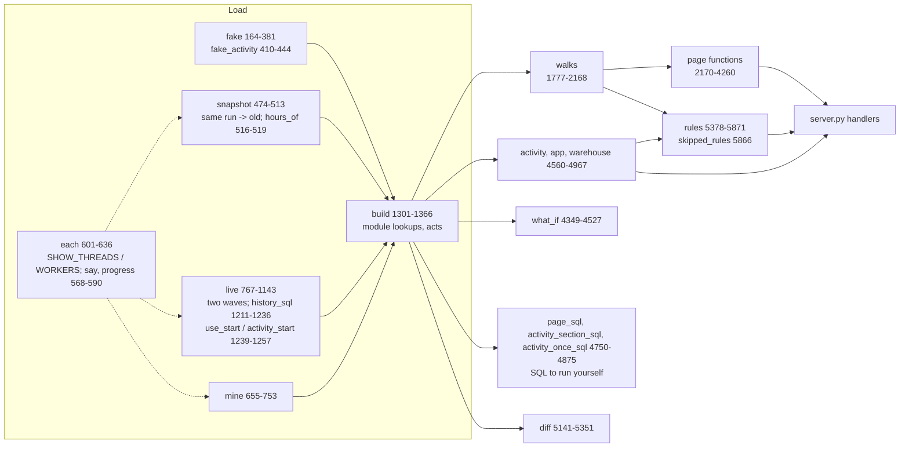
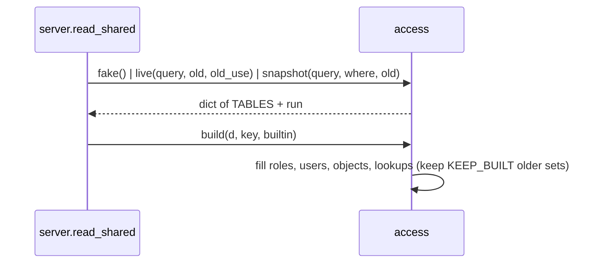

<!-- generated by darshan-singh-meel-knowledge-graph -->
# access.py

All data, walks and rules of the app (5,535 lines). Both versions call it; it imports no Streamlit or FastAPI (CLAUDE.md "Code style").

## Sections by area

| Area | Lines | What is there |
|---|---|---|
| Settings and constants | access.py:1-146 | `.env` load (access.py:25), `in_snowflake` / `INSIDE` (access.py:33-47), `ADMIN` (access.py:49), `BUILTIN` patterns (access.py:56-58), `MAX_HOPS`, `FUNC`/`TECH`/`BUILD`, `TABLES` (access.py:59-65), sensitive tags, dormancy, `MAX_PATHS` (access.py:84-94), `RULES` titles (access.py:100-140), `SEVERITY` (access.py:141); activity settings `OPTIONAL`, `ACTIVITY_DAYS`, `QUERY_TAG` (env, default access-explorer, access.py:68), `APP_ST` (env STREAMLIT_APP, default ST_ACCESS_EXPLORER, access.py:69), `INTERACTIVE`, `CLIENTS`, `SPIKE`, `NEW_DAYS` (access.py:65-82), `WORK_HOURS` default business hours 7-19 (access.py:79-80); read settings `STATEMENT_TIMEOUT` (300), `WORKERS` (3), `ACTIVITY_ON` / `HIERARCHY_ON` (env ACTIVITY / HIERARCHY, default on), `SKIP_ACTIVITY` / `SKIP_HIERARCHY` texts (access.py:70-74) |
| Fake data | access.py:147-471 | `SCHEMAS`, `CHAIN`, `FIN_USERS` (access.py:149-161), `fake()` (access.py:164-381), `fake_use()` (access.py:384-407), `fake_activity()` one finding per rule 24-28, HOURS per row, SUPPORT_01's use of the Streamlit app (access.py:410-444); the demo app SALES.MART.ST_CUSTOMER_LOOKUP (access.py:151, access.py:167, access.py:190-191, access.py:229), `fake_previous()` for What changed (access.py:460-471) |
| Snapshot loader | access.py:474-519 | `snapshot(query, where, old=None)`: last OK run of `TBL_ACCESS_RUN`; the same run as `old` -> `old` back (access.py:487-492); else each `TBL_ACCESS_<t>` of that run (`SELECT * EXCLUDE (RUN_ID)`, `WORKERS` at a time); `OBJECT_USE`, `ACTIVITY` optional, not read under `ACTIVITY=0`; `hours_of` parses ACTIVITY `HOURS` JSON (access.py:516-519) |
| Timeouts, progress, parallel reads | access.py:522-654 | `line`, `timed_out` / `timeout_hint` / `step_name` (STATEMENT_TIMEOUT messages, access.py:530-552), `ident`, `qualify`, `progress` / `say` / `took` (progress lines, access.py:568-590), `one`, `each` (`n` at a time, SHOW_THREADS or WORKERS, progress labels, access.py:601-636), `held_db_roles`, `info_schema` |
| My access | access.py:655-753 | `mine(query, db)`: the logged-in user's own access, read with their rights, writes nothing; one `each()` wave for the role SHOWs, user grants, DESC USER and usage (access.py:669-676) |
| Live (SOURCE=direct) | access.py:756-1269 | `READS` / `USE_COLS` / `ACT_COLS` (access.py:757-763); `live(query, old, old_use)` (access.py:767-1143): same dict as `snapshot()`; wave 1 probes, wave 2 ACCOUNT_USAGE reads `WORKERS` at a time, SHOW fallback waves; object use + activity from one ACCESS_HISTORY read for only the weeks / days `old_use` / `old` lack (access.py:875-904); `use_sql(since)` (access.py:1146-1162); `activity_sql` (access.py:1165-1208); `history_sql` / `history_rows` (access.py:1211-1236); `use_start` / `activity_start` (access.py:1239-1257); `only()` demo slice (access.py:1260-1269) |
| Lookups / build | access.py:1272-1414 | `ROLE_ON` (access.py:1284), `KEEP_BUILT` (access.py:1288), `acts` ACTIVITY rows (access.py:1281), `build()` (access.py:1301-1366), `cached()` (access.py:1380-1384), `kind_of`, `role_db`, `role_kind` (access.py:1387-1412) |
| Names, classes, ladder | access.py:1415-1740 | `uid` / `UTAG` users vs roles (access.py:1415-1421), `priv_class`, `priv_cat`, `category`, `LEVELS` ladder (access.py:1436-1507), `access_objects`, `ladder*`, `reach_counts` (access.py:1511-1609), `who_has` (access.py:1646-1659), `split_name` (access.py:1721) |
| Full walks | access.py:1741-1856 | `down`, `up`, `bfs`, `ups`, `best_paths`, `starts`, `walk`, `depth`, `chains` |
| Fast walks (counted) | access.py:1857-2022 | `dag`, `loops`, `counts`, `shortest`, `listed`, `fast`, `capped_paths` |
| Counted walks to holders | access.py:2024-2127 | `holding`, `tally`, `via_role`, `via_link`, `paths_to`, `reach_without` |
| Walk up | access.py:2129-2185 | `users_on`, `up_walk` (access.py:2136-2168), `up_only_via` |
| Graph inputs | access.py:2187-2407 | `down_graph`, `object_graph`, `role_graph`; `access_of`, `admin_paths`, `account_privs`, `admin_holders`, `who_users`, `who_can` (access.py:2303-2397) |
| Users | access.py:2408-2478 | `login_days`, `is_service`, `is_disabled`, `is_dormant`, `status`, `split_users`, `used_roles` |
| Sensitive data | access.py:2480-2974 | tags (`tag_rules`..`sensitive_cols`, access.py:2482-2524), policies and masking (`clear_for`..`col_view`, access.py:2533-2716), `data_view` (access.py:2718-2737), `governance_kpis` (access.py:2778-2785), `catalog` (access.py:2847-2860), `sens_flow` (access.py:2872-2913), `review_grid` (access.py:2926-2972) |
| Page aggregations | access.py:2975-3222 | `grants`, `grant_rows`, `reach`, `held`, `loses`, `role_stats`, `grantees`, `valid_privs`, `admin_*`, `matrix`, `object_stats`, `has_lacks`, `privs_on` |
| Big accounts | access.py:3223-3491 | `finding_index`, `group_objects`, `MAX_OBJECTS` 12 (access.py:3295), `graph_input` (access.py:3298-3388), `too_big`, `summary` (access.py:3408-3463), `graph_info` |
| Removal and requests | access.py:3492-3902 | `revoke` / `fix_text` text only (access.py:3523-3554), `with_sql` (access.py:3557-3570), `losers`, `removal`, `ask_for`, `can` (access.py:3673-3706), `cut_points`, `nearest`, `suggest`, `approver` |
| Access graph (screen 4) | access.py:3903-4108 | `access_graph` (access.py:3958-4106) |
| What they see (screen 7) | access.py:4109-4133 | `seen` |
| Compare / review / search | access.py:4134-4254 | `compare` (access.py:4150-4204; `match` / `extras` pass through `with_sql`, access.py:4203-4204), `review` (access.py:4207-4240), `search` (access.py:4243-4252) |
| What if | access.py:4255-4529 | `WHAT_IF_OPS` (access.py:4257), `changes_of`, `without_cuts`, `what_if` (access.py:4349-4527) |
| Granted vs used and Activity | access.py:4530-5108 | `use_state`; Activity tab: `act_state`, `client_label`, `activity`, `used_path`, `query_sql`, `activity_graph`, `user_reads`, `app_exposure`, `app_use`, `warehouse_use`, `rule29`, `mark_sensitive`, `activity_sensitive` (access.py:4546-5038); `used_on`, `granted_used` (access.py:5043-5104) |
| SQL to run yourself | access.py:4639-4877 | `DAYS_USAGE`, `QUERIES` (access_queries folder), `NEEDS` (privilege comment) (access.py:4641-4645); `lit`, `query_file`, `plain` (access.py:4658-4679); Activity section queries `ACT_FILTER`, `ACT_BASE`, `OFF`, `ACT_SECTIONS` (access.py:4682-4747), `activity_section_sql` (access.py:4750-4760); `page_sql` (access.py:4780-4875); logic in [logic/page-sql.md](../logic/page-sql.md) |
| What changed | access.py:5109-5355 | `state` / `restore` / `loaded` (access.py:5109-5138), `facts` (access.py:5141-5167), `diff` (access.py:5269-5351) |
| Rules | access.py:5356-5859 | `rule_rows`, `checks`, `find`, `rules_model` ... `rule23`, `rules_activity` 24-28 (access.py:5795-5846), `rule29` (access.py:4970-4985), `findings` (access.py:5849-5855) |

## Load and build

- `snapshot()` reads only `WHERE STATUS = 'OK'` latest run, so a half run is never shown; the run held already (`old`) costs that one query (access.py:479-492).
- `live()` must stay in step with `SP_ACCESS_SNAPSHOT` (docstring access.py:768-770; CLAUDE.md "Direct mode").
- `build()` skips work when `key` matches the last build; keeps older sets in `built` up to `KEEP_BUILT` (access.py:1301-1310).
- Example: the server calls `a.build(d, key, builtin)` under its lock (server.py:231).

## Rules -> functions

| Rules | Function | Lines |
|---|---|---|
| 1, 2, 3, 4, 13, 14 | `rules_model` | access.py:5494-5546 |
| 5, 9, 12 | `rules_admin` | access.py:5549-5572 |
| 6, 7, 10, 11, 15 | `rules_sensitive` | access.py:5575-5630 |
| 8, 16 | `rules_users` | access.py:5633-5645 |
| 17 | `rule17` (+ `readonly_writes` access.py:5451-5482) | access.py:5648-5664 |
| 18 | `rule18` (+ `unusual` access.py:5667-5693) | access.py:5696-5709 |
| 19 | `rule19` | access.py:5712-5726 |
| 20, 21 | `rules_operate` | access.py:5734-5745 |
| 22 | `rule22` | access.py:5748-5765 |
| 23 | `rule23` | access.py:5768-5792 |
| 24, 25, 26, 27, 28 | `rules_activity` (table activity, [logic/activity.md](../logic/activity.md)) | access.py:5795-5846 |
| 29 | `rule29` (Streamlit app exposure, via `app_exposure`) | access.py:4970-4985 |

- `findings()` concatenates all (rules 24-28 through `cached("activity", rules_activity)`, access.py:5854; then `rule29()`, same line) and sorts by rule number (access.py:5849-5855); `checks()` gives `(num, title, grantee, detail, path)` rows (access.py:5402-5404).
- `SCOPED` rules check only names passed in `only` (what_if rechecks only what a change touches) (access.py:5485-5486).

## Key functions

| Name | Does | path:line |
|---|---|---|
| `in_snowflake` | Active Snowpark session or `INSIDE=1` | access.py:33-44 |
| `fake` | Demo data set (at least one finding per rule) | access.py:164-381 |
| `fake_previous` | Earlier demo snapshot for What changed | access.py:460-471 |
| `snapshot` | Last OK run of the `TBL_ACCESS_` tables | access.py:474-513 |
| `mine` | Logged-in user's own access, live | access.py:655-753 |
| `live` | Whole account read now (SOURCE=direct); `old` / `old_use` rows -> incremental activity / object use read, one shared ACCESS_HISTORY read | access.py:767-1143 |
| `each` | Statements `n` at a time (SHOW_THREADS / WORKERS), in order, failures as exceptions, progress lines | access.py:601-636 |
| `history_sql` / `history_rows` | One ACCESS_HISTORY scan for object use and activity, split by PART | access.py:1211-1236 |
| `use_start` | Object use weeks to keep and the Monday to read from | access.py:1239-1247 |
| `skipped_rules` | Rules that did not run: HIERARCHY=0 (`WALKS`), ACTIVITY=0 (24-28) | access.py:5866-5871 |
| `activity_once_sql` | Every Activity section from one base read (RESULT_SCAN) | access.py:4763-4777 |
| `activity_sql` / `activity_start` | Activity SELECT per UTC day with HOURS and APP (same text as the procedure) and its incremental window | access.py:1165-1208, access.py:1250-1257 |
| `use_sql` | ACCESS_HISTORY usage SQL from a Monday (metadata only) | access.py:1146-1162 |
| `only` | One user's slice (demo My access) | access.py:1260-1269 |
| `build` | Fill module lookups; memo by key | access.py:1301-1366 |
| `cached` | `fn()` once per data set | access.py:1380-1384 |
| `kind_of` / `role_kind` | user / admin / database / functional / technical / group / object | access.py:1387-1412 |
| `who_has` | Screen 2 entries per user / role | access.py:1646-1659 |
| `down` / `up` / `bfs` | Full path walks down / up, shortest by BFS | access.py:1751-1788 |
| `dag` / `loops` | Role links minus loop back edges; role loops | access.py:1859-1924 |
| `counts` / `shortest` / `listed` / `fast` | Exact path counts, shortest paths, capped listing | access.py:1931-2009 |
| `up_walk` | Counted walk up to holders | access.py:2136-2168 |
| `access_of` / `who_can` | Reference listings (TF parity) | access.py:2303-2305, access.py:2393-2397 |
| `who_users` | Users of an object, counted | access.py:2367-2385 |
| `admin_holders` | Users / roles holding an admin role | access.py:2325-2333 |
| `status` / `is_dormant` | disabled / never / dormant / active | access.py:2443-2457 |
| `sensitive` / `masked` / `data_view` | Sensitive tags, masking, what a role sees | access.py:2515-2518, access.py:2573-2579, access.py:2718-2737 |
| `catalog` / `sens_flow` / `review_grid` | Screens 8, 16, 6 | access.py:2847-2860, access.py:2872-2913, access.py:2926-2972 |
| `grants` / `reach` / `held` / `grantees` / `matrix` | Page rows (cached per walk) | access.py:2977-3171 |
| `has_lacks` | Privileges held vs missing on one object | access.py:3196-3209 |
| `graph_input` / `summary` | Big-account roll-up and fold | access.py:3298-3388, access.py:3408-3463 |
| `revoke` / `fix_text` | IaC + SQL text for a grant edge (never run) | access.py:3523-3554 |
| `with_sql` | A Compare / Request change dict (op grant / revoke, role or privilege + objectType + object, to, toUser) plus its `sql` (revoke via `revoke()`, grant written here with a `-- undo:` line for a role) and `roleDb` / `toDb` from `role_kind()`: the server is the only SQL writer, the web pages never write SQL or guess a role's kind from a dot (never run) | access.py:3557-3570 |
| `can` | Can they? (count, shortest, choke, options) | access.py:3673-3706 |
| `cut_points` / `removal` / `nearest` / `suggest` / `ask_for` | Where to cut, ways to remove, ways in, request roles | access.py:3607-3900 |
| `access_graph` | Screen 4 graph | access.py:3958-4106 |
| `seen` / `compare` / `review` / `search` | Screens 7, 9, review export, search ranking | access.py:4111-4252 |
| `what_if` | Simulated revokes; restores lookups | access.py:4349-4527 |
| `act_state` / `activity` | Activity tab: available or why not; per-day, by-key and per-use numbers for an object, user, role, app or scope, with UTC hours, weekend, kind | access.py:4546-4553, access.py:4560-4613 |
| `query_sql` | Copy-only SQL listing every query behind the tab (never run) | access.py:4616-4636 |
| `lit` / `plain` / `query_file` | SQL literal for a SET line; a query of our own (comments, NEEDS, SET lines, SELECT); an `access_queries/` file with its SET lines filled in (None when the file is missing) | access.py:4658-4661, access.py:4676-4679, access.py:4664-4673 |
| `activity_section_sql` | SQL behind one Activity section (`ACT_SECTIONS` key) for an object, user, role, app or scope (never run) | access.py:4750-4760 |
| `page_sql` | SQL to run yourself behind a page: list of `{title, sql}`, most useful first (never run) | access.py:4780-4875 |
| `used_path` / `activity_graph` | Grant path behind each use; the Paths diagram | access.py:4877-4895, access.py:4898-4922 |
| `user_reads` / `app_exposure` / `app_use` | Objects a user reads; what a Streamlit app shows its viewers with its owner's rights; who can open it, who did, who saw data they can't read | access.py:4925-4927, access.py:4930-4943, access.py:4946-4958 |
| `warehouse_use` | Who ran queries on a warehouse (usage read) and who can but did not | access.py:4961-4967 |
| `activity_sensitive` / `mark_sensitive` | Sensitive columns each user + role used sees; tag text for an untagged table (never run) | access.py:5013-5036, access.py:4988-5010 |
| `granted_used` | Screen 13; also `sql`: the trim of unused grants joined from `changes_of(changes)`, as What if writes it (access.py:5104) | access.py:5061-5104 |
| `facts` / `diff` | Screen 14 | access.py:5141-5167, access.py:5269-5351 |
| `rule_rows` / `checks` / `findings` | Rule output for pages and tests | access.py:5378-5404, access.py:5849-5855 |
| `rules_activity` | Rules 24-28 on table activity | access.py:5795-5846 |
| `rule29` | Rule 29: Streamlit app shows its owner's sensitive data | access.py:4970-4985 |

- Graph fragment: `function:access.py:<name>` nodes, `implements` edges to `business_rule:rule_N` (_scripts/parts/modules.*.jsonl).
- unclear: `fake()` has no docstring; its content was not inspected line by line here.
