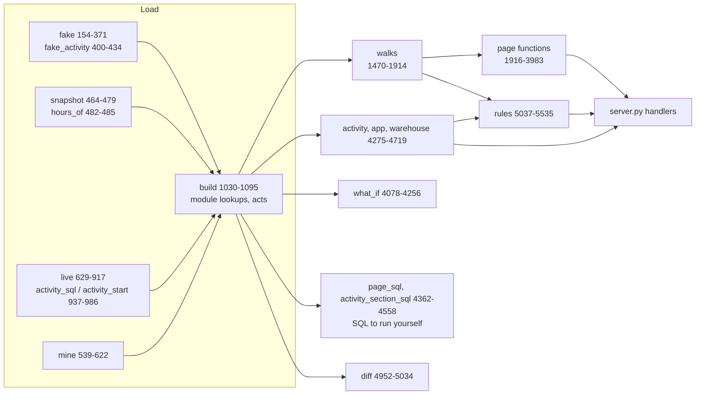
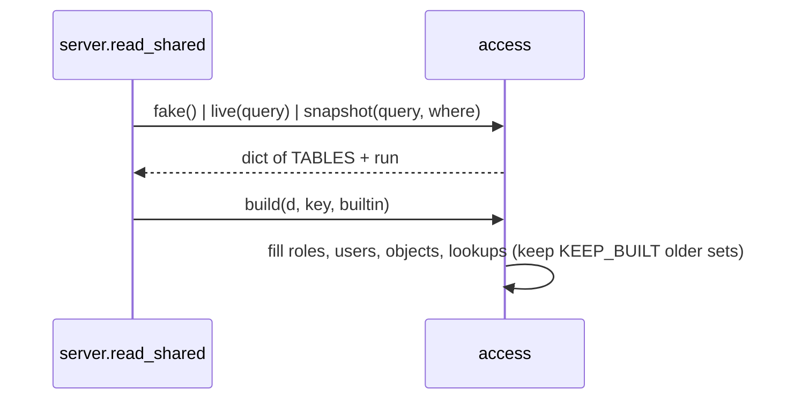

<!-- generated by darshan-singh-meel-knowledge-graph -->
# access.py

All data, walks and rules of the app (5,535 lines). Both versions call it; it imports no Streamlit or FastAPI (CLAUDE.md "Code style").

## Sections by area

| Area | Lines | What is there |
|---|---|---|
| Settings and constants | access.py:1-137 | `.env` load (access.py:21), `in_snowflake` / `INSIDE` (access.py:29-43), `ADMIN` (access.py:45), `BUILTIN` patterns (access.py:52-54), `MAX_HOPS`, `FUNC`/`TECH`/`BUILD`, `TABLES` (access.py:55-61), sensitive tags, dormancy, `MAX_PATHS` (access.py:75-85), `RULES` titles (access.py:91-131), `SEVERITY` (access.py:132); activity settings `OPTIONAL`, `ACTIVITY_DAYS`, `QUERY_TAG` (env, default access-explorer, access.py:64), `APP_ST` (env STREAMLIT_APP, default ST_ACCESS_EXPLORER, access.py:65), `INTERACTIVE`, `CLIENTS`, `SPIKE`, `NEW_DAYS` (access.py:61-73), `WORK_HOURS` default business hours 7-19 (access.py:70-71) |
| Fake data | access.py:138-462 | `SCHEMAS`, `CHAIN`, `FIN_USERS` (access.py:140-152), `fake()` (access.py:155-372), `fake_use()` (access.py:375-398), `fake_activity()` one finding per rule 24-28, HOURS per row, SUPPORT_01's use of the Streamlit app (access.py:401-435); the demo app SALES.MART.ST_CUSTOMER_LOOKUP (access.py:142, access.py:158, access.py:181-182, access.py:220), `fake_previous()` for What changed (access.py:451-462) |
| Snapshot loader | access.py:465-484 | `snapshot(query, where)`: last OK run of `TBL_ACCESS_RUN`, then each `TBL_ACCESS_<t>` of that run; `OBJECT_USE`, `ACTIVITY` optional; `hours_of` parses ACTIVITY `HOURS` JSON (access.py:484-490) |
| SHOW helpers | access.py:493-543 | `ident`, `line`, `qualify`, `each` (SHOW_THREADS at once, access.py:511-525), `held_db_roles`, `info_schema` |
| My access | access.py:544-627 | `mine(query, db)`: the logged-in user's own access, read with their rights, writes nothing |
| Live (SOURCE=direct) | access.py:630-1007 | `live(query, old)` (access.py:634-922): same dict as `snapshot()`, ACCOUNT_USAGE else SHOW, ACTIVITY read only for the days `old` lacks (access.py:904-913); `use_sql` ACCESS_HISTORY (access.py:925-939); `activity_sql` / `activity_start` (access.py:942-995); `only()` demo slice (access.py:998-1007) |
| Lookups / build | access.py:1010-1152 | `ROLE_ON` (access.py:1022), `KEEP_BUILT` (access.py:1026), `acts` ACTIVITY rows (access.py:1019), `build()` (access.py:1039-1104), `cached()` (access.py:1118-1122), `kind_of`, `role_db`, `role_kind` (access.py:1125-1150) |
| Names, classes, ladder | access.py:1153-1478 | `uid` / `UTAG` users vs roles (access.py:1153-1159), `priv_class`, `priv_cat`, `category`, `LEVELS` ladder (access.py:1174-1245), `access_objects`, `ladder*`, `reach_counts` (access.py:1249-1347), `who_has` (access.py:1384-1397), `split_name` (access.py:1459) |
| Full walks | access.py:1479-1594 | `down`, `up`, `bfs`, `ups`, `best_paths`, `starts`, `walk`, `depth`, `chains` |
| Fast walks (counted) | access.py:1595-1760 | `dag`, `loops`, `counts`, `shortest`, `listed`, `fast`, `capped_paths` |
| Counted walks to holders | access.py:1762-1865 | `holding`, `tally`, `via_role`, `via_link`, `paths_to`, `reach_without` |
| Walk up | access.py:1867-1923 | `users_on`, `up_walk` (access.py:1874-1906), `up_only_via` |
| Graph inputs | access.py:1925-2145 | `down_graph`, `object_graph`, `role_graph`; `access_of`, `admin_paths`, `account_privs`, `admin_holders`, `who_users`, `who_can` (access.py:2041-2135) |
| Users | access.py:2146-2216 | `login_days`, `is_service`, `is_disabled`, `is_dormant`, `status`, `split_users`, `used_roles` |
| Sensitive data | access.py:2218-2712 | tags (`tag_rules`..`sensitive_cols`, access.py:2220-2262), policies and masking (`clear_for`..`col_view`, access.py:2271-2454), `data_view` (access.py:2456-2475), `governance_kpis` (access.py:2516-2523), `catalog` (access.py:2585-2598), `sens_flow` (access.py:2610-2651), `review_grid` (access.py:2664-2710) |
| Page aggregations | access.py:2713-2960 | `grants`, `grant_rows`, `reach`, `held`, `loses`, `role_stats`, `grantees`, `valid_privs`, `admin_*`, `matrix`, `object_stats`, `has_lacks`, `privs_on` |
| Big accounts | access.py:2961-3229 | `finding_index`, `group_objects`, `MAX_OBJECTS` 12 (access.py:3033), `graph_input` (access.py:3036-3126), `too_big`, `summary` (access.py:3146-3201), `graph_info` |
| Removal and requests | access.py:3230-3640 | `revoke` / `fix_text` text only (access.py:3261-3292), `with_sql` (access.py:3295-3308), `losers`, `removal`, `ask_for`, `can` (access.py:3411-3444), `cut_points`, `nearest`, `suggest`, `approver` |
| Access graph (screen 4) | access.py:3641-3846 | `access_graph` (access.py:3696-3844) |
| What they see (screen 7) | access.py:3847-3871 | `seen` |
| Compare / review / search | access.py:3872-3992 | `compare` (access.py:3888-3942; `match` / `extras` pass through `with_sql`, access.py:3941-3942), `review` (access.py:3945-3978), `search` (access.py:3981-3990) |
| What if | access.py:3993-4267 | `WHAT_IF_OPS` (access.py:3995), `changes_of`, `without_cuts`, `what_if` (access.py:4087-4265) |
| Granted vs used and Activity | access.py:4268-4822 | `use_state`; Activity tab: `act_state`, `client_label`, `activity`, `used_path`, `query_sql`, `activity_graph`, `user_reads`, `app_exposure`, `app_use`, `warehouse_use`, `rule29`, `mark_sensitive`, `activity_sensitive` (access.py:4284-4752); `used_on`, `granted_used` (access.py:4757-4818) |
| SQL to run yourself | access.py:4375-4591 | `DAYS_USAGE`, `QUERIES` (access_queries folder), `NEEDS` (privilege comment) (access.py:4377-4381); `lit`, `query_file`, `plain` (access.py:4394-4415); Activity section queries `ACT_FILTER`, `ACT_BASE`, `OFF`, `ACT_SECTIONS` (access.py:4418-4480), `activity_section_sql` (access.py:4483-4493); `page_sql` (access.py:4496-4589); logic in [logic/page-sql.md](../logic/page-sql.md) |
| What changed | access.py:4823-5069 | `state` / `restore` / `loaded` (access.py:4823-4852), `facts` (access.py:4855-4881), `diff` (access.py:4983-5065) |
| Rules | access.py:5070-5568 | `rule_rows`, `checks`, `find`, `rules_model` ... `rule23`, `rules_activity` 24-28 (access.py:5506-5557), `rule29` (access.py:4684-4699), `findings` (access.py:5560-5566) |

## Load and build

- `snapshot()` reads only `WHERE STATUS = 'OK'` latest run, so a half run is never shown (access.py:467-472).
- `live()` must stay in step with `SP_ACCESS_SNAPSHOT` (docstring access.py:635-637; CLAUDE.md "Direct mode").
- `build()` skips work when `key` matches the last build; keeps older sets in `built` up to `KEEP_BUILT` (access.py:1039-1048).
- Example: the server calls `a.build(d, key, builtin)` under its lock (server.py:198).

## Rules -> functions

| Rules | Function | Lines |
|---|---|---|
| 1, 2, 3, 4, 13, 14 | `rules_model` | access.py:5208-5258 |
| 5, 9, 12 | `rules_admin` | access.py:5261-5283 |
| 6, 7, 10, 11, 15 | `rules_sensitive` | access.py:5286-5341 |
| 8, 16 | `rules_users` | access.py:5344-5356 |
| 17 | `rule17` (+ `readonly_writes` access.py:5165-5196) | access.py:5359-5375 |
| 18 | `rule18` (+ `unusual` access.py:5378-5404) | access.py:5407-5420 |
| 19 | `rule19` | access.py:5423-5437 |
| 20, 21 | `rules_operate` | access.py:5445-5456 |
| 22 | `rule22` | access.py:5459-5476 |
| 23 | `rule23` | access.py:5479-5503 |
| 24, 25, 26, 27, 28 | `rules_activity` (table activity, [logic/activity.md](../logic/activity.md)) | access.py:5506-5557 |
| 29 | `rule29` (Streamlit app exposure, via `app_exposure`) | access.py:4684-4699 |

- `findings()` concatenates all (rules 24-28 through `cached("activity", rules_activity)`, access.py:5565; then `rule29()`, same line) and sorts by rule number (access.py:5560-5566); `checks()` gives `(num, title, grantee, detail, path)` rows (access.py:5116-5118).
- `SCOPED` rules check only names passed in `only` (what_if rechecks only what a change touches) (access.py:5199-5200).

## Key functions

| Name | Does | path:line |
|---|---|---|
| `in_snowflake` | Active Snowpark session or `INSIDE=1` | access.py:29-40 |
| `fake` | Demo data set (at least one finding per rule) | access.py:155-372 |
| `fake_previous` | Earlier demo snapshot for What changed | access.py:451-462 |
| `snapshot` | Last OK run of the `TBL_ACCESS_` tables | access.py:465-484 |
| `mine` | Logged-in user's own access, live | access.py:544-627 |
| `live` | Whole account read now (SOURCE=direct); `old` ACTIVITY rows -> incremental activity read | access.py:634-922 |
| `activity_sql` / `activity_start` | Activity SELECT per UTC day with HOURS and APP (same text as the procedure) and its incremental window | access.py:942-985, access.py:988-995 |
| `use_sql` | ACCESS_HISTORY usage SQL (metadata only) | access.py:925-939 |
| `only` | One user's slice (demo My access) | access.py:998-1007 |
| `build` | Fill module lookups; memo by key | access.py:1039-1104 |
| `cached` | `fn()` once per data set | access.py:1118-1122 |
| `kind_of` / `role_kind` | user / admin / database / functional / technical / group / object | access.py:1125-1150 |
| `who_has` | Screen 2 entries per user / role | access.py:1384-1397 |
| `down` / `up` / `bfs` | Full path walks down / up, shortest by BFS | access.py:1489-1526 |
| `dag` / `loops` | Role links minus loop back edges; role loops | access.py:1597-1662 |
| `counts` / `shortest` / `listed` / `fast` | Exact path counts, shortest paths, capped listing | access.py:1669-1747 |
| `up_walk` | Counted walk up to holders | access.py:1874-1906 |
| `access_of` / `who_can` | Reference listings (TF parity) | access.py:2041-2043, access.py:2131-2135 |
| `who_users` | Users of an object, counted | access.py:2105-2123 |
| `admin_holders` | Users / roles holding an admin role | access.py:2063-2071 |
| `status` / `is_dormant` | disabled / never / dormant / active | access.py:2181-2195 |
| `sensitive` / `masked` / `data_view` | Sensitive tags, masking, what a role sees | access.py:2253-2256, access.py:2311-2317, access.py:2456-2475 |
| `catalog` / `sens_flow` / `review_grid` | Screens 8, 16, 6 | access.py:2585-2598, access.py:2610-2651, access.py:2664-2710 |
| `grants` / `reach` / `held` / `grantees` / `matrix` | Page rows (cached per walk) | access.py:2715-2909 |
| `has_lacks` | Privileges held vs missing on one object | access.py:2934-2947 |
| `graph_input` / `summary` | Big-account roll-up and fold | access.py:3036-3126, access.py:3146-3201 |
| `revoke` / `fix_text` | IaC + SQL text for a grant edge (never run) | access.py:3261-3292 |
| `with_sql` | A Compare / Request change dict (op grant / revoke, role or privilege + objectType + object, to, toUser) plus its `sql` (revoke via `revoke()`, grant written here with a `-- undo:` line for a role) and `roleDb` / `toDb` from `role_kind()`: the server is the only SQL writer, the web pages never write SQL or guess a role's kind from a dot (never run) | access.py:3295-3308 |
| `can` | Can they? (count, shortest, choke, options) | access.py:3411-3444 |
| `cut_points` / `removal` / `nearest` / `suggest` / `ask_for` | Where to cut, ways to remove, ways in, request roles | access.py:3345-3638 |
| `access_graph` | Screen 4 graph | access.py:3696-3844 |
| `seen` / `compare` / `review` / `search` | Screens 7, 9, review export, search ranking | access.py:3849-3990 |
| `what_if` | Simulated revokes; restores lookups | access.py:4087-4265 |
| `act_state` / `activity` | Activity tab: available or why not; per-day, by-key and per-use numbers for an object, user, role, app or scope, with UTC hours, weekend, kind | access.py:4284-4291, access.py:4298-4351 |
| `query_sql` | Copy-only SQL listing every query behind the tab (never run) | access.py:4354-4372 |
| `lit` / `plain` / `query_file` | SQL literal for a SET line; a query of our own (comments, NEEDS, SET lines, SELECT); an `access_queries/` file with its SET lines filled in (None when the file is missing) | access.py:4394-4397, access.py:4412-4415, access.py:4400-4409 |
| `activity_section_sql` | SQL behind one Activity section (`ACT_SECTIONS` key) for an object, user, role, app or scope (never run) | access.py:4483-4493 |
| `page_sql` | SQL to run yourself behind a page: list of `{title, sql}`, most useful first (never run) | access.py:4496-4589 |
| `used_path` / `activity_graph` | Grant path behind each use; the Paths diagram | access.py:4591-4609, access.py:4612-4636 |
| `user_reads` / `app_exposure` / `app_use` | Objects a user reads; what a Streamlit app shows its viewers with its owner's rights; who can open it, who did, who saw data they can't read | access.py:4639-4641, access.py:4644-4657, access.py:4660-4672 |
| `warehouse_use` | Who ran queries on a warehouse (usage read) and who can but did not | access.py:4675-4681 |
| `activity_sensitive` / `mark_sensitive` | Sensitive columns each user + role used sees; tag text for an untagged table (never run) | access.py:4727-4750, access.py:4702-4724 |
| `granted_used` | Screen 13; also `sql`: the trim of unused grants joined from `changes_of(changes)`, as What if writes it (access.py:4818) | access.py:4775-4818 |
| `facts` / `diff` | Screen 14 | access.py:4855-4881, access.py:4983-5065 |
| `rule_rows` / `checks` / `findings` | Rule output for pages and tests | access.py:5092-5118, access.py:5560-5566 |
| `rules_activity` | Rules 24-28 on table activity | access.py:5506-5557 |
| `rule29` | Rule 29: Streamlit app shows its owner's sensitive data | access.py:4684-4699 |

- Graph fragment: `function:access.py:<name>` nodes, `implements` edges to `business_rule:rule_N` (_scripts/parts/modules.*.jsonl).
- unclear: `fake()` has no docstring; its content was not inspected line by line here.
