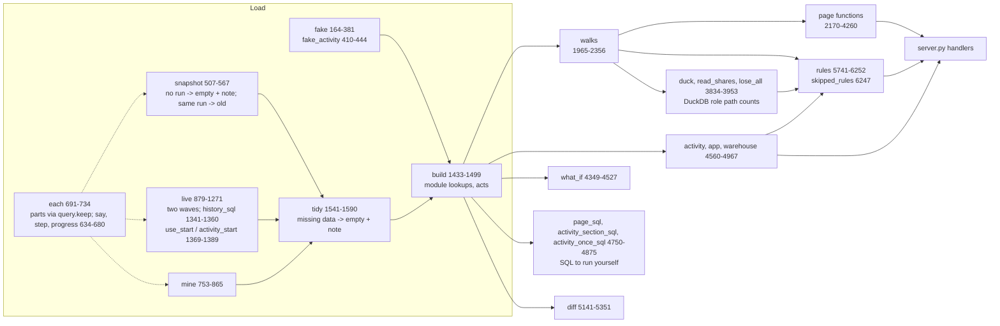
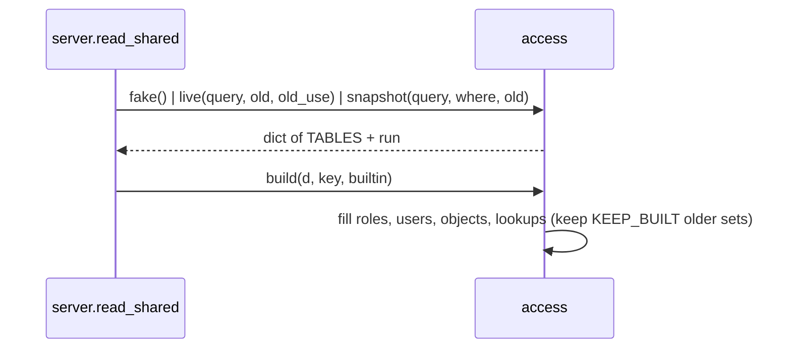

<!-- generated by darshan-singh-meel-knowledge-graph -->
# access.py

All data, walks and rules of the app (6,252 lines). Both versions call it; it imports no Streamlit or FastAPI (CLAUDE.md "Code style").

## Sections by area

| Area | Lines | What is there |
|---|---|---|
| Settings and constants | access.py:1-171 | `.env` load (access.py:28), `in_snowflake` / `INSIDE` (access.py:36-50), `ADMIN` (access.py:52), `BUILTIN` patterns (access.py:59-61), `MAX_HOPS`, `FUNC`/`TECH`/`BUILD`, `TABLES` (access.py:62-68), sensitive tags, dormancy, `MAX_PATHS` (access.py:109-119), `RULES` titles (access.py:125-165), `SEVERITY` (access.py:166); activity settings `OPTIONAL`, `ACTIVITY_DAYS`, `QUERY_TAG` (env, default access-explorer, access.py:93), `APP_ST` (env STREAMLIT_APP, default ST_ACCESS_EXPLORER, access.py:94), `INTERACTIVE`, `CLIENTS`, `SPIKE`, `NEW_DAYS` (access.py:68-107), `WORK_HOURS` default business hours 7-19 (access.py:104-105); read settings `STATEMENT_TIMEOUT` (300), `WORKERS` (3), `ACTIVITY_ON` / `HIERARCHY_ON` (env ACTIVITY / HIERARCHY, default on), `SKIP_ACTIVITY` / `SKIP_HIERARCHY` texts (access.py:95-99) |
| Fake data | access.py:172-505 | `SCHEMAS`, `CHAIN`, `FIN_USERS` (access.py:174-186), `fake()` (access.py:189-406), `fake_use()` (access.py:409-432), `fake_activity()` one finding per rule 24-28, HOURS per row, SUPPORT_01's use of the Streamlit app (access.py:435-469); the demo app SALES.MART.ST_CUSTOMER_LOOKUP (access.py:176, access.py:192, access.py:215-216, access.py:254), `fake_previous()` for What changed (access.py:494-505) |
| Snapshot loader | access.py:508-577 | `snapshot(query, where, old=None)`: last OK run of `TBL_ACCESS_RUN`; the same run as `old` -> `old` back (access.py:529-535); else each `TBL_ACCESS_<t>` of that run (`SELECT * EXCLUDE (RUN_ID)`, `WORKERS` at a time); `OBJECT_USE`, `ACTIVITY` optional, not read under `ACTIVITY=0`; `hours_of` parses ACTIVITY `HOURS` JSON (access.py:574-577) |
| Timeouts, progress, parallel reads | access.py:580-756 | `line`, `timed_out` / `timeout_hint` / `step_name` (STATEMENT_TIMEOUT messages, access.py:595-617), `ident`, `qualify`, `progress` / `say` / `took` (progress lines, access.py:633-669), `one`, `each` (`n` at a time, SHOW_THREADS or WORKERS, progress labels, access.py:695-738), `held_db_roles`, `info_schema` |
| My access | access.py:757-869 | `mine(query, db)`: the logged-in user's own access, read with their rights, writes nothing; one `each()` wave for the role SHOWs, user grants, DESC USER and usage (access.py:784-791) |
| Live (SOURCE=direct) | access.py:872-1405 | `READS` / `USE_COLS` / `ACT_COLS` (access.py:873-879); `live(query, old, old_use)` (access.py:883-1275): same dict as `snapshot()`; wave 1 probes, wave 2 ACCOUNT_USAGE reads `WORKERS` at a time, SHOW fallback waves; object use + activity from one ACCESS_HISTORY read for only the weeks / days `old_use` / `old` lack (access.py:991-1020); `use_sql(since)` (access.py:1278-1294); `activity_sql` (access.py:1297-1342); `history_sql` / `history_rows` (access.py:1345-1370); `use_start` / `activity_start` (access.py:1373-1393); `only()` demo slice (access.py:1396-1405) |
| Missing data | access.py:1506-1598 | `COLS`, `QUIET`, `NEED`, `SRC`, `LONG`, `ROW` (access.py:1506-1516); `hours` (access.py:1519-1533), `usable` (access.py:1536-1542), `tidy` (access.py:1545-1598): every table in build()'s shape, rows without names / day / action left out with a `missing_names` note, missing columns noted (`missing_columns`); `dated` (access.py:479-485) |
| DuckDB walk | access.py:3845-3975 | `rules_stamp` (access.py:3845-3849), `DUCKS` / `close_ducks` (access.py:3852-3858), `duck_table` (access.py:3861-3866), `duck` (access.py:3869-3906), `read_shares` (access.py:3909-3929), `lose_all` (access.py:3932-3971), `lose_key` (access.py:3974-3975) |
| Lookups / build | access.py:1408-1646 | `ROLE_ON` (access.py:1420), `KEEP_BUILT` (access.py:1424), `acts` ACTIVITY rows (access.py:1417), `build()` (access.py:1437-1502), `cached()` (access.py:1612-1616), `kind_of`, `role_db`, `role_kind` (access.py:1619-1644) |
| Names, classes, ladder | access.py:1647-1972 | `uid` / `UTAG` users vs roles (access.py:1647-1653), `priv_class`, `priv_cat`, `category`, `LEVELS` ladder (access.py:1668-1739), `access_objects`, `ladder*`, `reach_counts` (access.py:1743-1841), `who_has` (access.py:1878-1891), `split_name` (access.py:1953) |
| Full walks | access.py:1973-2093 | `down`, `up`, `bfs`, `ups`, `best_paths`, `starts`, `walk`, `depth`, `chains` |
| Fast walks (counted) | access.py:2094-2259 | `dag`, `loops`, `counts`, `shortest`, `listed`, `fast`, `capped_paths` |
| Counted walks to holders | access.py:2261-2364 | `holding`, `tally`, `via_role`, `via_link`, `paths_to`, `reach_without` |
| Walk up | access.py:2366-2422 | `users_on`, `up_walk` (access.py:2373-2405), `up_only_via` |
| Graph inputs | access.py:2424-2644 | `down_graph`, `object_graph`, `role_graph`; `access_of`, `admin_paths`, `account_privs`, `admin_holders`, `who_users`, `who_can` (access.py:2540-2634) |
| Users | access.py:2645-2720 | `login_days`, `is_service`, `is_disabled`, `is_dormant`, `status`, `split_users`, `used_roles` |
| Sensitive data | access.py:2722-3216 | tags (`tag_rules`..`sensitive_cols`, access.py:2724-2766), policies and masking (`clear_for`..`col_view`, access.py:2775-2958), `data_view` (access.py:2960-2979), `governance_kpis` (access.py:3020-3027), `catalog` (access.py:3089-3102), `sens_flow` (access.py:3114-3155), `review_grid` (access.py:3168-3214) |
| Page aggregations | access.py:3217-3464 | `grants`, `grant_rows`, `reach`, `held`, `loses`, `role_stats`, `grantees`, `valid_privs`, `admin_*`, `matrix`, `object_stats`, `has_lacks`, `privs_on` |
| Big accounts | access.py:3465-3733 | `finding_index`, `group_objects`, `MAX_OBJECTS` 12 (access.py:3537), `graph_input` (access.py:3540-3630), `too_big`, `summary` (access.py:3650-3705), `graph_info` |
| Removal and requests | access.py:3734-4287 | `revoke` / `fix_text` text only (access.py:3765-3796), `with_sql` (access.py:3799-3812), `losers`, `removal`, `ask_for`, `can` (access.py:4058-4091), `cut_points`, `nearest`, `suggest`, `approver` |
| Access graph (screen 4) | access.py:4288-4493 | `access_graph` (access.py:4343-4491) |
| What they see (screen 7) | access.py:4494-4518 | `seen` |
| Compare / review / search | access.py:4519-4639 | `compare` (access.py:4535-4589; `match` / `extras` pass through `with_sql`, access.py:4588-4589), `review` (access.py:4592-4625), `search` (access.py:4628-4637) |
| What if | access.py:4640-4914 | `WHAT_IF_OPS` (access.py:4642), `changes_of`, `without_cuts`, `what_if` (access.py:4734-4912) |
| Granted vs used and Activity | access.py:4915-5493 | `use_state`; Activity tab: `act_state`, `client_label`, `activity`, `used_path`, `query_sql`, `activity_graph`, `user_reads`, `app_exposure`, `app_use`, `warehouse_use`, `rule29`, `mark_sensitive`, `activity_sensitive` (access.py:4931-5423); `used_on`, `granted_used` (access.py:5428-5489) |
| SQL to run yourself | access.py:5024-5262 | `DAYS_USAGE`, `QUERIES` (access_queries folder), `NEEDS` (privilege comment) (access.py:5026-5030); `lit`, `query_file`, `plain` (access.py:5043-5064); Activity section queries `ACT_FILTER`, `ACT_BASE`, `OFF`, `ACT_SECTIONS` (access.py:5067-5132), `activity_section_sql` (access.py:5135-5145); `page_sql` (access.py:5165-5260); logic in [logic/page-sql.md](../logic/page-sql.md) |
| What changed | access.py:5494-5740 | `state` / `restore` / `loaded` (access.py:5494-5523), `facts` (access.py:5526-5552), `diff` (access.py:5654-5736) |
| Rules | access.py:5741-6262 | `rule_rows`, `checks`, `find`, `rules_model` ... `rule23`, `rules_activity` 24-28 (access.py:6190-6241), `rule29` (access.py:5355-5370), `findings` (access.py:6244-6250) |

## Load and build

- `snapshot()` reads only `WHERE STATUS = 'OK'` latest run, so a half run is never shown; no OK run, no RUN_ID or an unreadable `TBL_ACCESS_RUN` -> every table empty with NOTES `no_run` (a lost session raises, `lost()` access.py:588-592); a table that fails to read is empty, `UNAVAILABLE`, noted and listed in `UNREAD` (read again next time); the run held already (`old`) costs that one query (access.py:518-570).
- `build()` calls `tidy(d)` first and sets `memo["key"]` last, so a build that stopped half way never counts as done (access.py:1452, access.py:1503); missing, NULL or unreadable data gives empty results plus a note ([business_rule:missing_data_never_fails](../logic/rules.md)).
- `live()` must stay in step with `SP_ACCESS_SNAPSHOT` (docstring access.py:884-886; CLAUDE.md "Direct mode").
- `build()` skips work when `key` matches the last build; keeps older sets in `built` up to `KEEP_BUILT` (access.py:1437-1446).
- Example: the server calls `a.build(d, key, builtin)` under its lock (server.py:293).

## Rules -> functions

| Rules | Function | Lines |
|---|---|---|
| 1, 2, 3, 4, 13, 14 | `rules_model` | access.py:5886-5938 |
| 5, 9, 12 | `rules_admin` | access.py:5941-5964 |
| 6, 7, 10, 11, 15 | `rules_sensitive` | access.py:5967-6022 |
| 8, 16 | `rules_users` | access.py:6025-6037 |
| 17 | `rule17` (+ `readonly_writes` access.py:5839-5874) | access.py:6040-6056 |
| 18 | `rule18` (+ `unusual` access.py:6059-6085) | access.py:6088-6101 |
| 19 | `rule19` | access.py:6104-6118 |
| 20, 21 | `rules_operate` | access.py:6126-6137 |
| 22 | `rule22` | access.py:6140-6157 |
| 23 | `rule23` | access.py:6160-6187 |
| 24, 25, 26, 27, 28 | `rules_activity` (table activity, [logic/activity.md](../logic/activity.md)) | access.py:6190-6241 |
| 29 | `rule29` (Streamlit app exposure, via `app_exposure`) | access.py:5355-5370 |

- `findings()` runs the groups one after another, each timed ("Slowest rules: ..." in the load log), rules 24-28 through `cached("activity", rules_activity)` (access.py:6252), and sorts by rule number (access.py:6244-6260); `checks()` gives `(num, title, grantee, detail, path)` rows (access.py:5790-5792).
- `SCOPED` rules check only names passed in `only` (what_if rechecks only what a change touches) (access.py:5877-5878).

## Key functions

| Name | Does | path:line |
|---|---|---|
| `in_snowflake` | Active Snowpark session or `INSIDE=1` | access.py:36-47 |
| `fake` | Demo data set (at least one finding per rule) | access.py:189-406 |
| `fake_previous` | Earlier demo snapshot for What changed | access.py:494-505 |
| `snapshot` | Last OK run of the `TBL_ACCESS_` tables | access.py:508-571 |
| `mine` | Logged-in user's own access, live | access.py:757-869 |
| `live` | Whole account read now (SOURCE=direct); `old` / `old_use` rows -> incremental activity / object use read, one shared ACCESS_HISTORY read | access.py:883-1275 |
| `each` | Statements `n` at a time (SHOW_THREADS / WORKERS), in order, failures as exceptions, progress lines; a `cache.parted` query takes the whole wave (`keep`) | access.py:695-738 |
| `progress` / `say` / `step` | Progress sink with a heartbeat every `BEAT` s; a line; a timed build step | access.py:638-684 |
| `lost` | A lost session (stops a load) vs an unreadable table (a note) | access.py:588-592 |
| `tidy` / `usable` / `hours` | Data set in build()'s shape; row usable for the walks; HOURS as a dict | access.py:1545-1598, access.py:1536-1542, access.py:1519-1533 |
| `duck` / `read_shares` / `lose_all` | DuckDB role path counts per hop; per-role reach counts for rules 17 / 23; who loses access for many edges in one query | access.py:3869-3906, access.py:3909-3929, access.py:3932-3971 |
| `below` | `bfs([role])` once per data set (rules 3, 14) | access.py:2023-2025 |
| `rules_stamp` | Hash of access.py and its settings: rule results kept across restarts (server.kept_rules) | access.py:3845-3849 |
| `history_sql` / `history_rows` | One ACCESS_HISTORY scan for object use and activity, split by PART | access.py:1345-1370 |
| `use_start` | Object use weeks to keep and the Monday to read from | access.py:1373-1382 |
| `skipped_rules` | Rules that did not run: HIERARCHY=0 (`WALKS`), ACTIVITY=0 (24-28) | access.py:6269-6274 |
| `activity_once_sql` | Every Activity section from one base read (RESULT_SCAN) | access.py:5148-5162 |
| `activity_sql` / `activity_start` | Activity SELECT per UTC day with HOURS and APP (same text as the procedure) and its incremental window | access.py:1297-1342, access.py:1385-1393 |
| `use_sql` | ACCESS_HISTORY usage SQL from a Monday (metadata only) | access.py:1278-1294 |
| `only` | One user's slice (demo My access) | access.py:1396-1405 |
| `build` | Fill module lookups; memo by key | access.py:1437-1502 |
| `cached` | `fn()` once per data set | access.py:1612-1616 |
| `kind_of` / `role_kind` | user / admin / database / functional / technical / group / object | access.py:1619-1644 |
| `who_has` | Screen 2 entries per user / role | access.py:1878-1891 |
| `down` / `up` / `bfs` | Full path walks down / up, shortest by BFS | access.py:1983-2020 |
| `dag` / `loops` | Role links minus loop back edges; role loops | access.py:2096-2161 |
| `counts` / `shortest` / `listed` / `fast` | Exact path counts, shortest paths, capped listing | access.py:2168-2246 |
| `up_walk` | Counted walk up to holders | access.py:2373-2405 |
| `access_of` / `who_can` | Reference listings (TF parity) | access.py:2540-2542, access.py:2630-2634 |
| `who_users` | Users of an object, counted | access.py:2604-2622 |
| `admin_holders` | Users / roles holding an admin role | access.py:2562-2570 |
| `status` / `is_dormant` | disabled / never / dormant / active | access.py:2685-2699 |
| `sensitive` / `masked` / `data_view` | Sensitive tags, masking, what a role sees | access.py:2757-2760, access.py:2815-2821, access.py:2960-2979 |
| `catalog` / `sens_flow` / `review_grid` | Screens 8, 16, 6 | access.py:3089-3102, access.py:3114-3155, access.py:3168-3214 |
| `grants` / `reach` / `held` / `grantees` / `matrix` | Page rows (cached per walk) | access.py:3219-3413 |
| `has_lacks` | Privileges held vs missing on one object | access.py:3438-3451 |
| `graph_input` / `summary` | Big-account roll-up and fold | access.py:3540-3630, access.py:3650-3705 |
| `revoke` / `fix_text` | IaC + SQL text for a grant edge (never run) | access.py:3765-3796 |
| `with_sql` | A Compare / Request change dict (op grant / revoke, role or privilege + objectType + object, to, toUser) plus its `sql` (revoke via `revoke()`, grant written here with a `-- undo:` line for a role) and `roleDb` / `toDb` from `role_kind()`: the server is the only SQL writer, the web pages never write SQL or guess a role's kind from a dot (never run) | access.py:3799-3812 |
| `can` | Can they? (count, shortest, choke, options) | access.py:4058-4091 |
| `cut_points` / `removal` / `nearest` / `suggest` / `ask_for` | Where to cut, ways to remove, ways in, request roles | access.py:3992-4285 |
| `access_graph` | Screen 4 graph | access.py:4343-4491 |
| `seen` / `compare` / `review` / `search` | Screens 7, 9, review export, search ranking | access.py:4496-4637 |
| `what_if` | Simulated revokes; restores lookups | access.py:4734-4912 |
| `act_state` / `activity` | Activity tab: available or why not; per-day, by-key and per-use numbers for an object, user, role, app or scope, with UTC hours, weekend, kind | access.py:4931-4938, access.py:4945-4998 |
| `query_sql` | Copy-only SQL listing every query behind the tab (never run) | access.py:5001-5021 |
| `lit` / `plain` / `query_file` | SQL literal for a SET line; a query of our own (comments, NEEDS, SET lines, SELECT); an `access_queries/` file with its SET lines filled in (None when the file is missing) | access.py:5043-5046, access.py:5061-5064, access.py:5049-5058 |
| `activity_section_sql` | SQL behind one Activity section (`ACT_SECTIONS` key) for an object, user, role, app or scope (never run) | access.py:5135-5145 |
| `page_sql` | SQL to run yourself behind a page: list of `{title, sql}`, most useful first (never run) | access.py:5165-5260 |
| `used_path` / `activity_graph` | Grant path behind each use; the Paths diagram | access.py:5262-5280, access.py:5283-5307 |
| `user_reads` / `app_exposure` / `app_use` | Objects a user reads; what a Streamlit app shows its viewers with its owner's rights; who can open it, who did, who saw data they can't read | access.py:5310-5312, access.py:5315-5328, access.py:5331-5343 |
| `warehouse_use` | Who ran queries on a warehouse (usage read) and who can but did not | access.py:5346-5352 |
| `activity_sensitive` / `mark_sensitive` | Sensitive columns each user + role used sees; tag text for an untagged table (never run) | access.py:5398-5421, access.py:5373-5395 |
| `granted_used` | Screen 13; also `sql`: the trim of unused grants joined from `changes_of(changes)`, as What if writes it (access.py:5489) | access.py:5446-5489 |
| `facts` / `diff` | Screen 14 | access.py:5526-5552, access.py:5654-5736 |
| `rule_rows` / `checks` / `findings` | Rule output for pages and tests; `findings` times each group and names the slowest | access.py:5763-5792, access.py:6244-6260 |
| `rules_activity` | Rules 24-28 on table activity | access.py:6190-6241 |
| `rule29` | Rule 29: Streamlit app shows its owner's sensitive data | access.py:5355-5370 |

- Graph fragment: `function:access.py:<name>` nodes, `implements` edges to `business_rule:rule_N` (_scripts/parts/modules.*.jsonl).
- unclear: `fake()` has no docstring; its content was not inspected line by line here.
