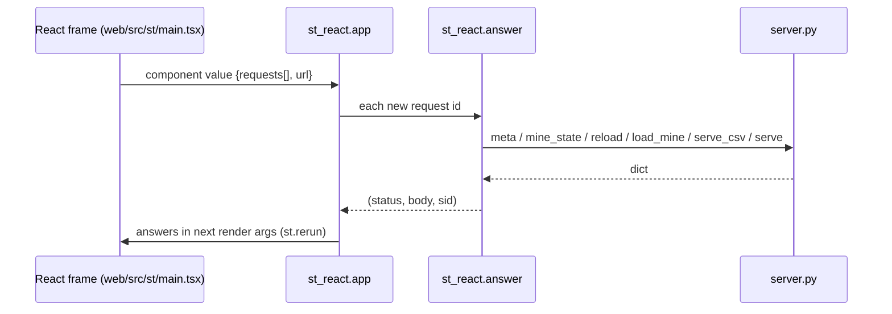

<!-- generated by darshan-singh-meel-knowledge-graph -->
# app.py and st_react.py

The Streamlit version: app.py sets the page up and runs `st_react.app()`, which hosts the same React app (web/dist-st) and answers its API calls with server.py (app.py:1-4, st_react.py:1-3).

## app.py

- `st.set_page_config(..., layout="wide")` and CSS that hides Streamlit chrome (app.py:9-13).
- "component did not load" hint until `st_react.UP` is set in session (app.py:14-17, app.py:19-20).
- Runs `st_react.app()` (app.py:18). No other logic (CLAUDE.md "Two versions, one logic").

## st_react.py

| Name | Does | path:line |
|---|---|---|
| `DIST` / `_comp` | Component `access_ui` declared from web/dist-st | st_react.py:12-13 |
| `UP` | Session key: frame talked back once | st_react.py:14 |
| `_js(obj)` | JSON safe inside `<script>` (`</` -> `<\/`) | st_react.py:17-19 |
| `answer(method, url, body, sid)` | Routes `/api/<name>` to server.py; ApiError -> its status; other errors -> 500 JSON | st_react.py:22-48 |
| `app(key)` | Renders the component, answers open requests, drops answered ones, mirrors URL to `st.query_params`, reruns when new | st_react.py:51-75 |

- `mine/load` makes a new sid and drops the old MINE entry, as the local server does (st_react.py:35-39).
- Unknown endpoint -> 404 `not_found` (st_react.py:44).
- Inside Snowflake: deployed by sql/4_streamlit.sql (`MAIN_FILE = 'app.py'`, sql/4_streamlit.sql:62-67); My access hidden there (server.py:136-138).
- Tests: `test_pages` hands every page to the component (test_access.py:657), `test_streamlit_bridge` (test_server.py:267).
