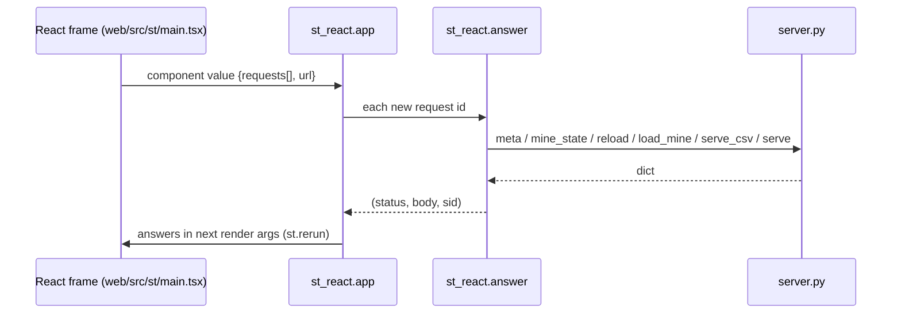

<!-- generated by darshan-singh-meel-knowledge-graph -->
# app.py and st_react.py

The Streamlit version: app.py sets the page up and runs `st_react.app()`, which hosts the same React app (web/dist-st) and answers its API calls with server.py (app.py:1-4, st_react.py:1-3).

## app.py

- `st.set_page_config(..., layout="wide")` and CSS that hides Streamlit chrome (app.py:13-17).
- "component did not load" hint until `st_react.UP` is set in session (app.py:18-21, app.py:23-24).
- Imports `server` and sets `server.BACKGROUND = False` (a refresh runs on the script thread with the app's session and shows its lines as the first load does) and `server.LOG_LINES = True` (progress lines in the terminal, inside Snowflake the app log) (app.py:7-11).
- Runs `st_react.app()` (app.py:22). No other logic (CLAUDE.md "Two versions, one logic").

## st_react.py

| Name | Does | path:line |
|---|---|---|
| `DIST` / `_comp` | Component `access_ui` declared from web/dist-st | st_react.py:13-14 |
| `UP` | Session key: frame talked back once | st_react.py:15 |
| `_js(obj)` | JSON safe inside `<script>` (`</` -> `<\/`) | st_react.py:18-20 |
| `answer(method, url, body, sid)` | Routes `/api/<name>` to server.py (`progress` -> `server.progress`, st_react.py:34-35); ApiError -> its status; other errors -> 500 JSON | st_react.py:23-51 |
| `shown(box, r, sid)` | `answer()` in a thread kept in `st.session_state["_ae_running"]` (a rerun waits for it); about once a second the last 40 `server.progress()` lines go into `box`, cleared at the end; no answer -> 500 | st_react.py:54-78 |
| `app(key)` | `box = st.empty()` above the app; renders the component, answers open requests through `shown()`, drops answered ones, mirrors URL to `st.query_params`, reruns when new | st_react.py:81-106 |

- `mine/load` makes a new sid and drops the old MINE entry, as the local server does (st_react.py:38-42).
- Unknown endpoint -> 404 `not_found` (st_react.py:47).
- Inside Snowflake: deployed by sql/4_streamlit.sql (`MAIN_FILE = 'app.py'`, sql/4_streamlit.sql:65-70); My access hidden there (server.py:265-267, `mine_off` server.py:260-278).
- Progress inside Snowflake: Python is busy during a load, so the frame cannot poll `/api/progress`; `shown()` writes the lines itself ([flows/load-progress.md](../flows/load-progress.md)).
- Tests: `test_pages` hands every page to the component (test_access.py:938), `test_streamlit_bridge` (test_server.py:385), `test_progress` (`shown` from a thread, test_server.py:1355-1403).
