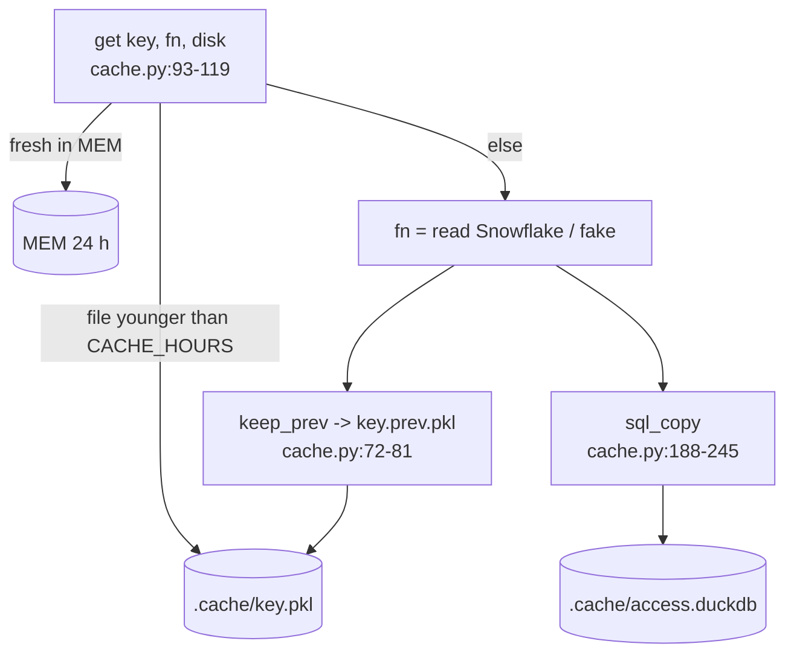

# cache.py

Where the data comes from (`config`) and how long it is kept: memory 24 h, `.cache/*.pkl` for CACHE_HOURS, and a DuckDB SQL copy (cache.py:1-9).

## Functions

| Name | Does | path:line |
|---|---|---|
| `config(env)` | `(mode, source, where)`: FAKE=1 -> fake; SOURCE default direct, objects if only ACCESS_SNAPSHOT; objects needs `DB.SCHEMA` | cache.py:27-40 |
| `name(what, user, where)` | Cache key: account + source + location + user + role | cache.py:43-48 |
| `local()` | Disk allowed: CACHE_HOURS > 0 and not inside Snowflake | cache.py:51-53 |
| `file(key)` | `.cache/<safe key>.pkl` | cache.py:56-57 |
| `keep_prev(f, new)` | Old file of another run becomes `.prev.pkl` (What changed) | cache.py:72-81 |
| `prev(key)` | Previous snapshot `(data, mtime)` or None | cache.py:84-90 |
| `get(key, fn, disk)` | Memory, else local file, else `fn()` stored in both | cache.py:93-119 |
| `ready(key)` | Would `get` answer without reading the source | cache.py:122-129 |
| `drop(key)` | Out of memory; file set aside as `.old.pkl` | cache.py:132-140 |
| `sql_wanted(disk)` | Never inside Snowflake or DUCKDB=0; fake only with DUCKDB=1 | cache.py:176-181 |
| `sql_copy(key, d, at)` | Writes TBL_ACCESS_ tables to schema `schema(key)`, older run as `*_PREV`, `COPIES` index | cache.py:188-245 |
| `sql_info(key)` | For the UI: file, schema, or why there is none | cache.py:248-256 |

## Settings

- `CACHE_HOURS` (default 24; 0 = memory only) (cache.py:21); memory `TTL` 24 h (cache.py:22).
- `DUCKDB` "" / 0 / 1 (cache.py:144); `COLUMNS` = TBL_ACCESS_ columns of sql/1_setup.sql (cache.py:146-163), checked by `test_duckdb` (cache.py:145).
- `LOCK` RLock: one read at a time (cache.py:24).

## Notes

- Without duckdb installed, a note and no copy; the app works the same (cache.py:193-197).
- Bulk load via a JSON-lines temp file, path quoted for folders with `'` (cache.py:228-234).
- Example key: `local_fake` in fake mode (inferred from `name()` defaults: account "local" when SNOWFLAKE_ACCOUNT is unset, cache.py:47).
