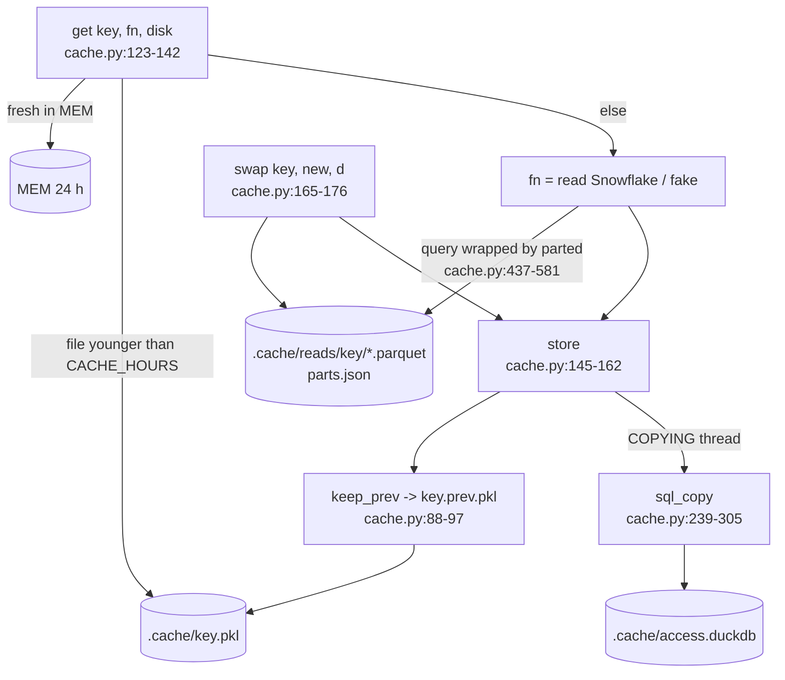

<!-- generated by darshan-singh-meel-knowledge-graph -->
# cache.py

Where the data comes from (`config`) and how long it is kept: memory 24 h, `.cache/*.pkl` for CACHE_HOURS, every Snowflake read as a Parquet part in `.cache/reads/<key>/` (a stopped load resumes), and a DuckDB SQL copy (cache.py:1-9, cache.py:319-324).

## Functions

| Name | Does | path:line |
|---|---|---|
| `config(env)` | `(mode, source, where)`: FAKE=1 -> fake; SOURCE default direct, objects if only ACCESS_SNAPSHOT; objects needs `DB.SCHEMA` | cache.py:42-55 |
| `name(what, user, where)` | Cache key: account + source + location + user + role, `_noactivity` under ACTIVITY=0 | cache.py:58-64 |
| `local()` | Disk allowed: CACHE_HOURS > 0 and not inside Snowflake | cache.py:67-69 |
| `file(key)` | `.cache/<safe key>.pkl` | cache.py:72-73 |
| `keep_prev(f, new)` | Old file of another run becomes `.prev.pkl` (What changed); an empty no-run read is never set aside | cache.py:88-97 |
| `prev(key)` | Previous snapshot `(data, mtime)` or None | cache.py:100-106 |
| `last(key)` | Newest data kept for the key: memory, `.pkl`, `.old.pkl` (set aside by `drop`), `.prev.pkl` | cache.py:109-120 |
| `lock(key)` | The key's own RLock (`LOCKS`, guarded by `LOCK`): one read per key, other keys never wait | cache.py:37-39 |
| `get(key, fn, disk)` | Memory, else local file, else `store(key, fn())`, under `lock(key)` | cache.py:123-142 |
| `store(key, d, disk)` | Memory, `.pkl` (via `keep_prev`), SQL copy in a `COPYING` thread (in a copy of the caller's context, so its lines reach the load log); a read with no OK run (RUN_ID None) memory only | cache.py:145-162 |
| `swap(key, new, d)` | A refresh read under `new` becomes key's data: key's parts folder is first renamed to `<dir>.gone` (a file held open on Windows fails there, nothing lost), new's folder takes its place, then `store()` | cache.py:165-176 |
| `ready(key)` | Would `get` answer without reading the source | cache.py:179-186 |
| `drop(key)` | Under `lock(key)`: out of memory (copy kept in `OLD` for `last()`); file set aside as `.old.pkl` | cache.py:189-199 |
| `sql_wanted(disk)` | Never inside Snowflake; fake only with DUCKDB=1; a Snowflake read whenever disk is allowed | cache.py:218-223 |
| `text(v)` | A value as the text its column is TRY_CAST from (dict / list JSON, booleans true / false) | cache.py:230-236 |
| `sql_copy(key, d, at)` | Under `SQL_LOCK` and `access.step("DuckDB copy ...")`: TBL_ACCESS_ tables to schema `schema(key)`, older run as `*_PREV`, `COPIES` index; per table one INSERT from an Arrow table (pyarrow) or UNNESTed text lists | cache.py:239-305 |
| `sql_info(key)` | For the UI: file, schema, "Being written now" while its thread runs, or why there is none | cache.py:308-317 |
| `parts_dir(key)` / `parts_of(key)` | `.cache/reads/<safe key>`; its `parts.json` (name -> file, rows, read_at, statements, colsets, errors, status) | cache.py:326-335 |
| `clear_parts(key)` | Every part read again next time, under `lock(key)` | cache.py:338-341 |
| `parts_read_at(key)` | Time of the oldest part: "Data from" | cache.py:344-346 |
| `old(key, base)` | ACTIVITY / OBJECT_USE rows a Direct load starts from, kept as `old.pkl` with the parts so a resumed load asks for the same days | cache.py:349-364 |
| `engine()` | pyarrow (its `pyarrow.parquet` importable), else duckdb, else None (no parts); once per process (`functools.cache`) | cache.py:367-376 |
| `duck_type(vals)` | DuckDB type of a column's Python values (ints in 64 bits as BIGINT: Parquet has no HUGEINT); mixed types raise (part not kept) | cache.py:379-392 |
| `write_part(f, rows)` / `read_part(f)` | Parquet via pyarrow (every column any row of the wave has), else DuckDB (a dict or list as its JSON text, as Snowflake answers a VARIANT); written as `.tmp` and renamed | cache.py:395-428 |
| `part_name(label, sqls)` | Label + sha1 (10 hex) of the statements | cache.py:431-434 |
| `parted(query, key, offline)` | `query(sql)` that keeps every read as a part and answers from the kept ones (`take` / `put`, `parts.json` written by `save`; a one-statement part keeps its rows without an index column); `q.keep()` takes a whole `each()` wave (a wave with timed-out statements reads only those again); `q.fresh` always asks Snowflake and keeps the answer for an offline build (the last OK run); `q.prune()` after a whole load drops the parts it did not ask for (an older run's tables, older activity days); a lost session is never kept; flow in [flows/two-stage-load.md](../flows/two-stage-load.md) | cache.py:437-581 |

## Settings

- `CACHE_HOURS` (default 24; 0 = memory only) (cache.py:28); memory `TTL` 24 h (cache.py:29).
- `DUCKDB` unset / 1 (cache.py:203): the copy follows every Snowflake read; `1` also copies fake data; there is no off switch. `COLUMNS = access.COLUMNS` (cache.py:204; defined at access.py:79-99), checked by `test_duckdb`.
- `OLD`, `LOCK` (guards `LOCKS`), `LOCKS` per-key RLocks, `SQL_LOCK` one DuckDB writer (cache.py:31-34); `SQL` last copy per key, `COPYING` key -> writer thread (cache.py:205-206).

## Notes

- Without duckdb installed, a note and no copy (cache.py:244-248); without pyarrow and duckdb no parts are kept and every load reads everything (cache.py:475-479).
- Bulk load: with pyarrow one `INSERT ... SELECT TRY_CAST("<col>" AS <type>) FROM src` over a registered Arrow table of text columns; else `TRY_CAST(UNNEST(?::VARCHAR[]) AS <type>)` per column (cache.py:284-296).
- Parts have no age: they are read again only on Rebuild snapshot / Read Snowflake again (`clear_parts`, `swap`), a fresh My access load or `run.py --export --fresh` (cache.py:319-324).
- Example key: `local_fake` in fake mode (inferred from `name()` defaults: account "local" when SNOWFLAKE_ACCOUNT is unset, cache.py:63).
