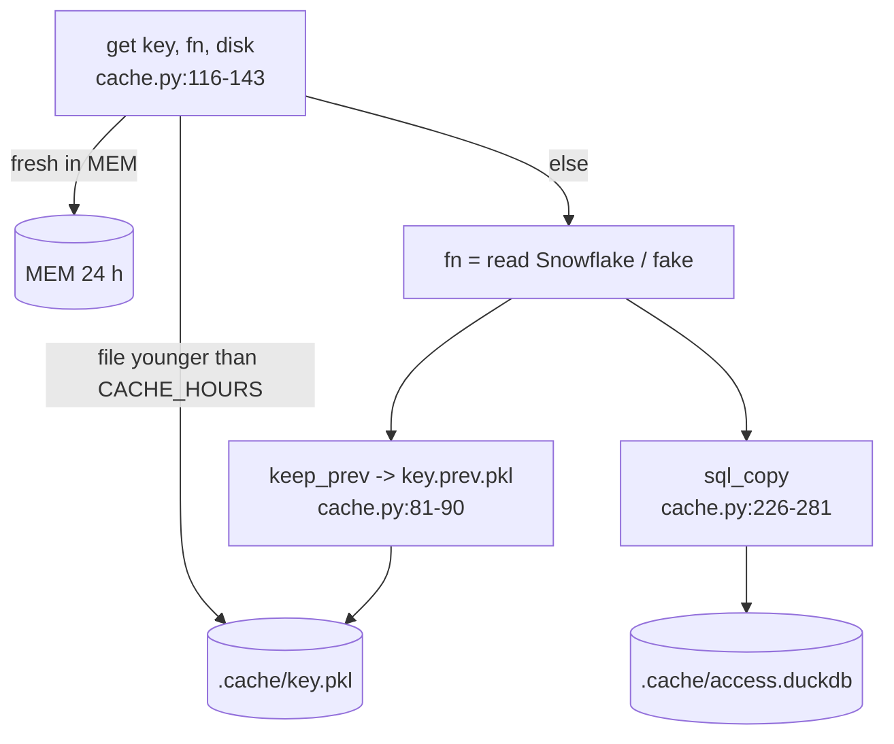

<!-- generated by darshan-singh-meel-knowledge-graph -->
# cache.py

Where the data comes from (`config`) and how long it is kept: memory 24 h, `.cache/*.pkl` for CACHE_HOURS, and a DuckDB SQL copy (cache.py:1-9).

## Functions

| Name | Does | path:line |
|---|---|---|
| `config(env)` | `(mode, source, where)`: FAKE=1 -> fake; SOURCE default direct, objects if only ACCESS_SNAPSHOT; objects needs `DB.SCHEMA` | cache.py:35-48 |
| `name(what, user, where)` | Cache key: account + source + location + user + role, `_noactivity` under ACTIVITY=0 | cache.py:51-57 |
| `local()` | Disk allowed: CACHE_HOURS > 0 and not inside Snowflake | cache.py:60-62 |
| `file(key)` | `.cache/<safe key>.pkl` | cache.py:65-66 |
| `keep_prev(f, new)` | Old file of another run becomes `.prev.pkl` (What changed) | cache.py:81-90 |
| `prev(key)` | Previous snapshot `(data, mtime)` or None | cache.py:93-99 |
| `last(key)` | Newest data kept for the key: memory, `.pkl`, `.old.pkl` (set aside by `drop`), `.prev.pkl`; Direct mode hands its ACTIVITY / OBJECT_USE rows to `live()` so only the missing days / weeks are read, objects mode hands it to `snapshot()` as `old` (server.py:124-127) | cache.py:102-113 |
| `lock(key)` | The key's own RLock (`LOCKS`, guarded by `LOCK`): one read per key, other keys never wait | cache.py:30-32 |
| `get(key, fn, disk)` | Memory, else local file, else `fn()` stored in both, under `lock(key)` | cache.py:116-143 |
| `ready(key)` | Would `get` answer without reading the source | cache.py:146-153 |
| `drop(key)` | Under `lock(key)`: out of memory (copy kept in `OLD` for `last()`); file set aside as `.old.pkl` | cache.py:156-166 |
| `sql_wanted(disk)` | Never inside Snowflake or DUCKDB=0; fake only with DUCKDB=1 | cache.py:205-210 |
| `text(v)` | A value as the text its column is TRY_CAST from (dict / list JSON, booleans true / false) | cache.py:217-223 |
| `sql_copy(key, d, at)` | Under `SQL_LOCK`: writes TBL_ACCESS_ tables to schema `schema(key)`, older run as `*_PREV`, `COPIES` index; one bulk INSERT per table | cache.py:226-280 |
| `sql_info(key)` | For the UI: file, schema, or why there is none | cache.py:283-291 |

## Settings

- `CACHE_HOURS` (default 24; 0 = memory only) (cache.py:21); memory `TTL` 24 h (cache.py:22).
- `DUCKDB` "" / 0 / 1 (cache.py:170); `COLUMNS` = TBL_ACCESS_ columns of sql/1_setup.sql, ACTIVITY included with `HOURS JSON` and `APP VARCHAR` (cache.py:172-192, cache.py:189-191), checked by `test_duckdb` (cache.py:171).
- `OLD`, `LOCK` (guards `LOCKS`), `LOCKS` per-key RLocks, `SQL_LOCK` one DuckDB writer (cache.py:24-27).

## Notes

- Without duckdb installed, a note and no copy; the app works the same (cache.py:231-235).
- Bulk load: per table one `INSERT ... SELECT TRY_CAST(UNNEST(?::VARCHAR[]) AS <type>), ...` with one text list per column (`RUN_ID` repeated), no temp file (cache.py:266-271).
- Example key: `local_fake` in fake mode (inferred from `name()` defaults: account "local" when SNOWFLAKE_ACCOUNT is unset, cache.py:56).
