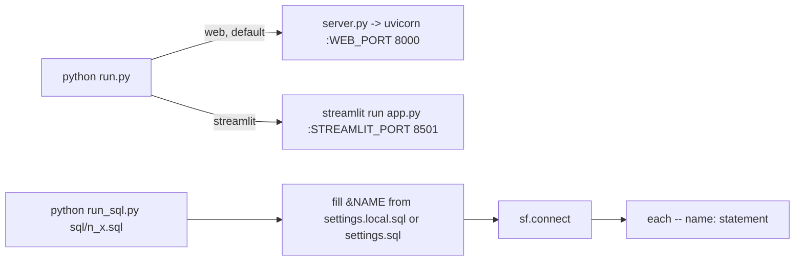

<!-- generated by darshan-singh-meel-knowledge-graph -->
# Run scripts

Root scripts that start the app, run the SQL files, and fill README.html: run.py, run_sql.py, sf.py (CLI), docs/make_readme.py.

## run.py

| Step | path:line |
|---|---|
| Usage: web / `--fake` / `streamlit` / `--port` / `--direct` / `--objects`; `APP` env sets the default | run.py:1-10 |
| `import access` loads `.env` (so ports can live there) | run.py:16 |
| Args: `app` (web / streamlit, default `APP` or web), `--fake`, `--port`, `--direct`, `--objects` | run.py:28-34 |
| `--fake` -> `FAKE=1`; source -> `SOURCE` | run.py:35-35 |
| `command(argv, env)` builds `(cmd, env)` (testable; `test_run_address`, test_server.py:703) | run.py:26-42 |
| streamlit: `python -m streamlit run app.py --server.port N --server.address $HOST --server.headless true` (HOST default 127.0.0.1) | run.py:33-38 |
| web: `WEB_PORT` then `python server.py` | run.py:39-41 |
| `__main__`: runs the command as a subprocess in the repo folder | run.py:45-47 |

## run_sql.py

| Name | Does | path:line |
|---|---|---|
| `SETTINGS` / `NAMES` | settings.local.sql if present, else settings.sql; `!define NAME=value` lines | run_sql.py:17-18 |
| `HERE` name | absolute repo path for `PUT 'file://&HERE/...'` | run_sql.py:19 |
| `check_names()` | Stops if any name is still `<...>` | run_sql.py:22-27 |
| `fill(sql)` | Replaces `&NAME`; unknown name stops | run_sql.py:30-35 |
| `missing_files(text)` | PUT sources that do not exist (checked before any statement) | run_sql.py:38-40 |
| `statements(text)` | `(name, flags, sql)` per `-- name:` block | run_sql.py:43-46 |
| `main(path)` | `USE ROLE &DEV_ROLE`, `USE SECONDARY ROLES NONE`, warehouse, database; runs each; `(may fail)` -> SKIPPED; `_verify.sql` -> OK / MISSING / WRONG, then VERIFIED or NOT VERIFIED | run_sql.py:49-79 |

- Example: `python run_sql.py sql/1_setup_verify.sql` prints `OK: TABLES (11 rows)` when all 11 TBL_ACCESS_ tables exist (format at run_sql.py:72-73, expectation at sql/1_setup_verify.sql:4).
- `(expect N)` compares the row count (run_sql.py:62, run_sql.py:72).

## sf.py CLI

- `python sf.py "select current_user()"` or `python sf.py -f query.sql`; prints tab-separated rows (sf.py:67-72). See sf.md.

## docs/make_readme.py

- Fills README.html between `<!--map:NAME-->` markers: overview, flow, rules (docs/make_readme.py:1-4).
- Imports access.py for rule titles and severities (docs/make_readme.py:12); areas from `server.RULE_INFO` (docs/make_readme.py:4).
- `rules()` (docs/make_readme.py:125), `inject()` (docs/make_readme.py:142); checked by `test_readme_rules` (test_access.py:1788).

## Other root files (not scripts)

- `settings.sql`: template of `&NAME` values (settings.sql:5-14); see sql.md.
