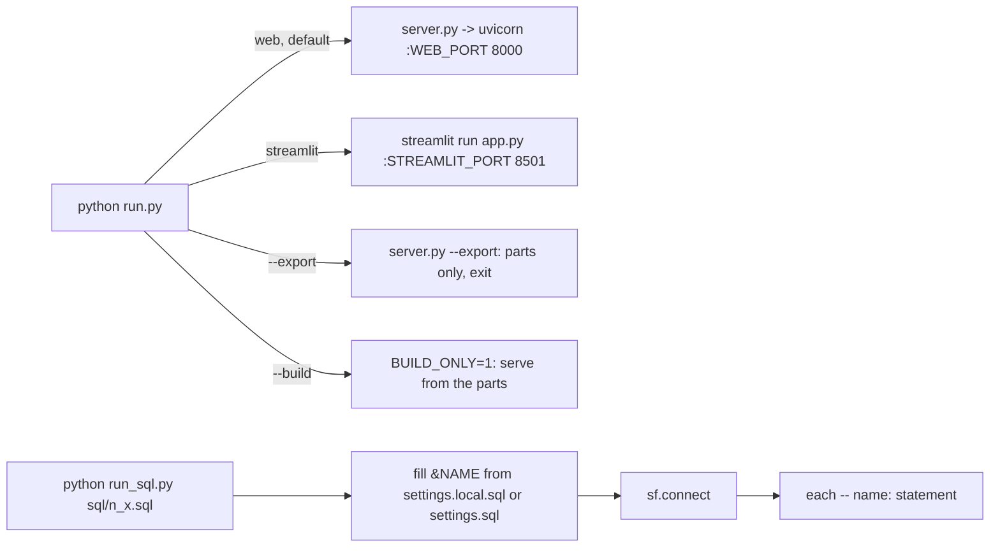

<!-- generated by darshan-singh-meel-knowledge-graph -->
# Run scripts

Root scripts that start the app, run the SQL files, and fill README.html: run.py, run_sql.py, sf.py (CLI), docs/make_readme.py.

## run.py

| Step | path:line |
|---|---|
| Usage: web / `--fake` / `--fake twin --scale N` / `streamlit` / `--port` / `--direct` / `--objects` / `--export` / `--build` / `--cache-dir`; `APP` env sets the default | run.py:1-17 |
| `import access` loads `.env` (so ports can live there) | run.py:23 |
| Args: `app` (web / streamlit, default `APP` or web), `--fake` (`1`, or `twin`: the synthetic twin of a big account, twin.py), `--scale`, `--cache-dir`, `--port`, `--direct`, `--objects`; `--export` / `--build` (one of them) and `--fresh` | run.py:29-39 |
| `--fake` -> `FAKE=1` or `FAKE=twin`; `--scale` -> `FAKE_SCALE`; `--cache-dir` -> `CACHE_DIR` (absolute, from where run.py started); source -> `SOURCE` | run.py:42-49 |
| `--fresh` without `--export` is an error; `--export [--fresh]` -> `python server.py --export [--fresh]` (stage 1 only, then exit, `server.export`); `--build` -> `BUILD_ONLY=1` (built from the parts kept, never Snowflake) — [flows/two-stage-load.md](../flows/two-stage-load.md) | run.py:50-55 |
| `command(argv, env)` builds `(cmd, env)` (testable; `test_run_address`, `test_parts`) | run.py:26-65 |
| streamlit: `python -m streamlit run app.py --server.port N --server.address $HOST --server.headless true` (HOST default 127.0.0.1) | run.py:56-61 |
| web: `WEB_PORT` then `python server.py` | run.py:62-64 |
| `__main__`: runs the command as a subprocess in the repo folder | run.py:68-70 |

## run_sql.py

| Name | Does | path:line |
|---|---|---|
| `SETTINGS` / `NAMES` | settings.local.sql if present, else settings.sql; `!define NAME=value` lines of settings.sql first, then settings.local.sql over them, so a name the local file lacks (e.g. `STREAMLIT_APP`, `QUERY_TAG`) keeps the template value | run_sql.py:17-19 |
| `HERE` name | absolute repo path for `PUT 'file://&HERE/...'` | run_sql.py:20 |
| `check_names()` | Stops on quotes, `$` or backslash in `STREAMLIT_APP` / `QUERY_TAG` (pasted into the procedure's Python and `$$` block), on `STATEMENT_TIMEOUT` / `WORKERS` / `ACTIVITY` that are not whole numbers (`int("&NAME")` in the procedure, run_sql.py:29-31), then if any name is still `<...>` | run_sql.py:23-34 |
| `fill(sql)` | Replaces `&NAME`; unknown name stops | run_sql.py:37-42 |
| `missing_files(text)` | PUT sources that do not exist (checked before any statement) | run_sql.py:45-47 |
| `statements(text)` | `(name, flags, sql)` per `-- name:` block | run_sql.py:50-53 |
| `main(path)` | `USE ROLE &DEV_ROLE`, `USE SECONDARY ROLES NONE`, warehouse, database; runs each; `(may fail)` -> SKIPPED; `_verify.sql` -> OK / MISSING / WRONG, then VERIFIED or NOT VERIFIED | run_sql.py:56-89 |

- Example: `python run_sql.py sql/1_setup_verify.sql` prints `OK: TABLES (11 rows)` when all 11 TBL_ACCESS_ tables exist (format at run_sql.py:82-83, expectation at sql/1_setup_verify.sql:4).
- `(expect N)` compares the row count (run_sql.py:69, run_sql.py:82).
- Each statement but a CALL carries `.env`'s `STATEMENT_TIMEOUT` (`sf.limit`); a timeout stops with `<name>: <timeout_hint> in .env` (run_sql.py:71-76).

## twin.py (synthetic twin of a big account)

- `twin(scale, seed)` returns the same dict as `access.fake()`, shaped like one big account's profile from counts, histograms and ratios only (every name made up), with findings for all 29 rules (twin.py:1-5, twin.py:123-476).
- `FAKE=twin` loads it instead of `access.fake()`: `data()` (twin.py:616-618) is what `server.read_shared` returns in fake mode (server.py:167); `data_previous()` / `previous()` the twin a week earlier for What changed (twin.py:601-609, twin.py:621-622; server.py:3118). `FAKE_SCALE` (`scale()`, default 1) shrinks every count; the same scale and seed give the same data (twin.py:612-613).
- With `FAKE=twin` the role prefixes are `R_F_` / `R_T_` unless `ROLE_PREFIXES` is set (access.py:76); the cache key carries `twin<scale>` (cache.py:64-66).
- Helpers: `spread` / `draw` (values from a histogram, twin.py:101-116), `fill` (rows per user, twin.py:479-485), `activity` (ACTIVITY and OBJECT_USE rows: builders load their schemas, others read what their roles reach, plus person changes, spikes and admin-role use, twin.py:488-598).
- Started with `python run.py --fake twin --scale 0.1` (run.py:5); checked by `test_twin` (test_access.py:2486-2496).

## sf.py CLI

- `python sf.py "select current_user()"` or `python sf.py -f query.sql`; prints tab-separated rows (sf.py:83-88). See sf.md.

## docs/make_readme.py

- Fills README.html between `<!--map:NAME-->` markers: overview, flow, rules (docs/make_readme.py:1-4).
- Imports access.py for rule titles and severities (docs/make_readme.py:12); areas from `server.RULE_INFO` (docs/make_readme.py:4).
- `rules()` (docs/make_readme.py:125), `inject()` (docs/make_readme.py:142); checked by `test_readme_rules` (test_access.py:2400).

## Other root files (not scripts)

- `settings.sql`: template of `&NAME` values (settings.sql:6-19), with defaults for `STREAMLIT_APP` (ST_ACCESS_EXPLORER) and `QUERY_TAG` (access-explorer); see documents/settings-sql.md.
