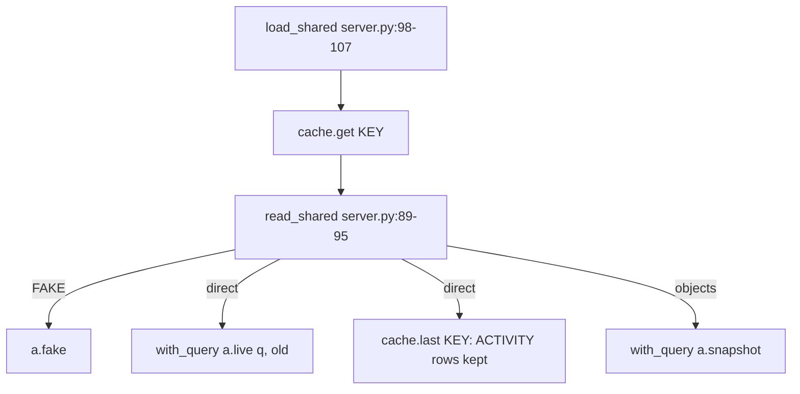

<!-- generated by darshan-singh-meel-knowledge-graph -->
# server.py

FastAPI JSON API over access.py, plus `serve()` / `serve_csv()` that st_react.py reuses; no logic of its own (server.py:1-4).

## Module state

- `MODE, SOURCE, WHERE = cache.config()` (server.py:21); `KEY` cache name (server.py:23); `DEMO_USER` (server.py:24).
- `PAGES` page key -> label (server.py:28-31); `GROUP` side-nav group (server.py:33-36); `SHARED_ONLY` = review, flow, changes (server.py:37).
- `LOCK` RLock: access.py keeps lookups in globals, build + answer under one lock (server.py:52); `ANSWERS`: `serve()` keeps each answer per (data set `data_key`, endpoint, params), up to `MAX_ANSWERS` (200, oldest out), so a repeat skips the lock (server.py:56-57, server.py:2279-2305); `LOAD` one Snowflake read at a time (server.py:53); `MINE` per-sid My access (server.py:54).
- `ApiError(status, detail, message)` (server.py:60).

## Endpoints

| Method | Path | Handler | path:line |
|---|---|---|---|
| GET | /api/meta | `meta` | server.py:2377-2379 -> server.py:2153-2187 |
| POST | /api/reload | `reload` (`what` = page / load / rebuild) | server.py:2381-2387 -> server.py:2208-2234 |
| POST | /api/mine/load | `load_mine`, sets `ae_sid` cookie (httponly, samesite strict, path /api) | server.py:2389-2397 -> server.py:154-180 |
| GET | /api/mine | `mine_state` | server.py:2399-2401 -> server.py:123-127 |
| GET | /api/home | `home_page` | server.py:1073-1094 |
| GET | /api/access | `access_page` | server.py:1004-1070 |
| GET | /api/user | `user_page` | server.py:879-950 |
| GET | /api/role | `role_page` | server.py:1133-1235 |
| GET | /api/object | `object_page` | server.py:1283-1361 |
| GET | /api/who | `who_page` | server.py:1364-1402 |
| GET | /api/check | `check_page` | server.py:1433-1533 |
| GET | /api/request | `request_page` | server.py:1536-1564 |
| GET | /api/map | `map_page` | server.py:1574-1615 |
| GET | /api/see | `see_page` | server.py:1631-1645 |
| GET | /api/usage | `usage_page` | server.py:1704-1718 |
| GET | /api/changes | `changes_page` | server.py:1721-1752 |
| GET | /api/activity | `activity_page` (`name` [+ `as`] / `user` / `role`) | server.py:1658-1696 |
| GET | /api/sql | `sql_page` (`page` + that page's own params: `user` / `a`, `role`, `name` / `obj` / `table`, `show`) | server.py:1699-1701 |
| GET | /api/compare | `compare_page` | server.py:1767-1787 |
| GET | /api/sensitive | `sensitive_page` | server.py:1792-1859 |
| GET | /api/rules | `rules_page` | server.py:1884-1905 |
| GET | /api/whatif | `whatif_page` (-> `what_if` server.py:1929-1940) | server.py:1943-1946 |
| GET | /api/review | `review_page` | server.py:1982-2008 |
| GET | /api/grid | `grid_page` | server.py:2011-2029 |
| GET | /api/flow | `flow_page` | server.py:2032-2039 |
| GET | /api/find | `find_page` | server.py:2056-2067 |
| GET | /api/list | `list_page` (`q`, `limit`, `what`) | server.py:2080-2095 |
| GET | /api/graph | `graph_page` | server.py:2126-2139 |
| GET | /api/rules.csv | `rules_csv` | server.py:1908-1921 |
| GET | /api/review.csv | `review_csv` | server.py:2042-2051 |
| GET | /api/whatif.csv | `whatif_csv` | server.py:1949-1955 |
| GET | /{path:path} | `spa`: web/dist file, else index.html; unknown /api/ -> 404 JSON | server.py:2421-2431 |

- The 23 GET routes are registered in a loop (server.py:2408-2410); CSV routes from `CSV` (server.py:2276, server.py:2418-2419).
- `WITH_REFS` answers get `refs` (kinds, types, sensitive, disabled) from `mkrefs` (server.py:2274-2275, server.py:2298-2299).

### Handler -> access.py (from the graph fragment, verified by text match)

| Handler | access.py calls |
|---|---|
| home_page | access_objects, grants, ladder_counts, governance_kpis, row_tables |
| access_page | grants, access_objects, data_views, ladder_counts, reach, ups |
| check_page | can, cut_points, nearest, lanes, best_paths, data_view, approver |
| object_page | object_stats, admin_holders, matrix, grantees, object_graph, data_view |
| who_page | who_has, admin_access, column_view, same_paths; app_exposure for a Streamlit app (server.py:1396) |
| map_page | access_graph, builtin_info |
| compare_page | compare, sensitive_rank |
| grid_page / flow_page | review_grid / sens_flow |
| usage_page / changes_page | granted_used (its `sql`: the trim as What if writes it; `sql=""` when usage is off, server.py:1717) / diff, fake_previous |
| request_page | suggest, approver, need_privs; each suggestion and the asked role get `change` = `a.with_sql(grant ...)` (server.py:1558-1562), so the page shows the server's SQL |
| rules_page | uses `S["rows"]` = `a.rule_rows` set in `session` (server.py:202) |
| activity_page | kind -> app / scope / warehouse (warehouse_use); act_state, activity, activity_graph (-> used_path, object / user / role only), activity_sensitive, query_sql, activity_section_sql per section (server.py:1689), app_use, mark_sensitive; rule >= 24 rows of `S["rows"]` on that name (server.py:1661-1696) |
| sql_page | page_sql (-> query_file, plain, activity_section_sql, query_sql) (server.py:1699-1701) |

## Data loading

- `load_shared(ask=True)` with SOURCE=direct and no copy ready -> 409 `shared_not_loaded`: direct reads only on a click (server.py:98-102).
- Direct mode reads the activity incrementally: `read_shared` passes the ACTIVITY rows of `cache.last(KEY)` to `a.live` (server.py:92-94; [flows/activity-read.md](../flows/activity-read.md)).
- `with_query` opens one connection, closes it only if `sf.owned()` (server.py:73-86).
- `session(view, sid, builtin)` builds the view's data under `LOCK`, fills `S` (sens, rows, breaks) (server.py:183-204).
- `reload` `rebuild` CALLs `SP_ACCESS_SNAPSHOT('AUTO')` (server.py:2216), the only non-read statement allowed (CLAUDE.md, test_read_only).

## Security checks

| Check | What | path:line |
|---|---|---|
| `allowed_hosts()` | loopback + HOST + `ALLOWED_HOSTS`; HOST=0.0.0.0 adds machine names and IPs | server.py:2316-2330 |
| `served(host)` | Host header must be served (`*` = any) | server.py:2343-2346 |
| `same_site` middleware | bad Host -> 400 `bad_host`; non-GET with foreign Origin, or `/api/` with `Sec-Fetch-Site` not same-origin/none -> 403 `cross_site` | server.py:2348-2364 |
| `mine_off()` | My access off inside Snowflake, `MY_ACCESS=0`, HOST not loopback or `ALLOWED_HOSTS` naming another host (server.py:145-146), key-pair login; `MY_ACCESS=1` forces on | server.py:133-151 |
| `csv_text()` | a cell starting with `= + - @` tab or CR (not a plain number) gets a leading `'`, so a CSV opened in Excel never runs an object name as a formula | server.py:286-294 |
| JSON errors | `ApiError` -> `{detail, message}` with its status; any other exception -> 500 `{detail: "error", message: "Type: text"}` | server.py:2366-2372 |

- Same error shape in Streamlit: `st_react.answer` (st_react.py:45-48); there a `.csv` name is served only when it is a key of `server.CSV`, else 404 (st_react.py:40-41).
- GZip for answers over 2000 bytes (server.py:2340).
- `__getattr__("app")` builds the app lazily for `uvicorn server:app` (server.py:2436-2441); `__main__` runs uvicorn on HOST / WEB_PORT (server.py:2444-2446).

## Activity (rules 24-28, rule 29, Activity tab)

| Item | What | path:line |
|---|---|---|
| `RULE_INFO` 24-29 | area "Activity" (24-28) or "Sensitive data" (29), plain-word text and fix hint per rule | server.py:359-373 |
| `SHORT` 24-29 | short rule labels (29: "app opens owner's data") | server.py:972-973 |
| `note_info("activity")` | health note: "No client in Activity" (SESSIONS not readable) or "No table activity" (ACCESS_HISTORY not readable) | server.py:405-408 |
| `MAX_ACTIVITY` | Activity rows sent (2000) | server.py:1655 |
| `work` | default business hours from `access.WORK_HOURS` | server.py:1676 |
| `activity_page` | GET /api/activity; flow in [flows/activity-tab.md](../flows/activity-tab.md) | server.py:1658-1696 |
| `section_sql` | per Activity section key of `a.ACT_SECTIONS`, the SQL of `a.activity_section_sql(name, what, first, last, key)` | server.py:1689 |
| `sql_page` | GET /api/sql: `{page, queries}` from `a.page_sql(page, p)`, empty entries dropped; not in WITH_REFS; flow in [flows/show-sql.md](../flows/show-sql.md) | server.py:1699-1701, server.py:2273 |
