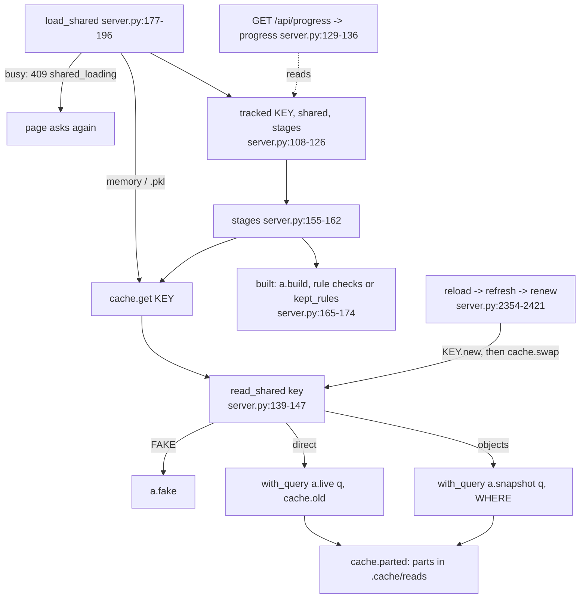

<!-- generated by darshan-singh-meel-knowledge-graph -->
# server.py

FastAPI JSON API over access.py, plus `serve()` / `serve_csv()` that st_react.py reuses; no logic of its own (server.py:1-4).

## Module state

- `MODE, SOURCE, WHERE = cache.config()` (server.py:23); `KEY` cache name (server.py:25); `DEMO_USER` (server.py:27).
- `PAGES` page key -> label (server.py:31-34); `GROUP` side-nav group (server.py:36-39); `SHARED_ONLY` = review, flow, changes (server.py:40).
- `LOCK` RLock: access.py keeps lookups in globals, build + answer under one lock (server.py:55); `ANSWERS`: `serve()` keeps each answer per (data set `data_key`, endpoint, params), up to `MAX_ANSWERS` (200, oldest out), so a repeat skips the lock (server.py:65-66, server.py:2481-2507); `LOAD` one Snowflake read at a time (server.py:56); `MINE` per-sid My access (server.py:57).
- `PROGRESS` cache key -> its last Snowflake read (view, running, start, lines), `PLOCK`, `MAX_LINES` 200 (server.py:59-64); `LOAD` one Snowflake read at a time (server.py:56).
- `ApiError(status, detail, message)` (server.py:69).
- `OFFLINE` = `BUILD_ONLY=1` (run.py --build): built from the parts kept, never a Snowflake read (server.py:26); `LOG_LINES` progress lines also on the terminal, `JOB` the last refresh (id, what, state, ok, message), `BACKGROUND` refresh in a thread, off inside Snowflake (server.py:61-63); `KEPT` rule results kept across restarts (server.py:306).

## Endpoints

| Method | Path | Handler | path:line |
|---|---|---|---|
| GET | /api/meta | `meta` | server.py:2586-2588 -> server.py:2295-2329 |
| POST | /api/reload | `reload` (`what` = page / load / rebuild): load reads now; page / rebuild start `refresh()` in the background (`{started, job}`), in a thread pool | server.py:2594-2596 -> server.py:2354-2421 |
| GET | /api/progress | `progress` (`view=` optional): lines of the read running now, plus `job` (the background refresh) | server.py:2598-2600 -> server.py:129-136 |
| POST | /api/mine/load | `load_mine`, sets `ae_sid` cookie (httponly, samesite strict, path /api) | server.py:2602-2610 -> server.py:244-275 |
| GET | /api/mine | `mine_state` | server.py:2612-2614 -> server.py:213-217 |
| GET | /api/home | `home_page` | server.py:1213-1235 |
| GET | /api/access | `access_page` | server.py:1144-1210 |
| GET | /api/user | `user_page` | server.py:1019-1090 |
| GET | /api/role | `role_page` | server.py:1274-1376 |
| GET | /api/object | `object_page` | server.py:1424-1502 |
| GET | /api/who | `who_page` | server.py:1505-1543 |
| GET | /api/check | `check_page` | server.py:1574-1674 |
| GET | /api/request | `request_page` | server.py:1677-1705 |
| GET | /api/map | `map_page` | server.py:1715-1756 |
| GET | /api/see | `see_page` | server.py:1772-1786 |
| GET | /api/usage | `usage_page` | server.py:1845-1859 |
| GET | /api/changes | `changes_page` | server.py:1862-1893 |
| GET | /api/activity | `activity_page` (`name` [+ `as`] / `user` / `role`) | server.py:1799-1837 |
| GET | /api/sql | `sql_page` (`page` + that page's own params: `user` / `a`, `role`, `name` / `obj` / `table`, `show`) | server.py:1840-1842 |
| GET | /api/compare | `compare_page` | server.py:1908-1928 |
| GET | /api/sensitive | `sensitive_page` | server.py:1933-2000 |
| GET | /api/rules | `rules_page` | server.py:2025-2047 |
| GET | /api/whatif | `whatif_page` (-> `what_if` server.py:2071-2082) | server.py:2085-2088 |
| GET | /api/review | `review_page` | server.py:2124-2150 |
| GET | /api/grid | `grid_page` | server.py:2153-2171 |
| GET | /api/flow | `flow_page` | server.py:2174-2181 |
| GET | /api/find | `find_page` | server.py:2198-2209 |
| GET | /api/list | `list_page` (`q`, `limit`, `what`) | server.py:2222-2237 |
| GET | /api/graph | `graph_page` | server.py:2268-2281 |
| GET | /api/rules.csv | `rules_csv` | server.py:2050-2063 |
| GET | /api/review.csv | `review_csv` | server.py:2184-2193 |
| GET | /api/whatif.csv | `whatif_csv` | server.py:2091-2097 |
| GET | /{path:path} | `spa`: web/dist file, else index.html; unknown /api/ -> 404 JSON | server.py:2634-2644 |

- The 23 GET routes are registered in a loop (server.py:2621-2623); CSV routes from `CSV` (server.py:2478, server.py:2631-2632).
- CSV export setting: `csv_on()` reads env `CSV` (unset = on, `0` = off) (server.py:2510-2511); `serve_csv` raises `ApiError(403, "csv_off")` before any session work when it is off (server.py:2514-2519). Both versions go through it: the FastAPI `*.csv` routes (server.py:2625-2629) and `st_react.answer` (st_react.py:44). `meta()` sends `csv` so the React app hides every CSV button (server.py:2299).
- `WITH_REFS` answers get `refs` (kinds, types, sensitive, disabled) from `mkrefs` (server.py:2476-2477, server.py:2500-2501).

### Handler -> access.py (from the graph fragment, verified by text match)

| Handler | access.py calls |
|---|---|
| home_page | access_objects, grants, ladder_counts, governance_kpis, row_tables |
| access_page | grants, access_objects, data_views, ladder_counts, reach, ups |
| check_page | can, cut_points, nearest, lanes, best_paths, data_view, approver |
| object_page | object_stats, admin_holders, matrix, grantees, object_graph, data_view |
| who_page | who_has, admin_access, column_view, same_paths; app_exposure for a Streamlit app (server.py:1537) |
| map_page | access_graph, builtin_info |
| compare_page | compare, sensitive_rank |
| grid_page / flow_page | review_grid / sens_flow |
| usage_page / changes_page | granted_used (its `sql`: the trim as What if writes it; `sql=""` when usage is off, server.py:1858) / diff, fake_previous |
| request_page | suggest, approver, need_privs; each suggestion and the asked role get `change` = `a.with_sql(grant ...)` (server.py:1699-1703), so the page shows the server's SQL |
| rules_page | uses `S["rows"]` = `a.rule_rows` set in `session` (server.py:298) |
| activity_page | kind -> app / scope / warehouse (warehouse_use); act_state, activity, activity_graph (-> used_path, object / user / role only), activity_sensitive, query_sql, activity_section_sql per section (server.py:1830), app_use, mark_sensitive; rule >= 24 rows of `S["rows"]` on that name (server.py:1802-1837) |
| sql_page | page_sql (-> query_file, plain, activity_section_sql, query_sql) (server.py:1840-1842) |

## Data loading

- `load_shared(ask=True)` answers from memory / `.pkl` at once; SOURCE=direct with no copy and no parts -> 409 `shared_not_loaded` (direct reads only on a click); a load already running -> 409 `shared_loading`, so a page never waits behind it; else `tracked(KEY, "shared", stages)`; an error -> 503 `shared_unreadable` (server.py:177-196).
- `stages()`: stage 1 `cache.get(KEY, read_shared)`, stage 2 `built(d)` (role graph and rule checks, each an `a.step` in the load log), then "Ready in N s" (server.py:155-174); flow in [flows/two-stage-load.md](../flows/two-stage-load.md).
- `with_query(fn, key)` logs in at the first statement that goes to Snowflake and wraps `query` with `cache.parted` (every read kept as a part; `OFFLINE`: parts only); the connection is closed only if `sf.owned()` (server.py:82-105).
- Direct mode reads activity and object use incrementally from `cache.old(key, KEY)` (server.py:143-145; [flows/activity-read.md](../flows/activity-read.md)); objects mode passes `old=cache.last(KEY)`; the last OK run is asked on every load, never kept as a part (server.py:147, access.py:513-516).
- `fetched()`: "Data from" = the oldest part, else the read time (server.py:199-202).
- `session(view, sid, builtin)` builds the view's data under `LOCK`, fills `S` (sens, rows, breaks); the shared rule results come from `kept_rules()` when kept (`.cache/<key>.rules.pkl`, stamp `(key, builtin, a.rules_stamp(), SERVER_STAMP)`), else are checked and saved (server.py:278-329).
- Loads run inside `tracked(key, view, fn)`: `a.progress` lines kept for `GET /api/progress` (`progress(view)`, never starts a load) and printed when `LOG_LINES`; `POST /api/reload` runs in a thread pool so the poll answers meanwhile (server.py:108-136, server.py:2596-2600; [flows/load-progress.md](../flows/load-progress.md)).
- Refresh: `reload` -> `refresh(what)` (one `JOB`, a thread when `BACKGROUND`) -> `renew(what)`: rebuild CALLs `SP_ACCESS_SNAPSHOT('AUTO')` via `call_snapshot()` (the only non-read statement allowed, CLAUDE.md, test_read_only; no STATEMENT_TIMEOUT, its timeout answers 503 with the limit message), then reads under `KEY + ".new"` (parts kept for an hour after a failed refresh, so the next resumes), `built()`, `cache.swap` (server.py:2354-2436); flow in [flows/background-refresh.md](../flows/background-refresh.md).
- `HIERARCHY=0`: `session()` skips rule 17's read-only writes for What-if breaks (server.py:299); `rules_page` / `home_page` send `skipped` (server.py:2031-2042, server.py:1230); `note_info` explains a `SKIPPED` source (ACTIVITY=0, server.py:506-509) and the notes of missing or unreadable data (`no_run`, `missing_names`, `missing_columns`, `secondary_roles`, `user`, UNAVAILABLE grants / user roles, server.py:515-554).
- `export(fresh)` (run.py --export): stage 1 only, the progress lines on the terminal; every part ok -> `cache.drop(KEY)` (the next start builds from the new parts), exit 0, else 1 (server.py:2671-2691).

## Security checks

| Check | What | path:line |
|---|---|---|
| `allowed_hosts()` | loopback + HOST + `ALLOWED_HOSTS`; HOST=0.0.0.0 adds machine names and IPs | server.py:2524-2538 |
| `served(host)` | Host header must be served (`*` = any) | server.py:2552-2555 |
| `same_site` middleware | bad Host -> 400 `bad_host`; non-GET with foreign Origin, or `/api/` with `Sec-Fetch-Site` not same-origin/none -> 403 `cross_site` | server.py:2557-2573 |
| `mine_off()` | My access off inside Snowflake, `MY_ACCESS=0`, HOST not loopback or `ALLOWED_HOSTS` naming another host (server.py:235-236), key-pair login; `MY_ACCESS=1` forces on | server.py:223-241 |
| `csv_text()` | a cell starting with `= + - @` tab or CR (not a plain number) gets a leading `'`, so a CSV opened in Excel never runs an object name as a formula | server.py:411-419 |
| `csv_on()` / `serve_csv` | `CSV=0`: every server CSV download answers 403 `csv_off`, in both versions; the app hides its CSV buttons from `meta.csv`. Whoever can open the app still sees the screen, so app access stays the real control (README.md:222) | server.py:2510-2519 |
| JSON errors | `ApiError` -> `{detail, message}` with its status; any other exception -> 500 `{detail: "error", message: "Type: text"}` | server.py:2575-2581 |

- Same error shape in Streamlit: `st_react.answer` (st_react.py:48-51); there a `.csv` name is served only when it is a key of `server.CSV`, else 404 (st_react.py:43-44).
- GZip for answers over 2000 bytes (server.py:2549).
- `__getattr__("app")` builds the app lazily for `uvicorn server:app` (server.py:2649-2654); `__main__`: `--export` runs `export()`, else `LOG_LINES = True` and uvicorn on HOST / WEB_PORT with `quiet_log()` (its access log leaves out GET /api/progress via `NoProgress`) (server.py:2697-2703, server.py:2657-2668).

## Activity (rules 24-28, rule 29, Activity tab)

| Item | What | path:line |
|---|---|---|
| `RULE_INFO` 24-29 | area "Activity" (24-28) or "Sensitive data" (29), plain-word text and fix hint per rule | server.py:484-498 |
| `SHORT` 24-29 | short rule labels (29: "app opens owner's data") | server.py:1112-1113 |
| `note_info("activity")` | health note: "No client in Activity" (SESSIONS not readable) or "No table activity" (ACCESS_HISTORY not readable) | server.py:538-541 |
| `MAX_ACTIVITY` | Activity rows sent (2000) | server.py:1796 |
| `work` | default business hours from `access.WORK_HOURS` | server.py:1817 |
| `activity_page` | GET /api/activity; flow in [flows/activity-tab.md](../flows/activity-tab.md) | server.py:1799-1837 |
| `section_sql` | per Activity section key of `a.ACT_SECTIONS`, the SQL of `a.activity_section_sql(name, what, first, last, key)` | server.py:1830 |
| `sql_page` | GET /api/sql: `{page, queries}` from `a.page_sql(page, p)`, empty entries dropped; not in WITH_REFS; flow in [flows/show-sql.md](../flows/show-sql.md) | server.py:1840-1842, server.py:2475 |
