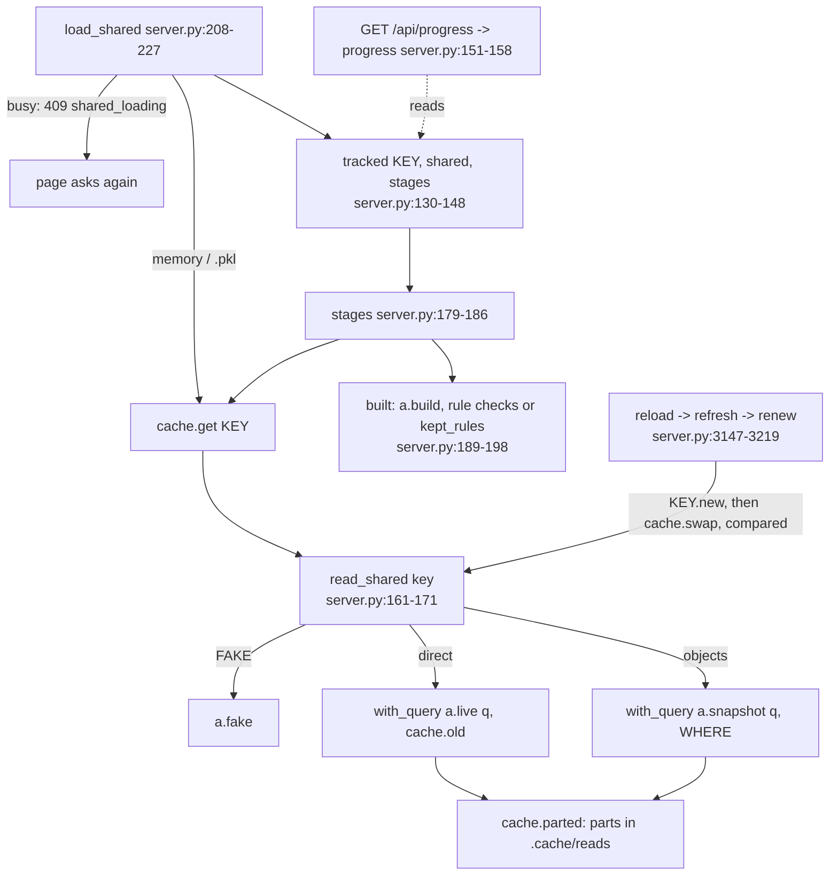

<!-- generated by darshan-singh-meel-knowledge-graph -->
# server.py

FastAPI JSON API over access.py, plus `serve()` / `serve_csv()` that st_react.py reuses; no logic of its own (server.py:1-4).

## Module state

- `MODE, SOURCE, WHERE = cache.config()` (server.py:25); `DIRECT` (server.py:26); `KEY` cache name (server.py:27); `DEMO_USER` (server.py:29).
- `PAGES` page key -> label (server.py:33-36); `GROUP` side-nav group (server.py:38-41); `SHARED_ONLY` = review, flow, changes (server.py:42).
- `LOCK` RLock: access.py keeps lookups in globals, build + answer under one lock (server.py:62); `ANSWERS`: `serve()` keeps each answer per (data set `data_key`, endpoint, params), up to `MAX_ANSWERS` (200, oldest out), so a repeat skips the lock (server.py:72-73, server.py:3294-3320); `LOAD` one Snowflake read at a time (server.py:63).
- `PROGRESS` cache key -> its last Snowflake read (view, running, start, lines), `PLOCK`, `MAX_LINES` 200 (server.py:66-71).
- `ApiError(status, detail, message)` (server.py:77-80).
- `OFFLINE` = `BUILD_ONLY=1` (run.py --build): built from the parts kept, never a Snowflake read (server.py:28); `LOG_LINES` progress lines also on the terminal, `JOB` the last refresh (id, what, state, ok, message), `BACKGROUND` refresh in a thread, off inside Snowflake (server.py:68-70); `KEPT` rule results kept across restarts, `SERVER_STAMP` hash of this file (server.py:345-346).
- Paging and graph limits: `PAGE` 50 rows per server-paged table (server.py:74), `MAX_MULTI` (server.py:58), `MAX_LANE` 24 role or people boxes per lane before a lane folds (server.py:59), `LAZY` 300 members over which combined boxes go out empty (server.py:56), `GSRC` the graph params a page sends back (server.py:60).

## Endpoints

| Method | Path | Handler | path:line |
|---|---|---|---|
| GET | /api/meta | `meta` | server.py:3404-3406 -> server.py:3086-3122 |
| POST | /api/reload | `reload` (`what` = page / load / rebuild): load reads now; page / rebuild start `refresh()` in the background (`{started, job}`), in a thread pool | server.py:3408-3414 -> server.py:3147-3161 |
| GET | /api/progress | `progress` (`view=` optional): lines of the read running now, plus `job` (the background refresh) | server.py:3416-3418 -> server.py:151-158 |
| POST | /api/mine/load | `load_mine`, sets `ae_sid` cookie (httponly, samesite strict, path /api) | server.py:3420-3428 -> server.py:281-312 |
| GET | /api/mine | `mine_state` | server.py:3430-3432 -> server.py:250-254 |
| GET | /api/home | `home_page` | server.py:1509-1531 |
| GET | /api/access | `access_page`: one page of the Access list (`access_list` filters, offset= / limit=) | server.py:1451-1494 |
| GET | /api/user | `user_page` | server.py:1174-1235 |
| GET | /api/privs | `privs_page`: one Privileges tab of the User page (of=role: the Role page), paged | server.py:1291-1295 |
| GET | /api/role | `role_page` | server.py:1687-1757 |
| GET | /api/held | `held_page`: the Role page's held by rows of one tab, paged | server.py:1672-1676 |
| GET | /api/object | `object_page` | server.py:1921-1978 |
| GET | /api/grantees | `grantees_page`: the Object page's grantees of one tab, paged; by=groups pages `grantee_groups` | server.py:1897-1907 |
| GET | /api/who | `who_page` | server.py:2030-2049 |
| GET | /api/check | `check_page` | server.py:2088-2188 |
| GET | /api/request | `request_page` | server.py:2191-2219 |
| GET | /api/map | `map_page` (node=: one box's detail) | server.py:2285-2303 |
| GET | /api/see | `see_page` | server.py:2319-2333 |
| GET | /api/usage | `usage_page` | server.py:2392-2406 |
| GET | /api/changes | `changes_page` (f=, subject=, offset= / limit=) | server.py:2412-2454 |
| GET | /api/activity | `activity_page` (`name` [+ `as`] / `user` / `role`) | server.py:2346-2384 |
| GET | /api/sql | `sql_page` (`page` + that page's own params: `user` / `a`, `role`, `name` / `obj` / `table`, `show`) | server.py:2387-2389 |
| GET | /api/compare | `compare_page` | server.py:2489-2509 |
| GET | /api/sensitive | `sensitive_page` | server.py:2523-2596 |
| GET | /api/rules | `rules_page` | server.py:2680-2732 |
| GET | /api/finding | `finding_page`: one finding in full by id= | server.py:2735-2739 |
| GET | /api/whatif | `whatif_page` (-> `what_if` server.py:2763-2774) | server.py:2777-2780 |
| GET | /api/review | `review_page` | server.py:2832-2880 |
| GET | /api/grid | `grid_page` | server.py:2923-2944 |
| GET | /api/flow | `flow_page` | server.py:2947-2956 |
| GET | /api/find | `find_page` | server.py:2976-2987 |
| GET | /api/list | `list_page` (`q`, `limit`, `what`) | server.py:3000-3015 |
| GET | /api/graph | `graph_page` (of= user / role / object / map / check / user-tab / role-tab; group=: one combined box) | server.py:3046-3072 |
| GET | /api/rules.csv | `rules_csv` | server.py:2742-2755 |
| GET | /api/review.csv | `review_csv` | server.py:2959-2971 |
| GET | /api/whatif.csv | `whatif_csv` | server.py:2783-2789 |
| GET | /api/privs.csv | `privs_csv` | server.py:1298-1304 |
| GET | /api/access.csv | `access_csv` | server.py:1497-1506 |
| GET | /api/held.csv | `held_csv` | server.py:1679-1684 |
| GET | /api/grantees.csv | `grantees_csv` | server.py:1910-1915 |
| GET | /api/who.csv | `who_csv` | server.py:2052-2057 |
| GET | /{path:path} | `spa`: web/dist file, else index.html; unknown /api/ -> 404 JSON | server.py:3452-3462 |

- The 28 GET page routes are registered in a loop (server.py:3439-3441); the 8 CSV routes from `CSV` (server.py:3290-3291, server.py:3449-3450).
- CSV export setting: `csv_on()` reads env `CSV` (unset = on, `0` = off) (server.py:3323-3324); `serve_csv` raises `ApiError(403, "csv_off")` before any session work when it is off (server.py:3327-3332). Both versions go through it: the FastAPI `*.csv` routes (server.py:3443-3450) and `st_react.answer` (st_react.py:43-44). `meta()` sends `csv` so the React app hides every CSV button (server.py:3090).
- `WITH_REFS` answers get `refs` (kinds, types, sensitive, disabled) from `mkrefs` (server.py:3288-3289, server.py:3313-3314).

### Handler -> access.py (verified by text match)

| Handler | access.py calls |
|---|---|
| home_page | access_objects, grants, ladder_counts, governance_kpis, row_tables |
| access_page | via `access_all` / `access_entries` (server.py:1376-1415): grants, access_objects, data_views, future_label, ladder_counts |
| user_page | `user_ctx` / `user_rows`, `grant_count` for the default-role banner (server.py:1184), `user_graph` -> graph_input, down_graph |
| role_page | `role_ctx` / `role_rows`, `role_up` -> readonly_writes, `role_graph`, `held_rows` -> loses, fix_text, role_edge (server.py:1613-1640) |
| check_page | can, cut_points, nearest, lanes, best_paths, data_view, approver |
| object_page | `object_ctx` / `object_rows` -> matrix, grantees, object_stats (server.py:1805-1835), `object_graph` |
| who_page | `who_all` / `who_data` -> who_has, admin_access, column_view, same_paths, app_exposure for a Streamlit app (server.py:1997-2027) |
| map_page | `map_graph` -> access_graph, builtin_info (server.py:2229-2258) |
| compare_page | compare, sensitive_rank |
| grid_page / flow_page | review_grid / sens_flow, flow_follow |
| usage_page / changes_page | granted_used (its `sql`: the trim as What if writes it; `sql=""` when usage is off, server.py:2405) / `diff_of` -> diff, fake_previous |
| request_page | suggest, approver, need_privs; each suggestion and the asked role get `change` = `a.with_sql(grant ...)` (server.py:2213-2217), so the page shows the server's SQL |
| rules_page / finding_page | `rule_index` over `S["rows"]` = `a.rule_rows` set in `session` (server.py:337, server.py:2626-2637) |
| activity_page | kind -> app / scope / warehouse (warehouse_use); act_state, activity, activity_graph (-> used_path, object / user / role only), activity_sensitive, query_sql, activity_section_sql per section (server.py:2377), app_use, mark_sensitive; rule >= 24 rows of `S["rows"]` on that name (server.py:2346-2384) |
| sql_page | page_sql (-> query_file, plain, activity_section_sql, query_sql) (server.py:2387-2389) |

## Paged tables and CSV

Big accounts send one page of a table, never every row; the full table only goes out as CSV.

| Table | Rows | Page | CSV |
|---|---|---|---|
| User / Role Privileges tab | `privs_rows` (tab=, q=, sort=, dir=; of=role reads the role's effective rows) server.py:1265-1281 | `privs_page` server.py:1291-1295 | `privs_csv` server.py:1298-1304 |
| Role held by | `held_rows` (one row per holder, what revoking cut= takes away) server.py:1613-1640; `held_tab_rows` (tab=users / roles / all) server.py:1656-1669 | `held_page` server.py:1672-1676 | `held_csv` server.py:1679-1684 |
| Object grantees | `grantee_tab_rows` server.py:1854-1867; `grantee_groups` (same chain and privileges as one group, `MAX_CHIPS` people listed) server.py:1870-1894 | `grantees_page` server.py:1897-1907 | `grantees_csv` server.py:1910-1915 |
| Access list | `access_all` / `access_entries` (riskiest first) server.py:1376-1415; `access_list` filters server.py:1427-1448 | `access_page` server.py:1451-1494 | `access_csv` server.py:1497-1506 |
| Who has access | `who_all` (once per data set) server.py:1985-1994; first `MAX_WHO` / `MAX_WHO_GROUPS` sent (server.py:1981-1982) | `who_page` server.py:2030-2049 | `who_csv` server.py:2052-2057 |
| Risks & fixes | `rule_index` server.py:2626-2637, `rule_groups` (by rule / person / object / grid) server.py:2658-2677, `finding_row` (no fix texts) server.py:2640-2650 | `rules_page` (`FINDINGS_PAGE` 100, `MAX_GROUPS` 200, server.py:2621-2622) server.py:2680-2732; `finding_page` server.py:2735-2739 | `rules_csv` server.py:2742-2755 |
| Review | `review_ctx` server.py:2802-2822, `review_slice` (sorted by a web table column) server.py:2883-2917 | `review_page` server.py:2832-2880 | `review_csv` server.py:2959-2971 |
| What changed events | `diff_of(prev)` server.py:2457-2474 | `changes_page` (`window`, `NAMES` 20 names per event) server.py:2412-2454 | none |

- `paged(p, rows)`: offset= and limit= (default `PAGE`, at most 1000) (server.py:1284-1288); `window(p, key, n)` the same for the other long tables (server.py:2514-2520); `num_param` caps one integer parameter (server.py:2653-2655).

## Graphs: lazy boxes

- `build_graph(...)` turns access.py's lanes and edges into graph JSON; `src` = the graph endpoint's params, so over `LAZY` members the combined boxes go out empty and `only=<box>` answers that box alone, members included (server.py:724-843).
- `fold_lanes(...)`: a lane with more than `MAX_LANE` roles or people becomes one box, `lane:<i>` for roles and `lane:<i>:people` for people; lines to its members point at the box with their count (server.py:690-721).
- `drawn_input(...)`: `a.graph_input` plus member groups; too big -> `a.summary` with fold groups (server.py:903-920).
- Page diagrams: `user_graph` (server.py:1154-1166), `role_graph` (server.py:1583-1606), `object_graph` (server.py:1838-1843), `map_graph` (objects over `MAX_BOX` rolled up per database, people and role lanes folded) (server.py:2229-2258), with `dress` for stacks, every-object and built-in boxes (server.py:2261-2274) and `map_detail` per box (server.py:2277-2282).
- `graph_page` redraws any of them alone (`of=`) or one combined box (`group=`) (server.py:3046-3072); `gsrc` builds the `src` params (server.py:1169-1171).

## Data loading

- `load_shared(ask=True)` answers from memory / `.pkl` at once; SOURCE=direct with no copy and no parts -> 409 `shared_not_loaded` (direct reads only on a click); a load already running -> 409 `shared_loading`, so a page never waits behind it; else `tracked(KEY, "shared", stages)`; an error -> 503 `shared_unreadable` with `load_error()` (server.py:208-233).
- `load_error(x)`: Snowflake's message, plus what to change when the session has no warehouse (server.py:230-233).
- `stages()`: stage 1 `cache.get(KEY, read_shared)`, stage 2 `built(d)`, then "Ready in N s" (server.py:179-186). `built(d)` does the first page's work inside the load, each an `a.step` in the load log: "Building the role graph", "Checking the rules", with findings "Working out what each fix changes" (rule 17 `ro` when `HIERARCHY_ON`, `breaks`), "Saving the rule results" (`kept_rules(save=True)`), "Preparing the pages" (`a.sensitive` as `sens`) (server.py:189-205); flow in [flows/two-stage-load.md](../flows/two-stage-load.md).
- `with_query(fn, key)` logs in at the first statement that goes to Snowflake and wraps `query` with `cache.parted` (every read kept as a part; `OFFLINE`: parts only); a lost session seen during the load is raised after it; `q.prune()` drops the parts this load did not ask for; the connection is closed only if `sf.owned()` (server.py:90-127).
- `read_shared(key)`: Direct mode reads activity and object use incrementally from `cache.old(key, KEY)` (server.py:165-167; [flows/activity-read.md](../flows/activity-read.md)); objects mode passes `old=cache.last(KEY)` (server.py:169); `_read` stamps every read, so `shared_key` changes on a re-read of the same run; `a.tidy(d)` runs before the copy is kept (server.py:170-176).
- `fetched()`: "Data from" = the oldest part, else the read time (server.py:236-239).
- `session(view, sid, builtin)` builds the view's data under `LOCK`, fills `S` (sens, rows, breaks); the rule results come from `kept_rules()` when kept (`.cache/<key>.rules.pkl`, stamp `(key, builtin, a.rules_stamp(), SERVER_STAMP)`), else are checked and saved; after a load `built()` has them all in `a.memo` already (server.py:316-371); `prev_findings(d)` gives the findings kept for the previous snapshot (server.py:374-382).
- Loads run inside `tracked(key, view, fn)`: `a.progress` lines kept for `GET /api/progress` (`progress(view)`, never starts a load) and printed when `LOG_LINES`; `POST /api/reload` runs in a thread pool so the poll answers meanwhile (server.py:130-158, server.py:3414-3418; [flows/load-progress.md](../flows/load-progress.md)).
- Refresh: `reload` -> `refresh(what)` (one `JOB`, a thread when `BACKGROUND`) -> `renew(what)`: rebuild CALLs `SP_ACCESS_SNAPSHOT('AUTO')` via `call_snapshot()` (the only non-read statement allowed, CLAUDE.md, test_read_only), then reads under `KEY + ".new"` (parts kept for an hour after a failed refresh, so the next resumes); any part that timed out keeps the old data; else `built()`, `cache.swap`, `compared()` (server.py:3147-3248); flow in [flows/background-refresh.md](../flows/background-refresh.md).
- `HIERARCHY=0`: `session()` skips rule 17's read-only writes for What-if breaks (server.py:338); `rules_page` / `home_page` send `skipped` (server.py:2692, server.py:2720-2721, server.py:1526); `note_info` explains a `SKIPPED` source and the notes of missing or unreadable data (server.py:556-607).
- `export(fresh)` (run.py --export): stage 1 only, the progress lines on the terminal; every part ok -> `cache.drop(KEY)` (the next start builds from the new parts), exit 0, else 1 (server.py:3489-3512).

## What changed at refresh time

- `diff_of(prev)`: `a.diff(prev, prev_findings(prev), shared_key(prev), pairs=False)` once per pair of data sets (`a.cached(("diff", run))`), kept in `.cache/<key>.diff.pkl` while both build keys, builtin, `a.rules_stamp()` and `SERVER_STAMP` match (server.py:2457-2474).
- `compared(d)`: after a refresh swaps in `d`, builds it and runs `diff_of(prev)` while the replaced data set is still kept built (`a.built`), so the first open of What changed answers at once; a failure only says so in the load log (server.py:3222-3233).
- `changes_page` filters the events by subject= and f= (gain / lose / risk / sensitive), pages them (`window`), cuts people / objects / subjects to `NAMES` per event and says when a big change names only its first `a.EVENT_NAMES` people (server.py:2412-2454).

## Security checks

| Check | What | path:line |
|---|---|---|
| `allowed_hosts()` | loopback + HOST + `ALLOWED_HOSTS`; HOST=0.0.0.0 adds machine names and IPs | server.py:3337-3351 |
| `served(host)` | Host header must be served (`*` = any) | server.py:3365-3368 |
| `same_site` middleware | bad Host -> 400 `bad_host`; non-GET with foreign Origin, or `/api/` with `Sec-Fetch-Site` not same-origin/none -> 403 `cross_site`; a page reloaded or closed mid-answer (Starlette RuntimeError, request disconnected) -> 204, the work is kept | server.py:3370-3391 |
| `mine_off()` | My access off inside Snowflake, `MY_ACCESS=0`, HOST not loopback or `ALLOWED_HOSTS` naming another host (server.py:272-273), key-pair login; `MY_ACCESS=1` forces on | server.py:260-278 |
| `csv_text()` | a cell starting with `= + - @` tab or CR (not a plain number) gets a leading `'`, so a CSV opened in Excel never runs an object name as a formula | server.py:464-472 |
| `csv_on()` / `serve_csv` | `CSV=0`: every server CSV download answers 403 `csv_off`, in both versions; the app hides its CSV buttons from `meta.csv`. Whoever can open the app still sees the screen, so app access stays the real control (README.md:222) | server.py:3323-3332 |
| JSON errors | `ApiError` -> `{detail, message}` with its status; any other exception -> 500 `{detail: "error", message: "Type: text"}` | server.py:3393-3399 |

- Same error shape in Streamlit: `st_react.answer` (st_react.py:48-51); there a `.csv` name is served only when it is a key of `server.CSV`, else 404 (st_react.py:43-44).
- GZip for answers over 2000 bytes (server.py:3362).
- `__getattr__("app")` builds the app lazily for `uvicorn server:app` (server.py:3467-3472); `__main__`: `--export` runs `export()`, else `LOG_LINES = True` and uvicorn on HOST / WEB_PORT with `quiet_log()` (its access log leaves out GET /api/progress via `NoProgress`) (server.py:3515-3521, server.py:3475-3486).

## Activity (rules 24-28, rule 29, Activity tab)

| Item | What | path:line |
|---|---|---|
| `RULE_INFO` 24-29 | area "Activity" (24-28) or "Sensitive data" (29), plain-word text and fix hint per rule | server.py:490-551 |
| `SHORT` 24-29 | short rule labels (29: "app opens owner's data") | server.py:1319-1327 |
| `note_info("activity")` | health note: "No client in Activity" (SESSIONS not readable) or "No table activity" (ACCESS_HISTORY not readable) | server.py:591-594 |
| `MAX_ACTIVITY` | Activity rows sent (2000) | server.py:2343 |
| `work` | default business hours from `access.WORK_HOURS` | server.py:2364 |
| `activity_page` | GET /api/activity; flow in [flows/activity-tab.md](../flows/activity-tab.md) | server.py:2346-2384 |
| `section_sql` | per Activity section key of `a.ACT_SECTIONS`, the SQL of `a.activity_section_sql(name, what, first, last, key)` | server.py:2377 |
| `sql_page` | GET /api/sql: `{page, queries}` from `a.page_sql(page, p)`, empty entries dropped; not in WITH_REFS; flow in [flows/show-sql.md](../flows/show-sql.md) | server.py:2387-2389, server.py:3287 |

