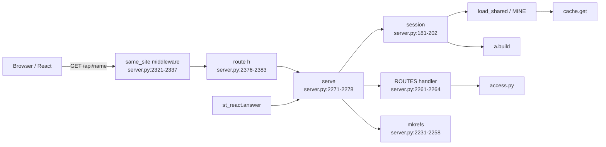
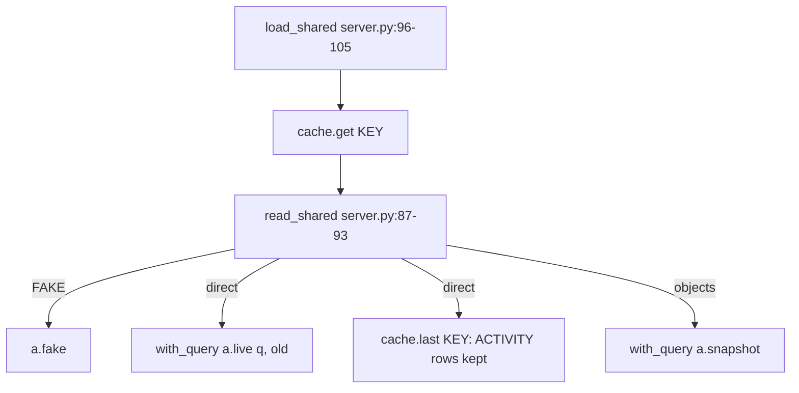

<!-- generated by darshan-singh-meel-knowledge-graph -->
# server.py

FastAPI JSON API over access.py, plus `serve()` / `serve_csv()` that st_react.py reuses; no logic of its own (server.py:1-4).

## Module state

- `MODE, SOURCE, WHERE = cache.config()` (server.py:21); `KEY` cache name (server.py:23); `DEMO_USER` (server.py:24).
- `PAGES` page key -> label (server.py:28-31); `GROUP` side-nav group (server.py:33-36); `SHARED_ONLY` = review, flow, changes (server.py:37).
- `LOCK` RLock: access.py keeps lookups in globals, build + answer under one lock (server.py:52); `LOAD` one Snowflake read at a time (server.py:53); `MINE` per-sid My access (server.py:54).
- `ApiError(status, detail, message)` (server.py:58).

## Endpoints

| Method | Path | Handler | path:line |
|---|---|---|---|
| GET | /api/meta | `meta` | server.py:2350-2352 -> server.py:2145-2179 |
| POST | /api/reload | `reload` (`what` = page / load / rebuild) | server.py:2354-2360 -> server.py:2200-2226 |
| POST | /api/mine/load | `load_mine`, sets `ae_sid` cookie (httponly, samesite strict, path /api) | server.py:2362-2370 -> server.py:152-178 |
| GET | /api/mine | `mine_state` | server.py:2372-2374 -> server.py:121-125 |
| GET | /api/home | `home_page` | server.py:1071-1092 |
| GET | /api/access | `access_page` | server.py:1002-1068 |
| GET | /api/user | `user_page` | server.py:877-948 |
| GET | /api/role | `role_page` | server.py:1131-1233 |
| GET | /api/object | `object_page` | server.py:1281-1359 |
| GET | /api/who | `who_page` | server.py:1362-1400 |
| GET | /api/check | `check_page` | server.py:1431-1531 |
| GET | /api/request | `request_page` | server.py:1534-1562 |
| GET | /api/map | `map_page` | server.py:1572-1613 |
| GET | /api/see | `see_page` | server.py:1629-1643 |
| GET | /api/usage | `usage_page` | server.py:1696-1710 |
| GET | /api/changes | `changes_page` | server.py:1713-1744 |
| GET | /api/activity | `activity_page` (`name` [+ `as`] / `user` / `role`) | server.py:1656-1693 |
| GET | /api/compare | `compare_page` | server.py:1759-1779 |
| GET | /api/sensitive | `sensitive_page` | server.py:1784-1851 |
| GET | /api/rules | `rules_page` | server.py:1876-1897 |
| GET | /api/whatif | `whatif_page` (-> `what_if` server.py:1921-1932) | server.py:1935-1938 |
| GET | /api/review | `review_page` | server.py:1974-2000 |
| GET | /api/grid | `grid_page` | server.py:2003-2021 |
| GET | /api/flow | `flow_page` | server.py:2024-2031 |
| GET | /api/find | `find_page` | server.py:2048-2059 |
| GET | /api/list | `list_page` (`q`, `limit`, `what`) | server.py:2072-2087 |
| GET | /api/graph | `graph_page` | server.py:2118-2131 |
| GET | /api/rules.csv | `rules_csv` | server.py:1900-1913 |
| GET | /api/review.csv | `review_csv` | server.py:2034-2043 |
| GET | /api/whatif.csv | `whatif_csv` | server.py:1941-1947 |
| GET | /{path:path} | `spa`: web/dist file, else index.html; unknown /api/ -> 404 JSON | server.py:2394-2404 |

- The 23 GET routes are registered in a loop (server.py:2381-2383); CSV routes from `CSV` (server.py:2268, server.py:2391-2392).
- `WITH_REFS` answers get `refs` (kinds, types, sensitive, disabled) from `mkrefs` (server.py:2266-2267, server.py:2276-2277).

### Handler -> access.py (from the graph fragment, verified by text match)

| Handler | access.py calls |
|---|---|
| home_page | access_objects, grants, ladder_counts, governance_kpis, row_tables |
| access_page | grants, access_objects, data_views, ladder_counts, reach, ups |
| check_page | can, cut_points, nearest, lanes, best_paths, data_view, approver |
| object_page | object_stats, admin_holders, matrix, grantees, object_graph, data_view |
| who_page | who_has, admin_access, column_view, same_paths; app_exposure for a Streamlit app (server.py:1394) |
| map_page | access_graph, builtin_info |
| compare_page | compare, sensitive_rank |
| grid_page / flow_page | review_grid / sens_flow |
| usage_page / changes_page | granted_used (its `sql`: the trim as What if writes it; `sql=""` when usage is off, server.py:1709) / diff, fake_previous |
| request_page | suggest, approver, need_privs; each suggestion and the asked role get `change` = `a.with_sql(grant ...)` (server.py:1556-1560), so the page shows the server's SQL |
| rules_page | uses `S["rows"]` = `a.rule_rows` set in `session` (server.py:200) |
| activity_page | kind -> app / scope / warehouse (warehouse_use); act_state, activity, activity_graph (-> used_path, object / user / role only), activity_sensitive, query_sql, app_use, mark_sensitive; rule >= 24 rows of `S["rows"]` on that name (server.py:1659-1693) |

## Data loading

- `load_shared(ask=True)` with SOURCE=direct and no copy ready -> 409 `shared_not_loaded`: direct reads only on a click (server.py:96-100).
- Direct mode reads the activity incrementally: `read_shared` passes the ACTIVITY rows of `cache.last(KEY)` to `a.live` (server.py:90-92; [flows/activity-read.md](../flows/activity-read.md)).
- `with_query` opens one connection, closes it only if `sf.owned()` (server.py:71-84).
- `session(view, sid, builtin)` builds the view's data under `LOCK`, fills `S` (sens, rows, breaks) (server.py:181-202).
- `reload` `rebuild` CALLs `SP_ACCESS_SNAPSHOT('AUTO')` (server.py:2208), the only non-read statement allowed (CLAUDE.md, test_read_only).

## Security checks

| Check | What | path:line |
|---|---|---|
| `allowed_hosts()` | loopback + HOST + `ALLOWED_HOSTS`; HOST=0.0.0.0 adds machine names and IPs | server.py:2289-2303 |
| `served(host)` | Host header must be served (`*` = any) | server.py:2316-2319 |
| `same_site` middleware | bad Host -> 400 `bad_host`; non-GET with foreign Origin, or `/api/` with `Sec-Fetch-Site` not same-origin/none -> 403 `cross_site` | server.py:2321-2337 |
| `mine_off()` | My access off inside Snowflake, `MY_ACCESS=0`, HOST not loopback or `ALLOWED_HOSTS` naming another host (server.py:143-144), key-pair login; `MY_ACCESS=1` forces on | server.py:131-149 |
| `csv_text()` | a cell starting with `= + - @` tab or CR (not a plain number) gets a leading `'`, so a CSV opened in Excel never runs an object name as a formula | server.py:284-292 |
| JSON errors | `ApiError` -> `{detail, message}` with its status; any other exception -> 500 `{detail: "error", message: "Type: text"}` | server.py:2339-2345 |

- Same error shape in Streamlit: `st_react.answer` (st_react.py:45-48); there a `.csv` name is served only when it is a key of `server.CSV`, else 404 (st_react.py:40-41).
- GZip for answers over 2000 bytes (server.py:2313).
- `__getattr__("app")` builds the app lazily for `uvicorn server:app` (server.py:2409-2414); `__main__` runs uvicorn on HOST / WEB_PORT (server.py:2417-2419).

## Activity (rules 24-28, rule 29, Activity tab)

| Item | What | path:line |
|---|---|---|
| `RULE_INFO` 24-29 | area "Activity" (24-28) or "Sensitive data" (29), plain-word text and fix hint per rule | server.py:357-371 |
| `SHORT` 24-29 | short rule labels (29: "app opens owner's data") | server.py:970-971 |
| `note_info("activity")` | health note: "No client in Activity" (SESSIONS not readable) or "No table activity" (ACCESS_HISTORY not readable) | server.py:403-406 |
| `MAX_ACTIVITY` | Activity rows sent (2000) | server.py:1653 |
| `work` | default business hours from `access.WORK_HOURS` | server.py:1674 |
| `activity_page` | GET /api/activity; flow in [flows/activity-tab.md](../flows/activity-tab.md) | server.py:1656-1693 |
