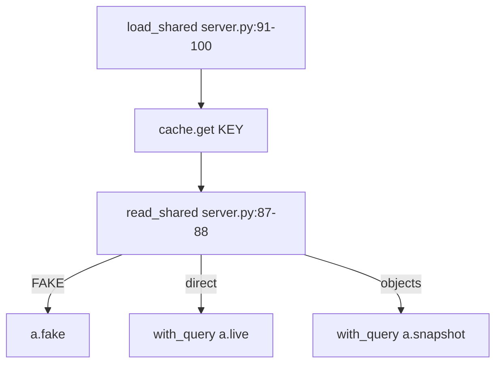

# server.py

FastAPI JSON API over access.py, plus `serve()` / `serve_csv()` that st_react.py reuses; no logic of its own (server.py:1-4).

## Module state

- `MODE, SOURCE, WHERE = cache.config()` (server.py:21); `KEY` cache name (server.py:23); `DEMO_USER` (server.py:24).
- `PAGES` page key -> label (server.py:28-31); `GROUP` side-nav group (server.py:33-36); `SHARED_ONLY` = review, flow, changes (server.py:37).
- `LOCK` RLock: access.py keeps lookups in globals, build + answer under one lock (server.py:52); `LOAD` one Snowflake read at a time (server.py:53); `MINE` per-sid My access (server.py:54).
- `ApiError(status, detail, message)` (server.py:58).

## Endpoints

| Method | Path | Handler | path:line |
|---|---|---|---|
| GET | /api/meta | `meta` | server.py:2282-2284 -> server.py:2078-2112 |
| POST | /api/reload | `reload` (`what` = page / load / rebuild) | server.py:2286-2292 -> server.py:2133-2159 |
| POST | /api/mine/load | `load_mine`, sets `ae_sid` cookie (httponly, samesite strict, path /api) | server.py:2294-2302 -> server.py:147-173 |
| GET | /api/mine | `mine_state` | server.py:2304-2306 -> server.py:116-120 |
| GET | /api/home | `home_page` | server.py:1048-1069 |
| GET | /api/access | `access_page` | server.py:979-1045 |
| GET | /api/user | `user_page` | server.py:855-926 |
| GET | /api/role | `role_page` | server.py:1108-1210 |
| GET | /api/object | `object_page` | server.py:1258-1336 |
| GET | /api/who | `who_page` | server.py:1339-1376 |
| GET | /api/check | `check_page` | server.py:1407-1507 |
| GET | /api/request | `request_page` | server.py:1510-1538 |
| GET | /api/map | `map_page` | server.py:1548-1589 |
| GET | /api/see | `see_page` | server.py:1605-1619 |
| GET | /api/usage | `usage_page` | server.py:1629-1643 |
| GET | /api/changes | `changes_page` | server.py:1646-1677 |
| GET | /api/compare | `compare_page` | server.py:1692-1712 |
| GET | /api/sensitive | `sensitive_page` | server.py:1717-1784 |
| GET | /api/rules | `rules_page` | server.py:1809-1830 |
| GET | /api/whatif | `whatif_page` (-> `what_if` server.py:1854-1865) | server.py:1868-1871 |
| GET | /api/review | `review_page` | server.py:1907-1933 |
| GET | /api/grid | `grid_page` | server.py:1936-1954 |
| GET | /api/flow | `flow_page` | server.py:1957-1964 |
| GET | /api/find | `find_page` | server.py:1981-1992 |
| GET | /api/list | `list_page` (`q`, `limit`, `what`) | server.py:2005-2020 |
| GET | /api/graph | `graph_page` | server.py:2051-2064 |
| GET | /api/rules.csv | `rules_csv` | server.py:1833-1846 |
| GET | /api/review.csv | `review_csv` | server.py:1967-1976 |
| GET | /api/whatif.csv | `whatif_csv` | server.py:1874-1880 |
| GET | /{path:path} | `spa`: web/dist file, else index.html; unknown /api/ -> 404 JSON | server.py:2326-2336 |

- The 22 GET routes are registered in a loop (server.py:2313-2315); CSV routes from `CSV` (server.py:2200, server.py:2323-2324).
- `WITH_REFS` answers get `refs` (kinds, types, sensitive, disabled) from `mkrefs` (server.py:2198, server.py:2208-2209).

### Handler -> access.py (from the graph fragment, verified by text match)

| Handler | access.py calls |
|---|---|
| home_page | access_objects, grants, ladder_counts, governance_kpis, row_tables |
| access_page | grants, access_objects, data_views, ladder_counts, reach, ups |
| check_page | can, cut_points, nearest, lanes, best_paths, data_view, approver |
| object_page | object_stats, admin_holders, matrix, grantees, object_graph, data_view |
| who_page | who_has, admin_access, column_view, same_paths |
| map_page | access_graph, builtin_info |
| compare_page | compare, sensitive_rank |
| grid_page / flow_page | review_grid / sens_flow |
| usage_page / changes_page | granted_used (its `sql`: the trim as What if writes it; `sql=""` when usage is off, server.py:1642) / diff, fake_previous |
| request_page | suggest, approver, need_privs; each suggestion and the asked role get `change` = `a.with_sql(grant ...)` (server.py:1532-1536), so the page shows the server's SQL |
| rules_page | uses `S["rows"]` = `a.rule_rows` set in `session` (server.py:195) |

## Data loading

- `load_shared(ask=True)` with SOURCE=direct and no copy ready -> 409 `shared_not_loaded`: direct reads only on a click (server.py:91-95).
- `with_query` opens one connection, closes it only if `sf.owned()` (server.py:71-84).
- `session(view, sid, builtin)` builds the view's data under `LOCK`, fills `S` (sens, rows, breaks) (server.py:176-197).
- `reload` `rebuild` CALLs `SP_ACCESS_SNAPSHOT('AUTO')` (server.py:2141), the only non-read statement allowed (CLAUDE.md, test_read_only).

## Security checks

| Check | What | path:line |
|---|---|---|
| `allowed_hosts()` | loopback + HOST + `ALLOWED_HOSTS`; HOST=0.0.0.0 adds machine names and IPs | server.py:2221-2235 |
| `served(host)` | Host header must be served (`*` = any) | server.py:2248-2251 |
| `same_site` middleware | bad Host -> 400 `bad_host`; non-GET with foreign Origin, or `/api/` with `Sec-Fetch-Site` not same-origin/none -> 403 `cross_site` | server.py:2253-2269 |
| `mine_off()` | My access off inside Snowflake, `MY_ACCESS=0`, HOST not loopback or `ALLOWED_HOSTS` naming another host (server.py:138-139), key-pair login; `MY_ACCESS=1` forces on | server.py:126-144 |
| `csv_text()` | a cell starting with `= + - @` tab or CR (not a plain number) gets a leading `'`, so a CSV opened in Excel never runs an object name as a formula | server.py:279-287 |
| JSON errors | `ApiError` -> `{detail, message}` with its status; any other exception -> 500 `{detail: "error", message: "Type: text"}` | server.py:2271-2277 |

- Same error shape in Streamlit: `st_react.answer` (st_react.py:45-48); there a `.csv` name is served only when it is a key of `server.CSV`, else 404 (st_react.py:40-41).
- GZip for answers over 2000 bytes (server.py:2245).
- `__getattr__("app")` builds the app lazily for `uvicorn server:app` (server.py:2341-2346); `__main__` runs uvicorn on HOST / WEB_PORT (server.py:2349-2351).
