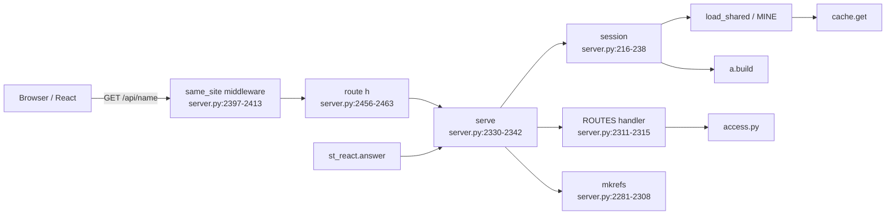
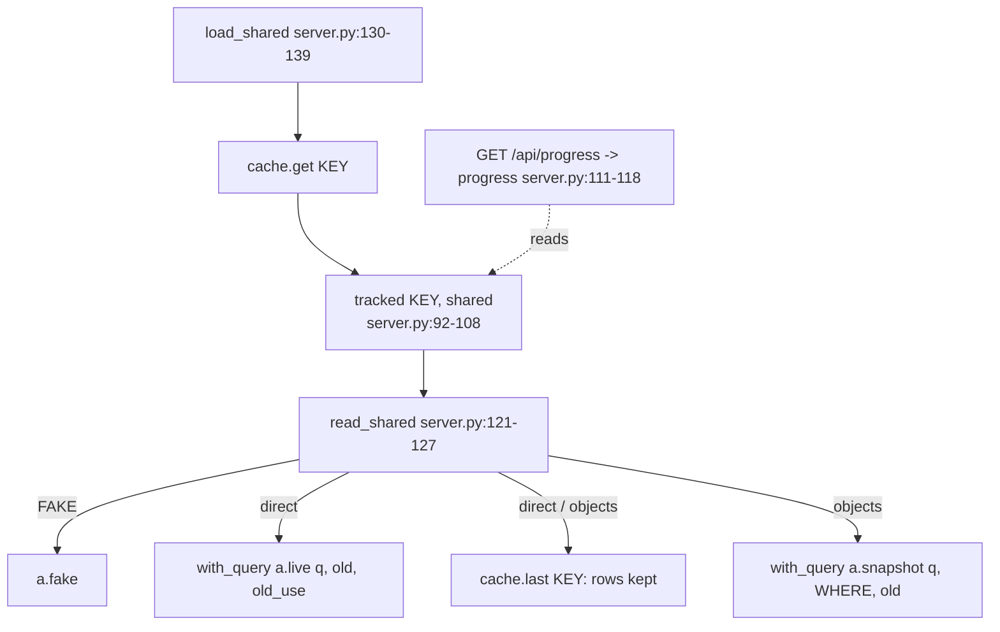

<!-- generated by darshan-singh-meel-knowledge-graph -->
# server.py

FastAPI JSON API over access.py, plus `serve()` / `serve_csv()` that st_react.py reuses; no logic of its own (server.py:1-4).

## Module state

- `MODE, SOURCE, WHERE = cache.config()` (server.py:21); `KEY` cache name (server.py:23); `DEMO_USER` (server.py:24).
- `PAGES` page key -> label (server.py:28-31); `GROUP` side-nav group (server.py:33-36); `SHARED_ONLY` = review, flow, changes (server.py:37).
- `LOCK` RLock: access.py keeps lookups in globals, build + answer under one lock (server.py:52); `ANSWERS`: `serve()` keeps each answer per (data set `data_key`, endpoint, params), up to `MAX_ANSWERS` (200, oldest out), so a repeat skips the lock (server.py:59-60, server.py:2321-2347); `LOAD` one Snowflake read at a time (server.py:53); `MINE` per-sid My access (server.py:54).
- `PROGRESS` cache key -> its last Snowflake read (view, running, start, lines), `PLOCK`, `MAX_LINES` 200 (server.py:56-58); `LOAD` one Snowflake read at a time (server.py:53).
- `ApiError(status, detail, message)` (server.py:63).

## Endpoints

| Method | Path | Handler | path:line |
|---|---|---|---|
| GET | /api/meta | `meta` | server.py:2426-2428 -> server.py:2193-2227 |
| POST | /api/reload | `reload` (`what` = page / load / rebuild), in a thread pool | server.py:2434-2436 -> server.py:2248-2276 |
| GET | /api/progress | `progress` (`view=` optional): lines of the read running now | server.py:2438-2440 -> server.py:111-118 |
| POST | /api/mine/load | `load_mine`, sets `ae_sid` cookie (httponly, samesite strict, path /api) | server.py:2442-2450 -> server.py:186-213 |
| GET | /api/mine | `mine_state` | server.py:2452-2454 -> server.py:155-159 |
| GET | /api/home | `home_page` | server.py:1111-1133 |
| GET | /api/access | `access_page` | server.py:1042-1108 |
| GET | /api/user | `user_page` | server.py:917-988 |
| GET | /api/role | `role_page` | server.py:1172-1274 |
| GET | /api/object | `object_page` | server.py:1322-1400 |
| GET | /api/who | `who_page` | server.py:1403-1441 |
| GET | /api/check | `check_page` | server.py:1472-1572 |
| GET | /api/request | `request_page` | server.py:1575-1603 |
| GET | /api/map | `map_page` | server.py:1613-1654 |
| GET | /api/see | `see_page` | server.py:1670-1684 |
| GET | /api/usage | `usage_page` | server.py:1743-1757 |
| GET | /api/changes | `changes_page` | server.py:1760-1791 |
| GET | /api/activity | `activity_page` (`name` [+ `as`] / `user` / `role`) | server.py:1697-1735 |
| GET | /api/sql | `sql_page` (`page` + that page's own params: `user` / `a`, `role`, `name` / `obj` / `table`, `show`) | server.py:1738-1740 |
| GET | /api/compare | `compare_page` | server.py:1806-1826 |
| GET | /api/sensitive | `sensitive_page` | server.py:1831-1898 |
| GET | /api/rules | `rules_page` | server.py:1923-1945 |
| GET | /api/whatif | `whatif_page` (-> `what_if` server.py:1969-1980) | server.py:1983-1986 |
| GET | /api/review | `review_page` | server.py:2022-2048 |
| GET | /api/grid | `grid_page` | server.py:2051-2069 |
| GET | /api/flow | `flow_page` | server.py:2072-2079 |
| GET | /api/find | `find_page` | server.py:2096-2107 |
| GET | /api/list | `list_page` (`q`, `limit`, `what`) | server.py:2120-2135 |
| GET | /api/graph | `graph_page` | server.py:2166-2179 |
| GET | /api/rules.csv | `rules_csv` | server.py:1948-1961 |
| GET | /api/review.csv | `review_csv` | server.py:2082-2091 |
| GET | /api/whatif.csv | `whatif_csv` | server.py:1989-1995 |
| GET | /{path:path} | `spa`: web/dist file, else index.html; unknown /api/ -> 404 JSON | server.py:2474-2484 |

- The 23 GET routes are registered in a loop (server.py:2461-2463); CSV routes from `CSV` (server.py:2318, server.py:2471-2472).
- CSV export setting: `csv_on()` reads env `CSV` (unset = on, `0` = off) (server.py:2350-2351); `serve_csv` raises `ApiError(403, "csv_off")` before any session work when it is off (server.py:2354-2359). Both versions go through it: the FastAPI `*.csv` routes (server.py:2465-2469) and `st_react.answer` (st_react.py:44). `meta()` sends `csv` so the React app hides every CSV button (server.py:2197).
- `WITH_REFS` answers get `refs` (kinds, types, sensitive, disabled) from `mkrefs` (server.py:2316-2317, server.py:2340-2341).

### Handler -> access.py (from the graph fragment, verified by text match)

| Handler | access.py calls |
|---|---|
| home_page | access_objects, grants, ladder_counts, governance_kpis, row_tables |
| access_page | grants, access_objects, data_views, ladder_counts, reach, ups |
| check_page | can, cut_points, nearest, lanes, best_paths, data_view, approver |
| object_page | object_stats, admin_holders, matrix, grantees, object_graph, data_view |
| who_page | who_has, admin_access, column_view, same_paths; app_exposure for a Streamlit app (server.py:1435) |
| map_page | access_graph, builtin_info |
| compare_page | compare, sensitive_rank |
| grid_page / flow_page | review_grid / sens_flow |
| usage_page / changes_page | granted_used (its `sql`: the trim as What if writes it; `sql=""` when usage is off, server.py:1756) / diff, fake_previous |
| request_page | suggest, approver, need_privs; each suggestion and the asked role get `change` = `a.with_sql(grant ...)` (server.py:1597-1601), so the page shows the server's SQL |
| rules_page | uses `S["rows"]` = `a.rule_rows` set in `session` (server.py:235) |
| activity_page | kind -> app / scope / warehouse (warehouse_use); act_state, activity, activity_graph (-> used_path, object / user / role only), activity_sensitive, query_sql, activity_section_sql per section (server.py:1728), app_use, mark_sensitive; rule >= 24 rows of `S["rows"]` on that name (server.py:1700-1735) |
| sql_page | page_sql (-> query_file, plain, activity_section_sql, query_sql) (server.py:1738-1740) |

## Data loading

- `load_shared(ask=True)` with SOURCE=direct and no copy ready -> 409 `shared_not_loaded`: direct reads only on a click (server.py:130-134).
- Direct mode reads activity and object use incrementally: `read_shared` passes the ACTIVITY and OBJECT_USE rows of `cache.last(KEY)` to `a.live` (server.py:124-126; [flows/activity-read.md](../flows/activity-read.md)); objects mode passes `old=cache.last(KEY)`, so the run held costs one query (server.py:127).
- Loads run inside `tracked(key, view, fn)`: `a.progress` lines kept for `GET /api/progress` (`progress(view)`, never starts a load); `POST /api/reload` runs in a thread pool so the poll answers meanwhile (server.py:92-118, server.py:2436-2440; [flows/load-progress.md](../flows/load-progress.md)).
- `HIERARCHY=0`: `session()` skips rule 17's read-only writes for What-if breaks (server.py:236); `rules_page` / `home_page` send `skipped` (server.py:1929-1940, server.py:1128); `note_info` explains a `SKIPPED` source (ACTIVITY=0, server.py:415-418).
- `with_query` opens one connection, closes it only if `sf.owned()` (server.py:76-89).
- `session(view, sid, builtin)` builds the view's data under `LOCK`, fills `S` (sens, rows, breaks) (server.py:216-238).
- `reload` `rebuild` CALLs `SP_ACCESS_SNAPSHOT('AUTO')` under `tracked()` (server.py:2256-2258), the only non-read statement allowed (CLAUDE.md, test_read_only); the CALL carries no STATEMENT_TIMEOUT (`sf.limit`), its timeout answers 503 with the warehouse / account limit message (test_switches).

## Security checks

| Check | What | path:line |
|---|---|---|
| `allowed_hosts()` | loopback + HOST + `ALLOWED_HOSTS`; HOST=0.0.0.0 adds machine names and IPs | server.py:2364-2378 |
| `served(host)` | Host header must be served (`*` = any) | server.py:2392-2395 |
| `same_site` middleware | bad Host -> 400 `bad_host`; non-GET with foreign Origin, or `/api/` with `Sec-Fetch-Site` not same-origin/none -> 403 `cross_site` | server.py:2397-2413 |
| `mine_off()` | My access off inside Snowflake, `MY_ACCESS=0`, HOST not loopback or `ALLOWED_HOSTS` naming another host (server.py:177-178), key-pair login; `MY_ACCESS=1` forces on | server.py:165-183 |
| `csv_text()` | a cell starting with `= + - @` tab or CR (not a plain number) gets a leading `'`, so a CSV opened in Excel never runs an object name as a formula | server.py:320-328 |
| `csv_on()` / `serve_csv` | `CSV=0`: every server CSV download answers 403 `csv_off`, in both versions; the app hides its CSV buttons from `meta.csv`. Whoever can open the app still sees the screen, so app access stays the real control (README.md:219) | server.py:2350-2359 |
| JSON errors | `ApiError` -> `{detail, message}` with its status; any other exception -> 500 `{detail: "error", message: "Type: text"}` | server.py:2415-2421 |

- Same error shape in Streamlit: `st_react.answer` (st_react.py:48-51); there a `.csv` name is served only when it is a key of `server.CSV`, else 404 (st_react.py:43-44).
- GZip for answers over 2000 bytes (server.py:2389).
- `__getattr__("app")` builds the app lazily for `uvicorn server:app` (server.py:2489-2494); `__main__` runs uvicorn on HOST / WEB_PORT (server.py:2497-2499).

## Activity (rules 24-28, rule 29, Activity tab)

| Item | What | path:line |
|---|---|---|
| `RULE_INFO` 24-29 | area "Activity" (24-28) or "Sensitive data" (29), plain-word text and fix hint per rule | server.py:393-407 |
| `SHORT` 24-29 | short rule labels (29: "app opens owner's data") | server.py:1010-1011 |
| `note_info("activity")` | health note: "No client in Activity" (SESSIONS not readable) or "No table activity" (ACCESS_HISTORY not readable) | server.py:443-446 |
| `MAX_ACTIVITY` | Activity rows sent (2000) | server.py:1694 |
| `work` | default business hours from `access.WORK_HOURS` | server.py:1715 |
| `activity_page` | GET /api/activity; flow in [flows/activity-tab.md](../flows/activity-tab.md) | server.py:1697-1735 |
| `section_sql` | per Activity section key of `a.ACT_SECTIONS`, the SQL of `a.activity_section_sql(name, what, first, last, key)` | server.py:1728 |
| `sql_page` | GET /api/sql: `{page, queries}` from `a.page_sql(page, p)`, empty entries dropped; not in WITH_REFS; flow in [flows/show-sql.md](../flows/show-sql.md) | server.py:1738-1740, server.py:2315 |
