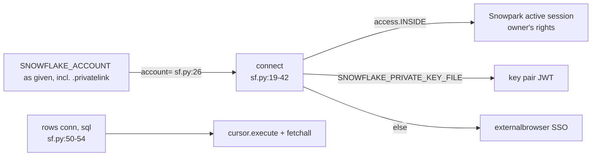

<!-- generated by darshan-singh-meel-knowledge-graph -->
# sf.py

Snowflake connection and the single read path `rows()`; also a CLI to run plain SQL (sf.py:1-12).

| Name | Does | path:line |
|---|---|---|
| `connect()` | App session inside Snowflake; else needs SNOWFLAKE_ACCOUNT; key pair or SSO, no password; sets `QUERY_TAG = access.QUERY_TAG` ('access-explorer') so the Activity read leaves the app's own queries out (sf.py:34) | sf.py:19-42 |
| `owned()` | True outside Snowflake: the caller may close the connection | sf.py:45-47 |
| `rows(conn, sql)` | `(column names, rows)`; every app read goes through here | sf.py:50-54 |
| `run(sql, conn)` | One statement, closing an own connection | sf.py:57-64 |
| `__main__` | `python sf.py "select ..."` or `-f file.sql` | sf.py:67-72 |

- Env vars: SNOWFLAKE_ACCOUNT / USER / ROLE / WAREHOUSE / DATABASE / SCHEMA (sf.py:27-35), SNOWFLAKE_PRIVATE_KEY_FILE / _PWD (sf.py:36-39).
- The query tag is set only on connections this file opens; inside Snowflake the app's active session is returned as it is (sf.py:20-22). Filter: `access.py:971`, `sql/1_setup.sql:566`.
- `account=` is `SNOWFLAKE_ACCOUNT` as given (sf.py:26); there is no PrivateLink code. PrivateLink works by the value `<org>-<account>.privatelink` plus private DNS for the account and OCSP hosts; key pair works as is, browser SSO needs the SAML integration on the PrivateLink URLs (`SAML2_SNOWFLAKE_ACS_URL`, `SAML2_SNOWFLAKE_ISSUER_URL`); inside Snowflake the app session needs none of it — README.md:181-196, README.html:645, processes/privatelink-login.md.
- SSO uses the token cache (`client_store_temporary_credential`) (sf.py:40-41).
- `test_read_only` records statements at this layer (test_server.py:328-375).
- Used by: server.with_query (server.py:75-79), run_sql.py (run_sql.py:14).
