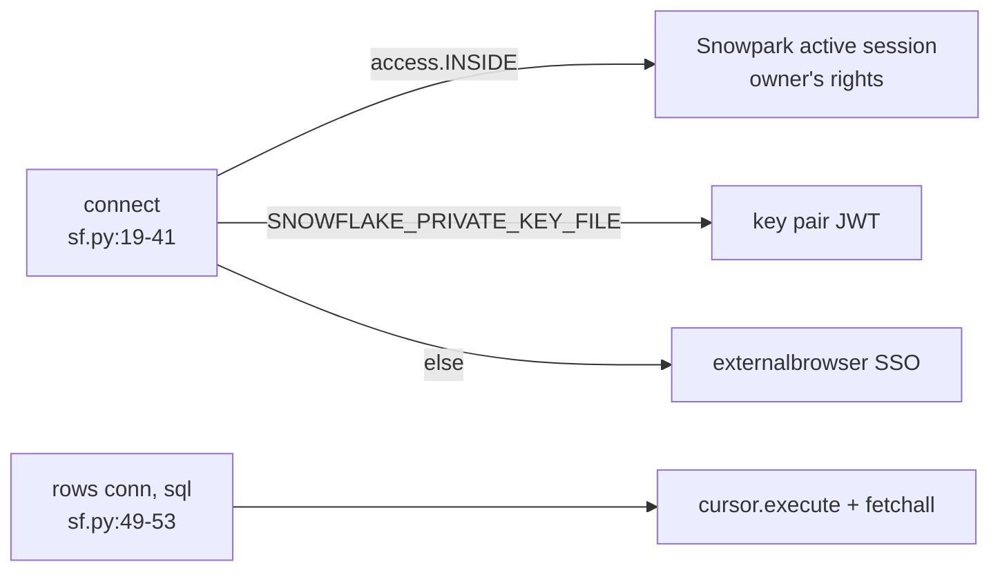

# sf.py

Snowflake connection and the single read path `rows()`; also a CLI to run plain SQL (sf.py:1-12).

| Name | Does | path:line |
|---|---|---|
| `connect()` | App session inside Snowflake; else needs SNOWFLAKE_ACCOUNT; key pair or SSO, no password | sf.py:19-41 |
| `owned()` | True outside Snowflake: the caller may close the connection | sf.py:44-46 |
| `rows(conn, sql)` | `(column names, rows)`; every app read goes through here | sf.py:49-53 |
| `run(sql, conn)` | One statement, closing an own connection | sf.py:56-63 |
| `__main__` | `python sf.py "select ..."` or `-f file.sql` | sf.py:66-71 |

- Env vars: SNOWFLAKE_ACCOUNT / USER / ROLE / WAREHOUSE / DATABASE / SCHEMA (sf.py:27-34), SNOWFLAKE_PRIVATE_KEY_FILE / _PWD (sf.py:35-38).
- SSO uses the token cache (`client_store_temporary_credential`) (sf.py:39-40).
- `test_read_only` records statements at this layer (test_server.py:322-344).
- Used by: server.with_query (server.py:73-77), run_sql.py (run_sql.py:14).
