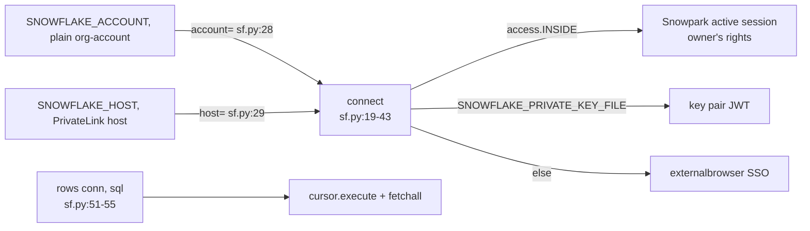

<!-- generated by darshan-singh-meel-knowledge-graph -->
# sf.py

Snowflake connection and the single read path `rows()`; also a CLI to run plain SQL (sf.py:1-12).

| Name | Does | path:line |
|---|---|---|
| `connect()` | App session inside Snowflake; else needs SNOWFLAKE_ACCOUNT, optional SNOWFLAKE_HOST (PrivateLink); key pair or SSO, no password; sets `QUERY_TAG = access.QUERY_TAG` (env `QUERY_TAG`, default 'access-explorer', access.py:64) so the Activity read leaves the app's own queries out (sf.py:35) | sf.py:19-43 |
| `owned()` | True outside Snowflake: the caller may close the connection | sf.py:46-48 |
| `rows(conn, sql)` | `(column names, rows)`; every app read goes through here | sf.py:51-55 |
| `run(sql, conn)` | One statement, closing an own connection | sf.py:58-65 |
| `__main__` | `python sf.py "select ..."` or `-f file.sql` | sf.py:68-73 |

- Env vars: SNOWFLAKE_ACCOUNT / HOST / USER / ROLE / WAREHOUSE / DATABASE / SCHEMA (sf.py:27-36); unset ones are dropped before the connect call (sf.py:43), SNOWFLAKE_PRIVATE_KEY_FILE / _PWD (sf.py:37-40).
- The query tag is set only on connections this file opens; inside Snowflake the app's active session is returned as it is (sf.py:20-22). Filter: `access.py:972`, `sql/1_setup.sql:567`.
- PrivateLink: `account=` stays the plain `SNOWFLAKE_ACCOUNT` (`<org>-<account>`, sf.py:28) and `host=` is `SNOWFLAKE_HOST` (`<org>-<account>.privatelink` + Snowflake domain, sf.py:29), plus private DNS for that host and the OCSP host; without `SNOWFLAKE_HOST` the connector uses the public host; key pair works as is, browser SSO needs the SAML integration on the PrivateLink URLs (`SAML2_SNOWFLAKE_ACS_URL`, `SAML2_SNOWFLAKE_ISSUER_URL`); inside Snowflake the app session needs none of it — README.md:181-196, README.md:208, README.html:645, processes/privatelink-login.md.
- SSO uses the token cache (`client_store_temporary_credential`) (sf.py:41-42).
- `test_read_only` records statements at this layer (test_server.py:328-375).
- Used by: server.with_query (server.py:75-79), run_sql.py (run_sql.py:14).
