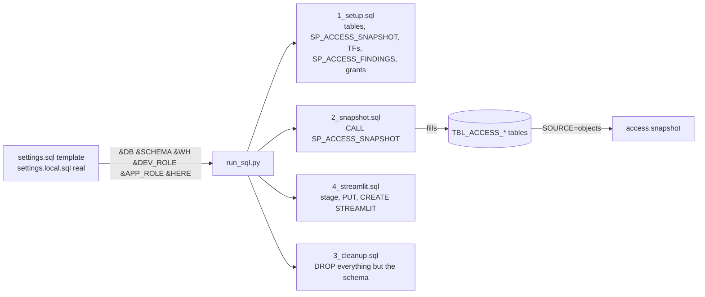
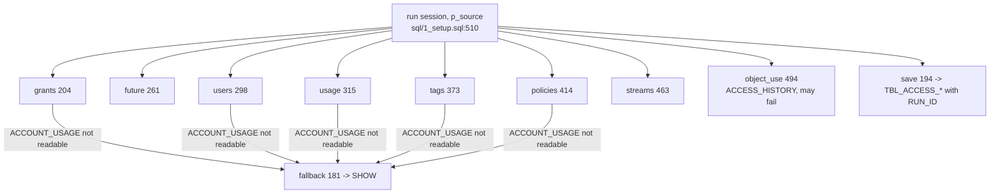

# sql/

Snowflake side: numbered `sql/<n>_<step>.sql` files of `-- name:` statements plus a `_verify.sql` each, with names as `&NAME` from settings.local.sql (template settings.sql), run by run_sql.py or SnowSQL `!source`.

## settings.sql (&NAME)

| Name | Meaning | path:line |
|---|---|---|
| `DB`, `SCHEMA` | Location of snapshot tables and procedure | settings.sql:4-6 |
| `WH` | Warehouse for procedure and app | settings.sql:7-8 |
| `DEV_ROLE` | Creates / owns tables and procedure; procedure reads with its rights | settings.sql:9-10 |
| `APP_ROLE` | SELECT on the snapshot tables only | settings.sql:11-12 |
| `HERE` | Repo path for PUT (SnowSQL only; run_sql.py fills it, run_sql.py:19) | settings.sql:13-14 |

- `run_sql.py` reads `!define` lines (run_sql.py:18) and refuses unfilled `<...>` values (run_sql.py:22-27).

## sql/1_setup.sql

- Header: 9 snapshot tables (+ findings table), procedures, table functions, app-role read access; safe to rerun (sql/1_setup.sql:1-4).
- Preamble: `USE ROLE &DEV_ROLE`, `USE SECONDARY ROLES NONE`, warehouse, database (sql/1_setup.sql:7-10).

| Statement | Creates | Line |
|---|---|---|
| TABLE_RUN ... TABLE_OBJECT_USE | `TBL_ACCESS_RUN`, `_GRANT`, `_USER_ROLE`, `_USER`, `_USAGE`, `_TAG`, `_POLICY`, `_STREAM`, `_OBJECT_USE` | sql/1_setup.sql:12, 23, 35, 43, 56, 66, 77, 89, 97 |
| TABLE_FINDING | findings table for SP_ACCESS_FINDINGS | sql/1_setup.sql:108 |
| PROCEDURE | `SP_ACCESS_SNAPSHOT(P_SOURCE DEFAULT 'AUTO')`, Python 3.11, EXECUTE AS OWNER | sql/1_setup.sql:121-561 |
| FUNCTION_ACCESS_OF (may fail) | `TF_ACCESS_OF(NAME, MAX_DEPTH)` | sql/1_setup.sql:577-636 |
| FUNCTION_WHO_CAN (may fail) | `TF_WHO_CAN(OBJECT_NAME, PRIVILEGE, MAX_DEPTH)` | sql/1_setup.sql:638-679 |
| FUNCTION_CAN (may fail) | `TF_CAN(USER_NAME, PRIVILEGE, OBJECT_NAME)` | sql/1_setup.sql:681-693 |
| STAGE_CODE, PUT_CODE | code stage + PUT access.py | sql/1_setup.sql:696, 680 |
| PROCEDURE_FINDINGS | `SP_ACCESS_FINDINGS(P_SETTINGS)` runs access.py | sql/1_setup.sql:703-765 |
| GRANT_*_APP (may fail) | USAGE on db / schema / warehouse, SELECT on each table, USAGE on TFs and procedure to `&APP_ROLE` | sql/1_setup.sql:768-818 |

### SP_ACCESS_SNAPSHOT internals

- Rows carry `RUN_ID`; the app reads only the last OK run (sql/1_setup.sql:133, access.py:403-406).
- `grants()` SHOW path: per role both `SHOW GRANTS TO ROLE` and `SHOW GRANTS OF ROLE` are read before either is kept, so a role refused half-way is skipped whole (listed in NOTES), never kept without its holders (sql/1_setup.sql:226-235).
- `future()` SHOW path: each place (database or schema) is tried on its own; a refused place skips only itself, one note per database, as `access.live` does (sql/1_setup.sql:279-293).
- `usage()`: the ACCOUNT_USAGE `QUERY_HISTORY` insert is extra; when it fails its rows are deleted and the dataset is `UNAVAILABLE` with the reason, the run stays OK (sql/1_setup.sql:334-341); test `test_usage_extra` (test_sql.py:409).
- `run()`: busy guard after the insert (earliest RUNNING run of the last hour goes on, others SKIPPED, sql/1_setup.sql:515-523); an OK run keeps the rows of a run RUNNING for under a day (sql/1_setup.sql:554-559). `test_run_overlap` (test_sql.py:367).
- `SP_ACCESS_FINDINGS` keeps only the last run: `DELETE FROM` the findings table inside the transaction (sql/1_setup.sql:752).
- Helpers: `rows` 156, `ident` 161, `clean` 165, `count` 200, `data_objects` 349, `use_sql` 477 (all sql/1_setup.sql).

## sql/2_snapshot.sql

- `SNAPSHOT`: `CALL &DB.&SCHEMA.SP_ACCESS_SNAPSHOT('AUTO')` (sql/2_snapshot.sql:11-12). P_SOURCE AUTO / ACCOUNT_USAGE / SHOW (sql/2_snapshot.sql:2-3).
- The app's "rebuild" sends the same CALL (server.py:2141).

## sql/3_cleanup.sql

- All `(may fail)`: DROP_STREAMLIT, DROP_STAGE_APP, DROP_TASK, DROP_PROCEDURE, DROP_PROCEDURE_FINDINGS, DROP_FUNCTION_CAN / WHO_CAN / ACCESS_OF, DROP_STAGE_CODE, DROP_TABLE_* (10; header comment says 10 TBL_ACCESS_ tables, sql/3_cleanup.sql:1) (sql/3_cleanup.sql:11-65). Schema stays (sql/3_cleanup.sql:2).

## sql/4_streamlit.sql

| Statement | Does | Line |
|---|---|---|
| STAGE_APP | app stage | sql/4_streamlit.sql:19 |
| PUT_APP, PUT_ACCESS, PUT_CACHE, PUT_SERVER, PUT_SF, PUT_ST_REACT, PUT_UI | Python files | sql/4_streamlit.sql:22-40 |
| PUT_ENVIRONMENT | environment.yml (sql/4_streamlit.sql:46) | sql/4_streamlit.sql:45 |
| PUT_WEB_INDEX, CLEAR_WEB_ASSETS (may fail), PUT_WEB_ASSETS | web/dist-st | sql/4_streamlit.sql:48-55 |
| PUT_SETTINGS | sis/.env as the app's .env (sql/4_streamlit.sql:59) | sql/4_streamlit.sql:58 |
| STREAMLIT | `CREATE OR REPLACE STREAMLIT ST_ACCESS_EXPLORER`, `MAIN_FILE = 'app.py'` | sql/4_streamlit.sql:61-67 |
| GRANT_DATABASE / SCHEMA / WAREHOUSE_APP (may fail), GRANT_STREAMLIT | app role access | sql/4_streamlit.sql:70-79 |

- Two options: SOURCE=objects (needs 1 and 2 first) or SOURCE=direct (owner role reads ACCOUNT_USAGE live) (sql/4_streamlit.sql:2-7).

## Verify files

| File | Checks | Lines |
|---|---|---|
| sql/1_setup_verify.sql | TABLES (expect 10), PROCEDURE, PROCEDURE_FINDINGS, FUNCTION_*, STAGE_CODE (expect 1), CALL_* smoke calls, ACCOUNT_USAGE_* readable (may fail), SHOW_STREAMS, DEV_ROLE_GRANTS | sql/1_setup_verify.sql:4-64 |
| sql/2_snapshot_verify.sql | LAST_RUN_OK (expect 1), ONE_RUN_IN_DATA (expect 1), counts by type / kind / domain, OBJECT_USE (may fail) | sql/2_snapshot_verify.sql:4-34 |
| sql/3_cleanup_verify.sql | Every object gone (expect 0) | sql/3_cleanup_verify.sql:3-24 |
| sql/4_streamlit_verify.sql | STREAMLIT (expect 1), STAGE_FILES, WEB_ASSETS (expect 4), GRANT_STREAMLIT | sql/4_streamlit_verify.sql:3-14 |

- Parity: `test_sql.py` runs the TF bodies read from sql/1_setup.sql on DuckDB against access.py (test_sql.py:1-2).
