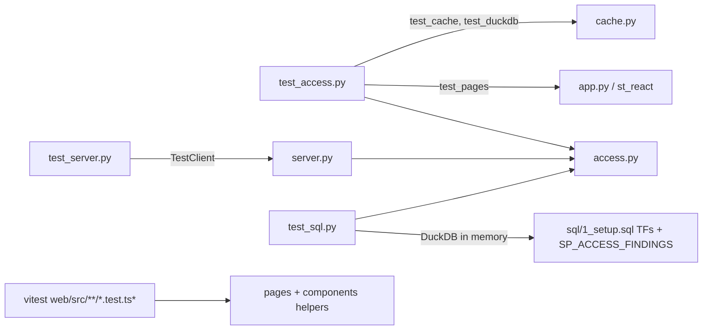

<!-- generated by darshan-singh-meel-knowledge-graph -->
# Tests

Three plain-Python test files (no pytest) on the fake data, plus vitest for web/src; packages in requirements-dev.txt.

## How to run

| Command | What | path:line |
|---|---|---|
| `python test_access.py` | Every `test_` function, `test_cache` first, `a.build(a.fake())` before each, all failures reported, then reruns itself with `ROLE_PREFIXES=ZF_,ZT_` (skips test_perf, test_pages, test_live there) | test_access.py:2499-2518 |
| `python test_server.py` | Every `test_` in file order; FAKE=1 set at import; TestClient on `server.make_app()` | test_server.py:10-17, test_server.py:1948-1954 |
| `python test_sql.py` | 16 tests in a fixed list | test_sql.py:831-835 |
| `npm test` (in web/) | `vitest run` | web/package.json:11 |
| Rule check | `python -c "import access as a; a.build(a.fake()); print(sorted({c[0] for c in a.checks()}, key=int))"` lists 1-29 | CLAUDE.md "Verify before saying done" |

- Test packages: requirements.txt + requirements-web.txt (duckdb for test_sql) + httpx for TestClient (requirements-dev.txt:1-4).
- `PERF=0` / `PERF_SCALE` control test_perf (CLAUDE.md; budgets docstring test_access.py:1562).

## test_access.py groups

| Group | Tests | Lines |
|---|---|---|
| Walks and depth | test_user, test_depth_limit, test_can, test_role, test_object, test_depth, test_classes, test_cycle, test_namespaces | test_access.py:30, 45, 64, 98, 114, 140, 160, 1139, 1733 |
| Admin paths / BFS starts | test_admin_paths (a cap per admin role: ACCOUNTADMIN not hidden behind SYSADMIN paths), test_shortest_default (a default role's longer start joins at its own hop) | test_access.py:1387, 1397 |
| SQL text | test_with_sql (Compare / Request / Granted vs used SQL and role kinds come from access.py) | test_access.py:2413 |
| Sensitive data | test_sensitive, test_data_view, test_has_lacks | test_access.py:189, 1683, 1671 |
| Users / rules | test_users, test_rule18_stable, test_rules, test_fixes_clear, test_readonly, test_public, test_new_rules, test_review_logic, test_kinds | test_access.py:240, 260, 268, 314, 327, 1175, 1208, 1146, 1131 |
| Loaders / Snowflake fakes | test_demo_db, test_each, test_live, test_live_inside, test_db_roles, test_setup_errors | test_access.py:348, 517, 614, 709, 868, 1097 |
| Cache | test_cache, test_duckdb | test_access.py:1839, 794 |
| Streamlit | test_pages (every `server.PAGES` key through app.py), test_sis_upload (4_streamlit.sql uploads every import, plus environment.yml, sis/.env, web/dist-st and `access_queries/*.sql` for the SQL panel, test_access.py:1089) | test_access.py:1038, 1071 |
| Fast / counted walks, perf | test_cap, test_fast, test_counted, test_built, test_builtin, test_perf (on `big()` test_access.py:1509) | test_access.py:1197, 1249, 1306, 1369, 1406, 1562 |
| What if | test_whatif_indirect, test_whatif | test_access.py:1433, 1453 |
| Graph inputs | test_group_graph, test_graph_inputs, test_summary | test_access.py:1624, 1805, 1824 |
| Screens | test_ladder, test_who_has, test_nearest, test_graph_see_compare, test_plan, test_review_catalog_flow, test_usage_changes, test_review_fixes | test_access.py:1907, 1953, 1999, 2057, 2110, 2131, 2184, 2374 |
| Activity | test_activity: Activity tab numbers, rules 24-28 (one finding each), UTC hours and weekend add up (test_access.py:2305-2308), activity_sql UTC / HOURS / StreamlitName (test_access.py:2317-2318), scope view and query_sql (test_access.py:2319-2321), warehouse_use (test_access.py:2335-2336), grant path behind a use, sensitive view, tag text, app_exposure and rule 29 with its What-if fix (test_access.py:2351-2359), owner role -> no rule 24, no ACTIVITY -> not available, incremental window (`activity_start`) | test_access.py:2293 |
| Settings switches | test_switches: `HIERARCHY=0` skips `a.WALKS` (listed by `skipped_rules`, rule 6 still runs, no "who loses access", pages still walk); `ACTIVITY=0` reads no OBJECT_USE / ACTIVITY table (objects) and probes no ACCESS_HISTORY / SESSIONS (direct), sources SKIPPED, rules 24-28 skipped, cache key `_noactivity`; defaults skip nothing | test_access.py:528 |
| Timeouts | test_timeout: `sf.rows` sends `STATEMENT_TIMEOUT_IN_SECONDS` and a timeout says the step and the doubled setting in minutes; the CALL goes without the limit and its timeout names the warehouse / account limit; `timeout_hint` for 120 s, 90 s and no number | test_access.py:575 |
| Progress lines | test_progress: `live()` gives the same data with and without `a.progress`, a `SHOW GRANTS TO / OF ROLE: n of m` line, `done in`; `snapshot()` with `WORKERS=3` names `[wN] TBL_ACCESS_GRANT: rows in s`; a timeout in a wave gets its own line with the longer setting; `each()` outside `progress()` reports nothing | test_access.py:2452 |
| Missing data | test_missing_names (a grant / user-role row without a name left out with a `missing_names` note; the `_tidy` marker makes a second tidy() skip the scan), test_empty_reads (unreadable or odd data: empty plus a note, never a crash, a no-run read never kept on disk), test_none_fuzz (`none_variants`: missing, NULL or empty in every table and column, never an exception; a failed build never counts as built) | test_access.py:913, 928, 1012 |
| What changed kept | test_diff_kept: the diff made at refresh time from the replaced data set still kept built equals `a.diff` | test_access.py:2273 |
| DuckDB walk | test_duck_reach: `duck()` / `lose_all` / `read_shares` answer who loses access and the rule 17 / 23 pre-filter exactly as the Python walk, on the fake data and `big()`; a role loop falls back to Python | test_access.py:1277 |
| Object inventory and type spelling | test_type_spelling (EXTERNAL_TABLE and EXTERNAL TABLE are one kind, DATABASE_ROLE keeps `_`; `access.spell`), test_inventory (Direct mode: ungranted Streamlit apps and notebooks become one OWNERSHIP row of their owner, unowned objects kept with no holder, the note lists only failures) | test_access.py:747, 762 |
| Blocked and admin links | test_blocked (a grant without USAGE on the schema / database is blocked, with the IaC text and GRANT to unblock; `can`, `gap_text`, `containers`, `who_has`), test_admin_real_links (admin roles reach only their real links; a SECURITYADMIN-only user is an admin holder but reads nothing) | test_access.py:1924, 1975 |
| Object activity | test_object_activity: `object_activity()` age buckets, read / write patterns per window (90 days: 5 read only, 1 write only, 1 both, 29 none), `nodata` for procedures, functions and tasks and without ACCESS_HISTORY, warehouses from QUERY_HISTORY, window edges by day | test_access.py:2226 |
| DESCRIBE is a look | test_describe_not_ddl: an ACCESS_HISTORY DDL row from a DESCRIBE becomes READ, no rule 24 finding; `ACT_BASE` has `LIKE 'DESCRIBE%'` | test_access.py:2431 |
| Synthetic twin | test_twin: `twin.twin(0.02)` is the same every run, has a finding for each rule 1-29, users / roles / objects within 30% of the profile times the scale | test_access.py:2486 |
| Docs | test_readme_rules (docs/make_readme.py rule table) | test_access.py:2400 |
| Settings | test_tag_settings: env `QUERY_TAG=it's`, `STREAMLIT_APP=ST_OTHER` in a child process -> `a.QUERY_TAG` / `a.APP_ST` take them, activity_sql has `<> 'it''s'` and `NOT LIKE '%.ST_OTHER%'` (a quote cannot end the string) | test_access.py:2444 |

## test_server.py groups

| Group | Tests | Lines |
|---|---|---|
| Page shapes | test_frame, test_user, test_role, test_object, test_check, test_request, test_sensitive_rules_review, test_who, test_access_home, test_graph_see_compare, test_risks_plan, test_review_grid_catalog_flow, test_usage_changes, test_activity (Activity tab of an object, a person, a role, `as=`, untagged table, rules 24-28 in area Activity; test_server.py:1185-1206), test_sql_page (GET /api/sql per page and `section_sql`; test_server.py:1242-1267), test_every_page, test_review_fixes, test_step3, test_step4 | test_server.py:55, 74, 153, 171, 296, 345, 380, 846, 873, 985, 1075, 1088, 1152, 1185, 1242, 1273, 1321, 1354, 1376 |
| Loading / My access | test_load_on_click, test_mine, test_mine_shared_server, test_rebuild_outcome | test_server.py:423, 440, 748, 728 |
| Paged pages and lazy boxes | test_paged (privilege rows and Access entries a page at a time, CSV complete, combined boxes sent empty and opened through graph?group=), test_big_lanes (people lanes fold into one lazy box; grantees, held by and role privileges page on the server; map objects roll up per database; node= detail), test_rules_paged (counts and groups cover every finding, findings a page at a time, fix texts from /api/finding) | test_server.py:103, 206, 1021 |
| What changed kept | test_changes_kept: a refresh compares at once (compared); What changed answers from it, after a restart too (.cache/<key>.diff.pkl); an event sends its first NAMES ids | test_server.py:1491 |
| Lost session | test_lost_session: Direct mode, a session lost halfway or no warehouse (606) stops the load with its message and keeps nothing | test_server.py:707 |
| Read-only | test_read_only: every statement via `sf.rows` must match READ_ONLY, plus the SP_ACCESS_SNAPSHOT CALL | test_server.py:594 |
| Security / errors | test_same_site, test_error_text | test_server.py:776, 805 |
| CSV off | test_csv_off: `CSV=0` -> `meta.csv` false and every `server.CSV` route 403 `csv_off`, through FastAPI and `st_react.answer` | test_server.py:1642 |
| Same run | test_same_run: objects mode, a reload while the latest OK run is the one held keeps the held data after one `TBL_ACCESS_RUN` query (also memory only); a new run reads every table again | test_server.py:640 |
| Switches / timeout | test_switches: `HIERARCHY=0` -> `/api/rules` `skipped` = WALKS, not passing, same through `st_react.answer`, Home `skipped` too; a rebuild CALL past the timeout answers 503 with the warehouse / account limit message | test_server.py:1656 |
| Progress | test_progress: `GET /api/progress` idle `{running:false, view:null, lines:[]}` (also `st_react.answer`); during a direct load `running`, view shared, lines from `Connected`; asking never starts a load; host and Sec-Fetch checks; `st_react.shown` draws the lines into a box from a thread | test_server.py:1694 |
| Newer run | test_newer_run: objects mode with parts asks the last OK run every load (never answered from a part), a newer run shows, an unchanged one reads no table again | test_server.py:665 |
| Missing data | test_pages_empty: every page and CSV, shared and mine, on missing / NULL / empty data answers empty plus a note, never a 500 | test_server.py:1286 |
| Background refresh / kept results / parts | test_background (Read Snowflake again in a thread: old data answers until the new is built; a failure keeps it and `/api/progress` `job` says why), test_kept_rules (rule results from `.cache/<key>.rules.pkl` after a restart while data, settings and access.py are the same), test_built_ready (a load leaves `rows`, `ro`, `breaks`, `sens` in `a.memo` with their load-log lines), test_parts (every read a part: only the timed-out part read again, `--build` reads nothing, `--export --fresh` reads all; `run.command` stage flags) | test_server.py:1393, 1441, 1476, 1541 |
| Versions | test_spa, test_streamlit_bridge, test_bundles_fresh (src-hash.txt) | test_server.py:467, 472, 816 |
| Graph schema | `graph_ok` checks GRAPH / NODE / EDGE keys and lane bounds | test_server.py:26-29, test_server.py:44-52 |
| Graph focus and folds | test_focus_keeps_way_in (`narrow` keeps the way in through a summary fold), test_crowded_lane (a lane over `MAX_LANE` people folds into one box), test_graph_focus (`focus=` on Map, User, Role, Object and `/api/graph`; database / schema boxes open into their objects; an unknown focus gives a note and the whole graph; schema / otype / access filters) | test_server.py:249, 259, 927 |
| Access and Can they? | test_object_admin_rows (Object matrix: an admin-only reader gets the privileges of the admin role's real links, with depth and path), test_access_type (`otype` filter and type counts), test_check_narrow (a Streamlit app asks USAGE; the narrowest grant first, ways to own it apart), test_check_inside (Can they? on a database or schema: rows inside per read / DML / DDL, USAGE chips, search) | test_server.py:190, 267, 275, 283 |
| Search, findings links, CSV cap | test_find_lock_free (`/api/find` answers names while `server.LOCK` is held, answer lines after; no fuzzy pass over `FUZZY_MAX` names), test_findings_link (User / Role findings_total equals the Risks list), test_review_csv_cap (over `REVIEW_CSV_MAX` rows the CSV is a 400 "pick one database"), test_rule_by_grantee (one rule's findings per grantee; menu counts from `/api/meta`) | test_server.py:490, 517, 528, 1139 |
| Object activity page | test_objuse: `/api/objuse` tabs (90 days: unused 30, read only 5, write only 1, all 49), paging, sort, scope / type / q filters, `days=7` a 400, CSV, Home's objuse card, off in My access | test_server.py:1209 |
| Honest answers | test_not_read_and_caps (a source not read skips its rules as "not read"; a missing prefix skips rules 1-2; capped lists report totals), test_correct_answers (admin subjects never a bare zero, future grants not counted, Request and Can they? agree, CSVs follow the screen), test_answer_first (each screen's answer line: one-step GRANT on Can they?, one reader count, state filters, What if places) | test_server.py:1745, 1794, 1869 |
| Risk strip | test_risks: `{severity, text, n, link}` items worst first on Access, Role, Who has access and Can they?; finding links list exactly `n` findings; clean subjects give `[]` | test_server.py:1905 |
| Other | test_whatif, test_review_check | test_server.py:538, 832 |
| Review 2026-11-10 | test_run_address (`run.command` passes HOST as `--server.address`), test_cache_lock (`cache.get` memory hit does not wait; `drop` under the lock), test_csv_formula (CSV cells that would run as Excel formulas get `'`) | test_server.py:1385, 1601, 1634 |

## test_sql.py

| Test | Checks | Line |
|---|---|---|
| test_demo | TFs equal access.py on fake data | test_sql.py:147 |
| test_cap_and_admin | 60-role chain with cycle stops at 50 hops like MAX_HOPS | test_sql.py:166 |
| test_blocked | TF_CAN's BLOCKED column equals `access.gap_text(access.can())`: no schema USAGE is blocked; USAGE from another held role, a database role's own database, an admin role and an imported database are not; a future grant does not count | test_sql.py:225 |
| test_edges | Ownership in TF_CAN, same-named user and role, duplicates, `' > '` in names | test_sql.py:192 |
| test_findings | SP_ACCESS_FINDINGS | test_sql.py:271 |
| test_streams | streams step -> TBL_ACCESS_STREAM; error -> UNAVAILABLE | test_sql.py:302 |
| test_objects | Procedure object inventory (same source as `access.inventory_*` / `schema_list`): each type from one level only (ACCOUNT_USAGE, then INFORMATION_SCHEMA, then SHOW) with a note why, ungranted objects as OWNERSHIP rows of their owner, databases and shares as objects, SHOW kinds ICEBERG TABLE / MATERIALIZED VIEW, temporary tables skipped | test_sql.py:469 |
| test_object_use | same ACCESS_HISTORY SELECT as access.use_sql | test_sql.py:333 |
| test_activity | SP activity step: same SELECT as access.activity_sql; `&QUERY_TAG` / `&STREAMLIT_APP` replaced by a.QUERY_TAG / a.APP_ST before the body runs (test_sql.py:358-359); same ACTIVITY_DAYS, QUERY_TAG and APP_ST; no ACCESS_HISTORY -> UNAVAILABLE, no rows | test_sql.py:350 |
| test_show_fallback | SHOW fallback equals access.live() | test_sql.py:368 |
| test_run_overlap | two SP_ACCESS_SNAPSHOT CALLs at once: one goes on, the other SKIPPED; an OK run keeps the rows of a run still running (started over an hour ago) | test_sql.py:559 |
| test_usage_extra | QUERY_HISTORY failing leaves the run OK, usage UNAVAILABLE | test_sql.py:613 |
| test_same_queries | each ACCOUNT_USAGE SELECT of `access.live()` has the same text in SP_ACCESS_SNAPSHOT (aliases, RUN_ID and the INSERT aside) | test_sql.py:707 |
| test_object_use_weeks | SP object use copies all but the last two weeks and reads from that Monday (and `access.use_start` in Direct mode): the same rows as a read of every week | test_sql.py:646 |
| test_proc_settings | SP settings: every statement carries `STATEMENT_TIMEOUT` (`TIMED`), no bare `.collect()`; `later()` runs at most `WORKERS` heavy jobs; `ACTIVITY=0` -> object use and activity SKIPPED, run OK; a timeout that fails the run names its step | test_sql.py:730 |
| test_history_shared | `access.history_sql` text is in the SP; one INSERT ALL fills object use and activity; when it fails each step runs its own INSERT; a skipped or failing step leaves the other alone | test_sql.py:788 |

## vitest (web/src)

| File | describe blocks (line) |
|---|---|
| app.test.tsx | App shell during a load (21): no SQL buttons before data, the first load locks the page; Read Snowflake again in the background keeps it usable, shows the latest line, then the new data; No default person on shared data (59) |
| api/client.test.tsx | useApi (14): asks again after a dropped connection or a read still running, a real error at once; get (35): a query too long for a URL goes as a POST body |
| components/codegen.test.ts | code output (10), home and links (48) |
| components/combo.test.tsx | Combo (5): only the answer for the text in the box, no match says so |
| components/graphfocus.test.tsx | graph focus (13): a focused graph says so with who has access, Show all or Escape returns, a click focuses at once, no bar without a focus |
| components/helpers.test.ts | categorising (15), graphs (39), folding and opening (91), routes (134), helpers (146) |
| components/loadlog.test.tsx | LoadLog (8): nothing before the first answer, about one poll a second while active, lines with seconds in an `aria-live` log, gone and no more polls when inactive; inside Streamlit (`poll` gives null) one poll only; Waiting (43): "Loading…", then "Loading… 4 s", after 10 s "still working" |
| components/namelist.test.tsx | NameList (8): first 8 linked, +N more, the full view when the server sent only the first names, plain without buttons |
| components/nulls.test.tsx | null and empty data (40): `short()` dash for a missing day, `DayStack` without a first day draws nothing, the Activity tab with null names / times and without a first day |
| components/paged.test.tsx | DataTable on the server (16), lazy graph boxes (49) |
| components/pager.test.tsx | DataTable pages (10): 120 rows -> "Rows 1–50 of 120", Next, a filter goes back to one page without a pager, CSV button gone under `CsvOn` false |
| components/render.test.tsx | render (27) |
| components/review1110.test.tsx | table helpers (21), copy-paste code (39), races, pickers and keys (58): collator sort, CSV formula cells, quoting / HCL escaping / multi-line reasons, Home Enter race, picker user vs role of one name, sortable header buttons, `viewPage`, Streamlit frame accepts only its parent's messages |
| components/risks.test.tsx | risk strip (9): keeps the server's order, says each tone in words, opens the line's link, "no risks" in one quiet line |
| components/visuals.test.tsx | change plan pictures (15), bars (25), graph (59), web fixes (85), data panel (153), activity day chart (170, `DayStack`), activity combinations (181, `combine`), activity day chart, patterns (205), pin and isolate (217) |
| pages/adminrows.test.ts | Users × privileges, Admin column (6): the admin roles listed, "all, via the role" when the snapshot shows nothing, "reaches nothing here" |
| pages/answerfirst.test.ts | answer first (13): Can they? says routes and depth once, never paths; Compare says what B lacks of A first; long role names cut in the middle |
| pages/changeplan.test.ts | change plan (13) |
| pages/fixes.test.ts | list toolbar search and CSV (21), access list grouping and sort (38), Home search (48) |
| pages/history.test.ts | granted vs used (11), what changed (18) |
| pages/homedata.test.ts | Home takeaways (5): rounded shares, weekend shading and busiest day, depth fill, active count and biggest area; Needs attention (32): one tile per problem, tone from the count, tiles whose source was not read left out |
| pages/homeview.test.tsx | Home page (42): sections in order with headings that never skip a level, tiles open their page, quick links grouped, busiest day and service users with admin, `/` focuses the search |
| pages/oldmap.test.ts | old-to-new map (51), Home (62) |
| pages/rules.test.tsx | Risks & fixes (26) |
| pages/screens.test.ts | access graph, what they see, compare (7) |
| pages/signoff.test.ts | review grid and sign-off (15), catalog (41), sensitive data flow (56), data age (67) |
| pages/verdict.test.ts | Can they? helpers (18), Request access text (60), doOf (129) |
| pages/who.test.ts | who has access (9) |
