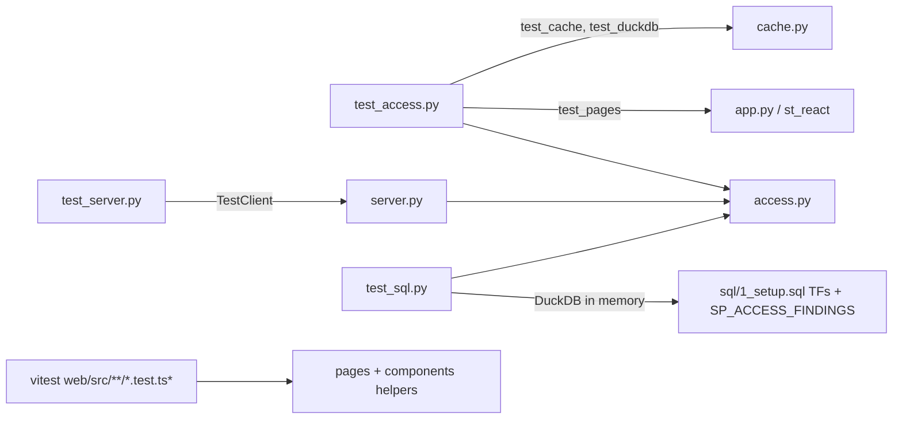

<!-- generated by darshan-singh-meel-knowledge-graph -->
# Tests

Three plain-Python test files (no pytest) on the fake data, plus vitest for web/src; packages in requirements-dev.txt.

## How to run

| Command | What | path:line |
|---|---|---|
| `python test_access.py` | Every `test_` function, `test_cache` first, `a.build(a.fake())` before each, all failures reported, then reruns itself with `ROLE_PREFIXES=ZF_,ZT_` (skips test_perf, test_pages, test_live there) | test_access.py:2246-2265 |
| `python test_server.py` | Every `test_` in file order; FAKE=1 set at import; TestClient on `server.make_app()` | test_server.py:8-15, test_server.py:1406-1412 |
| `python test_sql.py` | 14 tests in a fixed list | test_sql.py:682-686 |
| `npm test` (in web/) | `vitest run` | web/package.json:11 |
| Rule check | `python -c "import access as a; a.build(a.fake()); print(sorted({c[0] for c in a.checks()}, key=int))"` lists 1-29 | CLAUDE.md "Verify before saying done" |

- Test packages: requirements.txt + requirements-web.txt (duckdb for test_sql) + httpx for TestClient (requirements-dev.txt:1-4).
- `PERF=0` / `PERF_SCALE` control test_perf (CLAUDE.md; budgets docstring test_access.py:1453).

## test_access.py groups

| Group | Tests | Lines |
|---|---|---|
| Walks and depth | test_user, test_depth_limit, test_can, test_role, test_object, test_depth, test_classes, test_cycle, test_namespaces | test_access.py:30, 45, 64, 98, 114, 140, 160, 1039, 1618 |
| Admin paths / BFS starts | test_admin_paths (a cap per admin role: ACCOUNTADMIN not hidden behind SYSADMIN paths), test_shortest_default (a default role's longer start joins at its own hop) | test_access.py:1278, 1288 |
| SQL text | test_with_sql (Compare / Request / Granted vs used SQL and role kinds come from access.py) | test_access.py:2186 |
| Sensitive data | test_sensitive, test_data_view, test_has_lacks | test_access.py:189, 1574, 1562 |
| Users / rules | test_users, test_rule18_stable, test_rules, test_fixes_clear, test_readonly, test_public, test_new_rules, test_review_logic, test_kinds | test_access.py:240, 259, 267, 312, 325, 1075, 1099, 1046, 1031 |
| Loaders / Snowflake fakes | test_demo_db, test_each, test_live, test_live_inside, test_db_roles, test_setup_errors | test_access.py:345, 483, 580, 665, 768, 997 |
| Cache | test_cache, test_duckdb | test_access.py:1724, 694 |
| Streamlit | test_pages (every `server.PAGES` key through app.py), test_sis_upload (4_streamlit.sql uploads every import, plus environment.yml, sis/.env, web/dist-st and `access_queries/*.sql` for the SQL panel, test_access.py:989) | test_access.py:938, 971 |
| Fast / counted walks, perf | test_cap, test_fast, test_counted, test_built, test_builtin, test_perf (on `big()` test_access.py:1400) | test_access.py:1088, 1140, 1197, 1260, 1297, 1453 |
| What if | test_whatif_indirect, test_whatif | test_access.py:1324, 1344 |
| Graph inputs | test_group_graph, test_graph_inputs, test_summary | test_access.py:1515, 1690, 1709 |
| Screens | test_ladder, test_who_has, test_nearest, test_graph_see_compare, test_plan, test_review_catalog_flow, test_usage_changes, test_review_fixes | test_access.py:1792, 1809, 1830, 1888, 1939, 1960, 2006, 2147 |
| Activity | test_activity: Activity tab numbers, rules 24-28 (one finding each), UTC hours and weekend add up (test_access.py:2078-2081), activity_sql UTC / HOURS / StreamlitName (test_access.py:2090-2091), scope view and query_sql (test_access.py:2092-2094), warehouse_use (test_access.py:2108-2109), grant path behind a use, sensitive view, tag text, app_exposure and rule 29 with its What-if fix (test_access.py:2124-2132), owner role -> no rule 24, no ACTIVITY -> not available, incremental window (`activity_start`) | test_access.py:2066 |
| Settings switches | test_switches: `HIERARCHY=0` skips `a.WALKS` (listed by `skipped_rules`, rule 6 still runs, no "who loses access", pages still walk); `ACTIVITY=0` reads no OBJECT_USE / ACTIVITY table (objects) and probes no ACCESS_HISTORY / SESSIONS (direct), sources SKIPPED, rules 24-28 skipped, cache key `_noactivity`; defaults skip nothing | test_access.py:494 |
| Timeouts | test_timeout: `sf.rows` sends `STATEMENT_TIMEOUT_IN_SECONDS` and a timeout says the step and the doubled setting in minutes; the CALL goes without the limit and its timeout names the warehouse / account limit; `timeout_hint` for 120 s, 90 s and no number | test_access.py:541 |
| Progress lines | test_progress: `live()` gives the same data with and without `a.progress`, a `SHOW GRANTS TO / OF ROLE: n of m` line, `done in`; `snapshot()` with `WORKERS=3` names `[wN] TBL_ACCESS_GRANT: rows in s`; a timeout in a wave gets its own line with the longer setting; `each()` outside `progress()` reports nothing | test_access.py:2212 |
| Missing data | test_missing_names (a grant / user-role row without a name left out with a `missing_names` note; the `_tidy` marker makes a second tidy() skip the scan), test_empty_reads (unreadable or odd data: empty plus a note, never a crash, a no-run read never kept on disk), test_none_fuzz (`none_variants`: missing, NULL or empty in every table and column, never an exception; a failed build never counts as built) | test_access.py:813, 828, 912 |
| What changed kept | test_diff_kept: the diff made at refresh time from the replaced data set still kept built equals `a.diff` | test_access.py:2046 |
| DuckDB walk | test_duck_reach: `duck()` / `lose_all` / `read_shares` answer who loses access and the rule 17 / 23 pre-filter exactly as the Python walk, on the fake data and `big()`; a role loop falls back to Python | test_access.py:1168 |
| Docs | test_readme_rules (docs/make_readme.py rule table) | test_access.py:2173 |
| Settings | test_tag_settings: env `QUERY_TAG=it's`, `STREAMLIT_APP=ST_OTHER` in a child process -> `a.QUERY_TAG` / `a.APP_ST` take them, activity_sql has `<> 'it''s'` and `NOT LIKE '%.ST_OTHER%'` (a quote cannot end the string) | test_access.py:2204 |

## test_server.py groups

| Group | Tests | Lines |
|---|---|---|
| Page shapes | test_frame, test_user, test_role, test_object, test_check, test_request, test_sensitive_rules_review, test_who, test_access_home, test_graph_see_compare, test_risks_plan, test_review_grid_catalog_flow, test_usage_changes, test_activity (Activity tab of an object, a person, a role, `as=`, untagged table, rules 24-28 in area Activity; test_server.py:886-906), test_sql_page (GET /api/sql per page and `section_sql`; test_server.py:909-934), test_every_page, test_review_fixes, test_step3, test_step4 | test_server.py:53, 72, 151, 166, 224, 261, 295, 700, 720, 743, 806, 819, 860, 886, 909, 940, 988, 1020, 1042 |
| Loading / My access | test_load_on_click, test_mine, test_mine_shared_server, test_rebuild_outcome | test_server.py:336, 353, 602, 582 |
| Paged pages and lazy boxes | test_paged (privilege rows and Access entries a page at a time, CSV complete, combined boxes sent empty and opened through graph?group=), test_big_lanes (people lanes fold into one lazy box; grantees, held by and role privileges page on the server; map objects roll up per database; node= detail), test_rules_paged (counts and groups cover every finding, findings a page at a time, fix texts from /api/finding) | test_server.py:101, 181, 774 |
| What changed kept | test_changes_kept: a refresh compares at once (compared); What changed answers from it, after a restart too (.cache/<key>.diff.pkl); an event sends its first NAMES ids | test_server.py:1157 |
| Lost session | test_lost_session: Direct mode, a session lost halfway or no warehouse (606) stops the load with its message and keeps nothing | test_server.py:561 |
| Read-only | test_read_only: every statement via `sf.rows` must match READ_ONLY, plus the SP_ACCESS_SNAPSHOT CALL | test_server.py:448 |
| Security / errors | test_same_site, test_error_text | test_server.py:630, 659 |
| CSV off | test_csv_off: `CSV=0` -> `meta.csv` false and every `server.CSV` route 403 `csv_off`, through FastAPI and `st_react.answer` | test_server.py:1303 |
| Same run | test_same_run: objects mode, a reload while the latest OK run is the one held keeps the held data after one `TBL_ACCESS_RUN` query (also memory only); a new run reads every table again | test_server.py:494 |
| Switches / timeout | test_switches: `HIERARCHY=0` -> `/api/rules` `skipped` = WALKS, not passing, same through `st_react.answer`, Home `skipped` too; a rebuild CALL past the timeout answers 503 with the warehouse / account limit message | test_server.py:1317 |
| Progress | test_progress: `GET /api/progress` idle `{running:false, view:null, lines:[]}` (also `st_react.answer`); during a direct load `running`, view shared, lines from `Connected`; asking never starts a load; host and Sec-Fetch checks; `st_react.shown` draws the lines into a box from a thread | test_server.py:1355 |
| Newer run | test_newer_run: objects mode with parts asks the last OK run every load (never answered from a part), a newer run shows, an unchanged one reads no table again | test_server.py:519 |
| Missing data | test_pages_empty: every page and CSV, shared and mine, on missing / NULL / empty data answers empty plus a note, never a 500 | test_server.py:953 |
| Background refresh / kept results / parts | test_background (Read Snowflake again in a thread: old data answers until the new is built; a failure keeps it and `/api/progress` `job` says why), test_kept_rules (rule results from `.cache/<key>.rules.pkl` after a restart while data, settings and access.py are the same), test_built_ready (a load leaves `rows`, `ro`, `breaks`, `sens` in `a.memo` with their load-log lines), test_parts (every read a part: only the timed-out part read again, `--build` reads nothing, `--export --fresh` reads all; `run.command` stage flags) | test_server.py:1059, 1107, 1142, 1207 |
| Versions | test_spa, test_streamlit_bridge, test_bundles_fresh (src-hash.txt) | test_server.py:380, 385, 670 |
| Graph schema | `graph_ok` checks GRAPH / NODE / EDGE keys and lane bounds | test_server.py:24-27, test_server.py:42-50 |
| Other | test_whatif, test_review_check | test_server.py:403, 686 |
| Review 2026-11-10 | test_run_address (`run.command` passes HOST as `--server.address`), test_cache_lock (`cache.get` memory hit does not wait; `drop` under the lock), test_csv_formula (CSV cells that would run as Excel formulas get `'`) | test_server.py:1051, 1247, 1280 |

## test_sql.py

| Test | Checks | Line |
|---|---|---|
| test_demo | TFs equal access.py on fake data | test_sql.py:146 |
| test_cap_and_admin | 60-role chain with cycle stops at 50 hops like MAX_HOPS | test_sql.py:162 |
| test_edges | Ownership in TF_CAN, same-named user and role, duplicates, `' > '` in names | test_sql.py:188 |
| test_findings | SP_ACCESS_FINDINGS | test_sql.py:239 |
| test_streams | streams step -> TBL_ACCESS_STREAM; error -> UNAVAILABLE | test_sql.py:270 |
| test_object_use | same ACCESS_HISTORY SELECT as access.use_sql | test_sql.py:293 |
| test_activity | SP activity step: same SELECT as access.activity_sql; `&QUERY_TAG` / `&STREAMLIT_APP` replaced by a.QUERY_TAG / a.APP_ST before the body runs (test_sql.py:318-319); same ACTIVITY_DAYS, QUERY_TAG and APP_ST; no ACCESS_HISTORY -> UNAVAILABLE, no rows | test_sql.py:310 |
| test_show_fallback | SHOW fallback equals access.live() | test_sql.py:328 |
| test_run_overlap | two SP_ACCESS_SNAPSHOT CALLs at once: one goes on, the other SKIPPED; an OK run keeps the rows of a run still running (started over an hour ago) | test_sql.py:412 |
| test_usage_extra | QUERY_HISTORY failing leaves the run OK, usage UNAVAILABLE | test_sql.py:465 |
| test_same_queries | each ACCOUNT_USAGE SELECT of `access.live()` has the same text in SP_ACCESS_SNAPSHOT (aliases, RUN_ID and the INSERT aside) | test_sql.py:559 |
| test_object_use_weeks | SP object use copies all but the last two weeks and reads from that Monday (and `access.use_start` in Direct mode): the same rows as a read of every week | test_sql.py:498 |
| test_proc_settings | SP settings: every statement carries `STATEMENT_TIMEOUT` (`TIMED`), no bare `.collect()`; `later()` runs at most `WORKERS` heavy jobs; `ACTIVITY=0` -> object use and activity SKIPPED, run OK; a timeout that fails the run names its step | test_sql.py:582 |
| test_history_shared | `access.history_sql` text is in the SP; one INSERT ALL fills object use and activity; when it fails each step runs its own INSERT; a skipped or failing step leaves the other alone | test_sql.py:639 |

## vitest (web/src)

| File | describe blocks (line) |
|---|---|
| components/loadlog.test.tsx | LoadLog (8): nothing before the first answer, about one poll a second while active, lines with seconds in an `aria-live` log, gone and no more polls when inactive; inside Streamlit (`poll` gives null) one poll only; Waiting: "Loading…", then "Loading… 4 s", after 10 s "still working" (loadlog.test.tsx:41-51) |
| components/nulls.test.tsx | null and empty data (40): `short()` dash for a missing day, `DayStack` without a first day draws nothing, the Activity tab with null names / times and without a first day |
| app.test.tsx | App shell during a load (21): no SQL buttons before data, the first load locks the page; Read Snowflake again in the background keeps it usable, shows the latest line, then the new data |
| components/codegen.test.ts | code output (10), home and links (56) |
| components/review1110.test.tsx | table helpers (21), copy-paste code (39), races, pickers and keys (58): collator sort, CSV formula cells, quoting / HCL escaping / multi-line reasons, Home Enter race, picker user vs role of one name, sortable header buttons, `viewPage`, Streamlit frame accepts only its parent's messages |
| components/helpers.test.ts | categorising (15), graphs (39), folding and opening (91), routes (134), helpers (146) |
| components/pager.test.tsx | DataTable pages (8): 120 rows -> "Rows 1–50 of 120", Next, a filter goes back to one page without a pager, CSV button gone under `CsvOn` false |
| components/render.test.tsx | render (27) |
| components/visuals.test.tsx | change plan pictures (21), bars (39), graph (71), web fixes (97), data panel (165), activity day chart (182, `DayStack`), activity combinations (193, `combine`), activity day chart pin and isolate (210) |
| pages/changeplan.test.ts | change plan (13) |
| pages/fixes.test.ts | list toolbar (21), access list grouping (38), Home search (48) |
| pages/history.test.ts | granted vs used (15), what changed (30) |
| pages/oldmap.test.ts | old-to-new map (51), Home (62) |
| pages/screens.test.ts | graph, see, compare (7) |
| pages/signoff.test.ts | review grid (15), catalog (34), flow (49) |
| pages/verdict.test.ts | Can they? helpers (18), Request access text (54) |
| pages/who.test.ts | who has access (9) |
