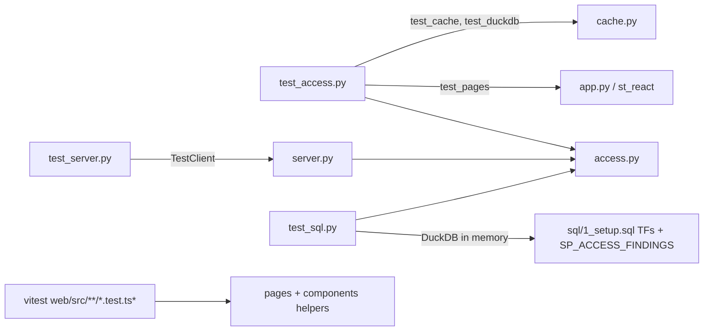

# Tests

Three plain-Python test files (no pytest) on the fake data, plus vitest for web/src; packages in requirements-dev.txt.

## How to run

| Command | What | path:line |
|---|---|---|
| `python test_access.py` | Every `test_` function, `test_cache` first, `a.build(a.fake())` before each, all failures reported, then reruns itself with `ROLE_PREFIXES=ZF_,ZT_` (skips test_perf, test_pages, test_live there) | test_access.py:1701-1720 |
| `python test_server.py` | Every `test_` in file order; FAKE=1 set at import; TestClient on `server.make_app()` | test_server.py:7-14, test_server.py:676-680 |
| `python test_sql.py` | 7 tests in a fixed list | test_sql.py:342-345 |
| `npm test` (in web/) | `vitest run` | web/package.json:11 |
| Rule check | `python -c "import access as a; a.build(a.fake()); print(sorted({c[0] for c in a.checks()}, key=int))"` lists 1-23 | CLAUDE.md "Verify before saying done" |

- Test packages: requirements.txt + requirements-web.txt (duckdb for test_sql) + httpx for TestClient (requirements-dev.txt:1-4).
- `PERF=0` / `PERF_SCALE` control test_perf (CLAUDE.md; budgets docstring test_access.py:1091).

## test_access.py groups

| Group | Tests | Lines |
|---|---|---|
| Walks and depth | test_user, test_depth_limit, test_can, test_role, test_object, test_depth, test_classes, test_cycle, test_namespaces | test_access.py:28-158, 747, 1255 |
| Sensitive data | test_sensitive, test_data_view, test_has_lacks | test_access.py:187, 1199, 1211 |
| Users / rules | test_users, test_rule18_stable, test_rules, test_fixes_clear, test_readonly, test_public, test_new_rules, test_review_logic, test_kinds | test_access.py:235-319, 739-844 |
| Loaders / Snowflake fakes | test_demo_db, test_each, test_live, test_live_inside, test_db_roles, test_setup_errors | test_access.py:339-646, 705 |
| Cache | test_cache, test_duckdb | test_access.py:1358, 528 |
| Streamlit | test_pages (every `server.PAGES` key through app.py), test_sis_upload (4_streamlit.sql uploads every import) | test_access.py:646, 679 |
| Fast / counted walks, perf | test_cap, test_fast, test_counted, test_built, test_builtin, test_perf (on `big()` test_access.py:1038) | test_access.py:792-935, 1091 |
| What if | test_whatif_indirect, test_whatif | test_access.py:962, 982 |
| Graph inputs | test_group_graph, test_graph_inputs, test_summary | test_access.py:1153, 1324, 1343 |
| Screens | test_ladder, test_who_has, test_nearest, test_graph_see_compare, test_plan, test_review_catalog_flow, test_usage_changes, test_review_fixes | test_access.py:1419-1662 |
| Docs | test_readme_rules (docs/make_readme.py rule table) | test_access.py:1688 |

## test_server.py groups

| Group | Tests | Lines |
|---|---|---|
| Page shapes | test_frame, test_user, test_role, test_object, test_check, test_request, test_sensitive_rules_review, test_who, test_access_home, test_graph_see_compare, test_risks_plan, test_review_grid_catalog_flow, test_usage_changes, test_every_page, test_review_fixes, test_step3, test_step4 | test_server.py:50-199, 459-667 |
| Loading / My access | test_load_on_click, test_mine, test_mine_shared_server, test_rebuild_outcome | test_server.py:214, 230, 345, 364 |
| Read-only | test_read_only: every statement via `sf.rows` must match READ_ONLY, plus the SP_ACCESS_SNAPSHOT CALL | test_server.py:322-342 |
| Security / errors | test_same_site, test_error_text | test_server.py:389, 418 |
| Versions | test_spa, test_streamlit_bridge, test_bundles_fresh (src-hash.txt) | test_server.py:257, 262, 429 |
| Graph schema | `graph_ok` checks GRAPH / NODE / EDGE keys and lane bounds | test_server.py:16-47 |
| Other | test_whatif, test_review_check | test_server.py:279, 445 |

## test_sql.py

| Test | Checks | Line |
|---|---|---|
| test_demo | TFs equal access.py on fake data | test_sql.py:134 |
| test_cap_and_admin | 60-role chain with cycle stops at 50 hops like MAX_HOPS | test_sql.py:150 |
| test_edges | Ownership in TF_CAN, same-named user and role, duplicates, `' > '` in names | test_sql.py:176 |
| test_findings | SP_ACCESS_FINDINGS | test_sql.py:222 |
| test_streams | streams step -> TBL_ACCESS_STREAM; error -> UNAVAILABLE | test_sql.py:252 |
| test_object_use | same ACCESS_HISTORY SELECT as access.use_sql | test_sql.py:275 |
| test_show_fallback | SHOW fallback equals access.live() | test_sql.py:291 |

## vitest (web/src)

| File | describe blocks (line) |
|---|---|
| components/codegen.test.ts | code output (10), home and links (56) |
| components/helpers.test.ts | categorising (15), graphs (39), folding and opening (91), routes (134), helpers (146) |
| components/render.test.tsx | render (27) |
| components/visuals.test.tsx | change plan pictures (21), bars (39), graph (71), web fixes (97), data panel (165) |
| pages/changeplan.test.ts | change plan (13) |
| pages/fixes.test.ts | list toolbar (21), access list grouping (38), Home search (48) |
| pages/history.test.ts | granted vs used (15), what changed (30) |
| pages/oldmap.test.ts | old-to-new map (51), Home (62) |
| pages/screens.test.ts | graph, see, compare (7) |
| pages/signoff.test.ts | review grid (15), catalog (34), flow (49) |
| pages/verdict.test.ts | Can they? helpers (18), Request access text (54) |
| pages/who.test.ts | who has access (9) |
