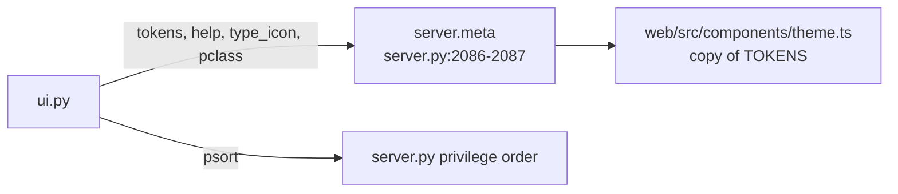

# ui.py

Presentation constants only, mostly sent to the React app in `/api/meta`; no data logic (ui.py:1-3).

| Name | What | path:line |
|---|---|---|
| `KINDS` | user, functional, technical, group, database, admin, object | ui.py:5 |
| `SHAPE` | radius + border style per kind (user pill, group/database dashed) | ui.py:6-8 |
| `_kinds(rows)` | kind -> bg / border / text / radius / dash | ui.py:11-13 |
| `TOKENS` | light and dark colour tokens + node kind styles | ui.py:16-21 |
| `PCLASS` | privilege class labels (read, write, own, use, manage, admin, inherit, also) | ui.py:22-23 |
| `TYPE_ICON` | object type -> (text glyph, label) | ui.py:25-30 |
| `HELP` | plain-language definitions for tooltips | ui.py:33-64 |
| `PRIVS` / `psort` | fixed privilege order; `'SELECT ×120'` sorts as SELECT | ui.py:65-72 |

- Node colour scheme matches CLAUDE.md: functional blue, technical coffee, group dashed amber, database dashed grey-blue, admin red (ui.py:18).
- `theme.ts` says it copies these tokens and must be kept in step (web/src/components/theme.ts:1).
