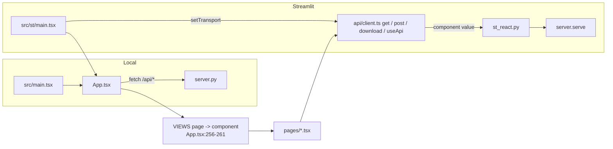

<!-- generated by darshan-singh-meel-knowledge-graph -->
# web/ (React app)

One React + TypeScript app (web/src) built twice: `dist` served by server.py and `dist-st` hosted by Streamlit (web/vite.config.ts:22-24).

## Shell and routing (web/src/App.tsx)

| Piece | Does | path:line |
|---|---|---|
| `SHARED_ONLY`, `viewPage(page, mine)` | Pages about everyone (review, flow, changes; `server.SHARED_ONLY`): switching to My access on one of them opens access; home stays (used by `setView`, web/src/App.tsx:282) | web/src/App.tsx:27-30 |
| `PAGES`, `LABEL`, `GROUPS` | 17 page keys, labels, nav groups (answers / admin / detail) | web/src/App.tsx:31-38 |
| `redirect(page, params)` | Old links to new screens; unknown page -> home | web/src/App.tsx:41-95 |
| `read()` / `url()` / `useLoc()` | URL `?page=&data=mine&...` <-> location; pushState / popstate | web/src/App.tsx:110-133 |
| `useTheme()` | dark by default, light / dark switch saved in localStorage | web/src/App.tsx:135-143 |
| `Find` | Top-bar search -> `GET /api/find` | web/src/App.tsx:145 |
| `Side`, `DataInfo`, `DataTime` | Side nav, "Data from" box (SQL copy), refresh | web/src/App.tsx:169, web/src/App.tsx:218, web/src/App.tsx:244 |
| `VIEWS` | page key -> page component | web/src/App.tsx:256-261 |
| `App` | `GET /api/meta` (web/src/App.tsx:272), `POST mine/load` (web/src/App.tsx:294), `POST reload` load (web/src/App.tsx:295), page / rebuild (web/src/App.tsx:303) | web/src/App.tsx:264-434 |
| Refresh in the background | `refresh(what)` posts `reload` (page / rebuild); an answer with `started` sets `bg` (job id, latest line): the top bar shows a spinner button "Reading again: <line>" / "Rebuilding: ..." that opens the full `LoadLog`; a poll of `/api/progress` ends when `job` is done or failed (or the server restarted): `clearCache()` and a notice ([flows/background-refresh.md](../flows/background-refresh.md)) | web/src/App.tsx:298-337, web/src/App.tsx:375-378 |
| First load lock | `loadingShared` (meta error `shared_loading`) polls and asks again when the load ends; while it or the first load runs everything but the log is `inert` (`lock`); `hasData` hides the SQL button, right-click SQL and the SQL panel until data is loaded | web/src/App.tsx:351-355, web/src/App.tsx:385, web/src/App.tsx:397, web/src/App.tsx:422 |
| SQL behind this page | State `sql` (web/src/App.tsx:269); top-bar "SQL" button (web/src/App.tsx:385) and a right-click on `<main>` (Shift + right-click keeps the browser menu, web/src/App.tsx:395-396) open `SqlPanel` for the current page and params (web/src/App.tsx:397); flow in [flows/show-sql.md](../flows/show-sql.md) | web/src/App.tsx:385-397 |
| Providers | `SqlCtx` (cards open the SQL panel) and `CsvOn` (`meta.csv`) around every page | web/src/App.tsx:359-360 |

## API client (web/src/api/client.ts)

- `get()` caches every GET by URL until `clearCache()` (web/src/api/client.ts:9-14, web/src/api/client.ts:35-44).
- `setTransport` swaps fetch for the Streamlit bridge (web/src/api/client.ts:23-26); `post()` (web/src/api/client.ts:52-59); `download()` saves a server CSV (web/src/api/client.ts:62-70).
- `peek(path, p)`: GET without the cache for polling; `null` under the Streamlit transport, where Python answers only once done (web/src/api/client.ts:46-50).
- `useApi(path, p)` refetches on param change or cache clear; `path=null` skips (web/src/api/client.ts:75-92).
- Errors -> `ApiFail(status, detail, message)` from the JSON body (web/src/api/client.ts:5-7, web/src/api/client.ts:28-33).

## Pages (ui_screen nodes)

| Page key | File | Shows | Endpoints (path:line) |
|---|---|---|---|
| home | pages/Home.tsx | Search, "can X read Y" to Can they?, my access, risks, data protection, recent | home (Home.tsx:67), find (Home.tsx:80): hits keep the text they answer, a slow older answer never replaces a newer one; Home says its counts leave skipped rules out (Home.tsx:154) |
| access | pages/Access.tsx | One page of objects at their highest ladder level, filtered and paged on the server (`Pager`, Access.tsx:184); embeds User / Role / ChangeFeed; tab Activity (`ActivityTab what=user|role`) | access (Access.tsx:28, next pages Access.tsx:68), access.csv (Access.tsx:145), activity (Activity.tsx:57) |
| user | pages/User.tsx | User paths; Privileges tabs paged on the server through `PrivilegeTabs` | user (User.tsx:14), privs (components/PrivilegeTabs.tsx:62), graph of=user-tab (components/PrivilegeTabs.tsx:41) |
| role | pages/Role.tsx | Role paths; held by paged on the server (`HeldBy`, Role.tsx:37) | role (Role.tsx:80), held (Role.tsx:59), privs of=role (components/PrivilegeTabs.tsx:62) |
| object | pages/Object.tsx | Who has access to an object or admin roles (preset=admin); tab Activity filtered by `as=`; `AppNote` for a Streamlit app (Object.tsx:76, Object.tsx:91-106); grantees by group or row (`GroupedGrantees`); the matrix as a `PagedTable` (Object.tsx:346) | who (Object.tsx:28), who.csv (Object.tsx:55), list (Object.tsx:31), rules (Object.tsx:277), object (Object.tsx:289), grantees (components/Grantees.tsx:94, components/Grantees.tsx:118) |
| check | pages/Check.tsx | Can they? Yes / Partly / No, routes, where to cut, nearest ways in | check (Check.tsx:19) |
| graph | pages/Map.tsx | Access graph from table, role or person; the map (objects rolled up) is fetched only on the Trace tab; a box opened later asks map node= | map (Map.tsx:25, Map.tsx:78), list (Map.tsx:27-28), graph (Map.tsx:70) |
| see | pages/See.tsx | What they see + role usage | see (See.tsx:19) |
| compare | pages/Compare.tsx | Two people or roles: only A / only B / different / same | compare (Compare.tsx:18) |
| request | pages/Request.tsx | Suggested role, approver, SQL / Terraform / ticket text | request (Request.tsx:18) |
| sensitive | pages/Sensitive.tsx (+ Catalog.tsx) | Sensitive objects and readers as `PagedTable`s (Sensitive.tsx:72, Sensitive.tsx:91); catalog tab (client CSV) | sensitive (Sensitive.tsx:36) |
| flow | pages/Flow.tsx | People -> granted role -> sensitive object | flow (Flow.tsx:17) |
| rules | pages/Rules.tsx (+ Risks.tsx) | Risks & fixes: counts and groups from the server, one group's findings fetched when opened (`GroupItems`, Risks.tsx:21-33), a finding's fix texts fetched on demand (`FindingFix`, Risks.tsx:45-59); heat grid, rule list, plan panel; rules that did not run (`skipped`) show their reason (`skipNote`, Risks.tsx:136-140) | rules (Rules.tsx:26, Risks.tsx:23), finding (Risks.tsx:46), rules.csv (Rules.tsx:31), whatif (Risks.tsx:280) |
| review | pages/Review.tsx (+ ReviewGrid.tsx) | Review rows paged, filtered and sorted on the server + CSV; grid with Keep / Revoke | review (Review.tsx:38), review.csv (Review.tsx:42), grid (ReviewGrid.tsx:21) |
| whatif | pages/Whatif.tsx (+ Plan.tsx) | Simulated revokes, who loses what, change plan | list (Whatif.tsx:54), whatif.csv (Whatif.tsx:190, Plan.tsx:126), whatif (Whatif.tsx:200, Plan.tsx:136), list (Plan.tsx:22-23) |
| usage | pages/Usage.tsx | Granted vs used (ACCESS_HISTORY) | usage (Usage.tsx:27) |
| changes | pages/Changes.tsx | Gained / lost access, new / fixed findings, watched questions; events paged on the server (`Pager`, Changes.tsx:61) | changes (Changes.tsx:34), list (Changes.tsx:120), check / who (Changes.tsx:161) |

- `PagedTable` (pages/paged.tsx:10-29): a table the server pages: this page's rows, `Pager` over the server's total (offset in a URL param, page size in `limit`, `PAGE` 50 as server.PAGE, pages/paged.tsx:8), and a CSV of every row from the same request with `limit=0`.
- pages/Activity.tsx: `ActivityTab` (Activity.tsx:54-58) and `UseLine` (Activity.tsx:72-86) call `/api/activity`; `Activity` (Activity.tsx:104-166) is one access log of stacked sections (the CLAUDE.md exception to the tabs rule), shaped by `what`, inside a `SectionSql` context holding `section_sql` (Activity.tsx:89, Activity.tsx:132); each section is a `Sec` card whose `sql` key hands that section's query to `Card` (Activity.tsx:92-94), shown inline by the card's `</>` corner mark: `Warehouse` (Activity.tsx:246-272) for a warehouse; tiles (`Tiles`, Activity.tsx:176-199) or `AppViewers` for a Streamlit app (Activity.tsx:213-243); `OffHours` (sql=off, Activity.tsx:275-322); `Touched` heat grid (sql=touched, Activity.tsx:362-402; `Heat`, Activity.tsx:326-352); `Hours` (sql=hours; hours shifted by the business-time slider at the top of the tab; overview pages only) (Activity.tsx:406-452); `Detail` (objects busiest first, sql=objects, then `ObjTiles`, `ByClient` (sql=client), `Kinds` (sql=kinds), `Matrix` (sql=matrix), `ByType` (sql=type_day) and `ByDay` (sql=by_day), Activity.tsx:455-506); `ByType` (DML / Read / DDL per day in their own colours, with `DayPanel` (Activity.tsx:624-642): busiest or pinned day, average a day, active days, Activity.tsx:646-674); `ByDay` (queries per day by user, role, client, statement, R / W / DDL or object kind, or any combination via `combine`, top 4 and Other, with a day-by-day table view, Activity.tsx:678-710); `WhoUsed` (sql=who, Activity.tsx:713-756); `Sensitive` (Activity.tsx:792-819); `Paths` (Activity.tsx:770-789); DDL changes (sql=ddl, Activity.tsx:154-158); `QuerySql` (Activity.tsx:822-831); `Checks` (Activity.tsx:833-846). Exports `offOf` (off-hours of a row after the UTC offset, Activity.tsx:25-26) and `combine` (rows summed per combination of dimensions, Activity.tsx:608-621). Types `ActivityPage` etc. (web/src/api/types.ts:1296-1340). Flow: [flows/activity-tab.md](../flows/activity-tab.md).
- pages/Activity.tsx null data: `short(d)` shows "–" for a missing or unreadable day, `initials(n)` takes a null name (Activity.tsx:50-53); the tab without a parseable first day says there is no table activity (tests: components/nulls.test.tsx).
- pages/Object.tsx: `AppNote` banner on a Streamlit app's Who has access page: viewers see the owner role's data; who sees sensitive data they can't read (Object.tsx:76, Object.tsx:91-106; `WhoPage.app`, web/src/api/types.ts:1057-1058).
- Pickers search the server: `Pick` -> `GET /api/list?q=&limit=50` (web/src/pages/common.tsx:54-73).
- SQL to run yourself (pages/common.tsx): `SqlBox` shows one query in a `<pre>` with a Copy SQL button (`copyText`) (web/src/pages/common.tsx:100-109); `SqlPanel` asks `GET /api/sql` with the page and its params, closes on Escape, and lists every query as a `SqlBox` (web/src/pages/common.tsx:113-129); styles `.ae-sqlpanel`, `.ae-sqlbox` (web/src/app.css:732-738). Never runs the SQL.
- Page helpers without UI: changeplan.ts, history.ts, signoff.ts, verdict.ts, who.ts, screens.ts (imports at web/src/pages/Plan.tsx:9, web/src/pages/Changes.tsx:11, web/src/pages/Catalog.tsx:7, web/src/pages/Check.tsx:10, web/src/pages/Object.tsx:15, web/src/pages/Map.tsx:9).
- The change plan is saved in this browser (`useSaved`, web/src/pages/Risks.tsx:10) (inferred from name; see changeplan.ts).

## Components (web/src/components)

| File | Role |
|---|---|
| Graph.tsx | Lane graph: ELK layout, React Flow, folds, keyboard / touch (Graph.tsx:1-3) |
| layout.ts | ELK loaded on first graph (layout.ts:54) |
| graphs.ts / tabgraph.ts | Pure lane-graph helpers / tab diagram |
| Legend.tsx | Legend next to each graph |
| PathStrip.tsx / PathText.tsx | A path as node-styled chips |
| DataTable.tsx / table.ts | Sortable, filterable table; CSV. Pages of 50 rows by default (`limit`), the viewer picks 25 / 50 / 100 / 250; back to page 1 on a new filter, sort or row set (DataTable.tsx:45-72). `server={path, params}`: the table asks that endpoint for each page with q / sort / dir / offset / limit (typed `q` sent 250 ms after the last key) and downloads `${path}.csv` for every matching row (DataTable.tsx:62-64, DataTable.tsx:83); `paged`: rows the caller fetched, page changes go back through `onChange` (`ServerTable`, DataTable.tsx:36-43). `Pager` (Prev / Next, "Rows a–b of N", optional per-page pick) is exported (DataTable.tsx:137-155) and also pages Access, Changes, Risks groups, grantee groups and Activity's busiest-objects table (pages/Activity.tsx:488). `CsvOn` context + `useCsv()` (table.ts:5-6): `App` provides `meta.csv` (App.tsx:360); every CSV button hides when it is false. Headers sort through a `<button>` (`.ae-th-btn`, DataTable.tsx:103); one shared `Intl.Collator` (table.ts:17); `toCsv` prefixes `'` to a cell starting with `= + - @` tab / CR (not a number), as `server.csv_text` (table.ts:38-43) |
| Findings.tsx | Rule findings with Fix panel (text only) |
| Grantees.tsx | Who can reach an object: `GroupedGrantees` pages the server's groups (`GET /api/grantees?by=groups`, `GROUPS` 50 a page) or its rows (`server` table, by=rows) (Grantees.tsx:86-118); `groupGrantees` groups rows on the client (Grantees.tsx:25) |
| PrivilegeTabs.tsx / tabs.ts | Privileges split in tabs; with `server` each tab's table is paged by `GET /api/privs` and its diagram comes from `GET /api/graph?of=user-tab|role-tab` (PrivilegeTabs.tsx:41, PrivilegeTabs.tsx:62) |
| kit.tsx / visuals.tsx / parts.tsx | Small SVG / CSS pieces on `--ae-*` tokens; `DayStack` queries-per-day stacked HTML bars with readout, pin, key focus, weekend shading and lanes; draws nothing without a parseable first day (visuals.tsx:77-154, visuals.tsx:83); `Waiting` "Loading…" with its seconds and, after 10 s, a still-working hint, shown by the app before meta and by `Load` before a page's answer (kit.tsx:239-246) |
| LoadLog.tsx | While a load or refresh runs (`busy` / `m.loading` / `loadingShared` / the open background log, App.tsx:403), polls `GET /api/progress` about once a second through `peek` and lists the server's lines with their seconds in an `aria-live` log, newest in view; nothing before the first answer; inside Streamlit `peek` gives null and it stops (LoadLog.tsx:1-31, styles.css:295-300; test loadlog.test.tsx) |
| Combo.tsx | Search box for Find and pickers; `close(keep)` sets the text kept after a pick or blur (Combo.tsx:39, 50, 60) |
| codegen.ts | SQL / Terraform / ticket text. `sqlOf()` only joins the server's `sql` of each change (`access.with_sql` / `revoke`) under the note's comments: the server is the one SQL writer (codegen.ts:68-71); Terraform uses `roleDb` / `toDb` from the server, never a dot in the name; names quoted as `access.sql_name` / `sql_obj` (`name`, `obj`), HCL strings escaped (`h`), every line of a multi-line note commented (codegen.ts:18-26) |
| theme.ts | Copy of ui.py TOKENS |

## Build outputs

| | `npm run build` -> web/dist | `npm run build:st` -> web/dist-st |
|---|---|---|
| Entry | web/index.html -> src/main.tsx | web/st/index.html -> src/st/main.tsx (web/st/index.html:10) |
| Served by | server.py `spa` (server.py:31, server.py:3452-3462) | st_react.py component (st_react.py:13-14) |
| Assets | inline limit 4096, ELK own chunk | no inlined assets, one JS (inlineDynamicImports) + one CSS (web/vite.config.ts:37-39) |
| Stamp | src-hash.txt of web/src (web/vite.config.ts:10-20), checked by `test_bundles_fresh` (test_server.py:670) | same |

- Both bundles are committed; rebuild both after any web/src change (CLAUDE.md "Two versions, one logic").
- Streamlit protocol: componentReady / setComponentValue / setFrameHeight (web/src/st/protocol.ts:5-7); requests sent as the component value (web/src/st/main.tsx:22).
- components/parts.tsx: every `Card` carries a `</>` mark in its top-right corner (`SqlMark`, parts.tsx:10-17; `SqlCtx`, parts.tsx:7): its own `sql` shows inline (`SqlInline`, parts.tsx:20-29), else the page's `SqlPanel` opens led by the card's title; `App` provides `SqlCtx` and opens the panel on a right-click too (App.tsx:359, App.tsx:395-396).
