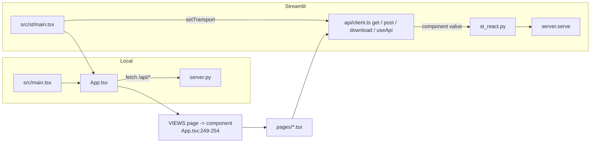

<!-- generated by darshan-singh-meel-knowledge-graph -->
# web/ (React app)

One React + TypeScript app (web/src) built twice: `dist` served by server.py and `dist-st` hosted by Streamlit (web/vite.config.ts:22-24).

## Shell and routing (web/src/App.tsx)

| Piece | Does | path:line |
|---|---|---|
| `SHARED_ONLY`, `viewPage(page, mine)` | Pages about everyone (review, flow, changes; `server.SHARED_ONLY`): switching to My access on one of them opens access; home stays (used by `setView`, web/src/App.tsx:277) | web/src/App.tsx:27-30 |
| `PAGES`, `LABEL`, `GROUPS` | 17 page keys, labels, nav groups (answers / admin / detail) | web/src/App.tsx:31-38 |
| `redirect(page, params)` | Old links to new screens; unknown page -> home | web/src/App.tsx:41-95 |
| `read()` / `url()` / `useLoc()` | URL `?page=&data=mine&...` <-> location; pushState / popstate | web/src/App.tsx:107-130 |
| `useTheme()` | light / dark, saved in localStorage | web/src/App.tsx:132-140 |
| `Find` | Top-bar search -> `GET /api/find` | web/src/App.tsx:142-151 |
| `Side`, `DataInfo`, `DataTime` | Side nav, "Data from" box (SQL copy), refresh | web/src/App.tsx:166-251 |
| `VIEWS` | page key -> page component | web/src/App.tsx:253-258 |
| `App` | `GET /api/meta` (web/src/App.tsx:268), `POST mine/load` (web/src/App.tsx:289), `POST reload` page / load (web/src/App.tsx:290-291), rebuild (web/src/App.tsx:293) | web/src/App.tsx:261 |

## API client (web/src/api/client.ts)

- `get()` caches every GET by URL until `clearCache()` (web/src/api/client.ts:9-14, web/src/api/client.ts:35-44).
- `setTransport` swaps fetch for the Streamlit bridge (web/src/api/client.ts:23-26); `post()` (web/src/api/client.ts:46-53); `download()` saves a server CSV (web/src/api/client.ts:56-64).
- `useApi(path, p)` refetches on param change or cache clear; `path=null` skips (web/src/api/client.ts:69-86).
- Errors -> `ApiFail(status, detail, message)` from the JSON body (web/src/api/client.ts:5-7, web/src/api/client.ts:28-33).

## Pages (ui_screen nodes)

| Page key | File | Shows | Endpoints (path:line) |
|---|---|---|---|
| home | pages/Home.tsx | Search, "can X read Y" to Can they?, my access, risks, data protection, recent | home (Home.tsx:66), find (Home.tsx:79); hits keep the text they answer, a slow older answer never replaces a newer one, Enter opens only hits for the text now in the box (Home.tsx:68-69, 77-80, 87) |
| access | pages/Access.tsx | One row per object at highest ladder level; embeds User / Role / ChangeFeed; tab Activity (`ActivityTab what=user|role`, Access.tsx:106-110) | access (Access.tsx:32), activity (Activity.tsx:37) |
| user | pages/User.tsx | User paths | user (User.tsx:14) |
| role | pages/Role.tsx | Role paths | role (Role.tsx:77) |
| object | pages/Object.tsx | Who has access to an object or admin roles (preset=admin); tab Activity (not on preset=admin, Object.tsx:72-76) filtered by `as=`; "Access for" strip shows `UseLine` (Object.tsx:121); `AppNote` for a Streamlit app (Object.tsx:68) | who (Object.tsx:27), rules (Object.tsx:262), list (Object.tsx:273), object (Object.tsx:275) |
| check | pages/Check.tsx | Can they? Yes / Partly / No, routes, where to cut, nearest ways in | check (Check.tsx:19) |
| graph | pages/Map.tsx | Access graph from table, role or person | map (Map.tsx:23), list (Map.tsx:25-26), graph (Map.tsx:69) |
| see | pages/See.tsx | What they see + role usage | see (See.tsx:19) |
| compare | pages/Compare.tsx | Two people or roles: only A / only B / different / same | compare (Compare.tsx:18) |
| request | pages/Request.tsx | Suggested role, approver, SQL / Terraform / ticket text | request (Request.tsx:18) |
| sensitive | pages/Sensitive.tsx (+ Catalog.tsx) | Sensitive objects, masked columns, readers; catalog tab (client CSV) | sensitive (Sensitive.tsx:37) |
| flow | pages/Flow.tsx | People -> granted role -> sensitive object | flow (Flow.tsx:16) |
| rules | pages/Rules.tsx (+ Risks.tsx) | Risks & fixes, heat grid, rule list, plan panel | rules (Rules.tsx:13), rules.csv (Rules.tsx:21), whatif (Risks.tsx:219) |
| review | pages/Review.tsx (+ ReviewGrid.tsx) | Review rows + CSV; grid with Keep / Revoke | review (Review.tsx:31), review.csv (Review.tsx:34), grid (ReviewGrid.tsx:19) |
| whatif | pages/Whatif.tsx (+ Plan.tsx) | Simulated revokes, who loses what, change plan | list (Whatif.tsx:55), whatif.csv (Whatif.tsx:189), whatif (Whatif.tsx:199, Plan.tsx:135), list (Plan.tsx:22-23) |
| usage | pages/Usage.tsx | Granted vs used (ACCESS_HISTORY) | usage (Usage.tsx:25) |
| changes | pages/Changes.tsx | Gained / lost access, new / fixed findings, watched questions | changes (Changes.tsx:32), list (Changes.tsx:115), check / who (Changes.tsx:156) |

- pages/Activity.tsx: `ActivityTab` (Activity.tsx:35-39) and `UseLine` (Activity.tsx:53-67) call `/api/activity`; `Activity` (Activity.tsx:81-124) is one access log of stacked sections (the CLAUDE.md exception to the tabs rule), shaped by `what`: `Warehouse` (Activity.tsx:204-230) for a warehouse; tiles (`Tiles`, Activity.tsx:134-157) or `AppViewers` for a Streamlit app (Activity.tsx:171-201); `OffHours` (Activity.tsx:233-280); `Touched` heat grid (`Heat`, Activity.tsx:284-360); `Hours` with the business-time slider UTC-12..+14 (Activity.tsx:364-412); `Detail` (objects busiest first, then `ObjTiles`, `ByClient`, `Kinds`, `Matrix`, `ByType` and `ByDay`, Activity.tsx:415-462); `ByType` (DML / Read / DDL per day in their own colours, with `DayPanel`: busiest or pinned day, average a day, active days, Activity.tsx:580-630); `ByDay` (queries per day by user, role, client, statement, R / W / DDL or object kind, or any combination via `combine`, top 4 and Other, with a day-by-day table view, Activity.tsx:564-577, Activity.tsx:634-666); `WhoUsed` (Activity.tsx:669-712); `Sensitive` (Activity.tsx:748-775); `Paths` (Activity.tsx:726-745); DDL changes; `QuerySql` (Activity.tsx:778-787); `Checks` (Activity.tsx:789-802). Exports `offOf` (off-hours of a row after the UTC offset, Activity.tsx:25-26) and `combine` (rows summed per combination of dimensions, Activity.tsx:562-575). Types `ActivityPage` etc. (web/src/api/types.ts:1216-1259). Flow: [flows/activity-tab.md](../flows/activity-tab.md).
- pages/Object.tsx: `AppNote` banner on a Streamlit app's Who has access page: viewers see the owner role's data; who sees sensitive data they can't read (Object.tsx:68, Object.tsx:83-98; `WhoPage.app`, web/src/api/types.ts:985-986).
- Pickers search the server: `Pick` -> `GET /api/list?q=&limit=50` (web/src/pages/common.tsx:54-71).
- Page helpers without UI: changeplan.ts, history.ts, signoff.ts, verdict.ts, who.ts, screens.ts (imports at web/src/pages/Plan.tsx:9, web/src/pages/Changes.tsx:11, web/src/pages/Catalog.tsx:7, web/src/pages/Check.tsx:10, web/src/pages/Object.tsx:15, web/src/pages/Map.tsx:9).
- The change plan is saved in this browser (`useSaved`, web/src/pages/Risks.tsx:9) (inferred from name; see changeplan.ts).

## Components (web/src/components)

| File | Role |
|---|---|
| Graph.tsx | Lane graph: ELK layout, React Flow, folds, keyboard / touch (Graph.tsx:1-3) |
| layout.ts | ELK loaded on first graph (layout.ts:54) |
| graphs.ts / tabgraph.ts | Pure lane-graph helpers / tab diagram |
| Legend.tsx | Legend next to each graph |
| PathStrip.tsx / PathText.tsx | A path as node-styled chips |
| DataTable.tsx / table.ts | Sortable, filterable table; CSV. Headers sort through a `<button>` (keyboard, `.ae-th-btn`); rows re-sort only when the column keys change, not on each new `columns` array (DataTable.tsx:36-41, 64-71); one shared `Intl.Collator` (table.ts:12); `toCsv` prefixes `'` to a cell starting with `= + - @` tab / CR (not a number), as `server.csv_text` (table.ts:34-37) |
| Findings.tsx | Rule findings with Fix panel (text only) |
| Grantees.tsx | Who can reach an object, grouped by chain |
| PrivilegeTabs.tsx / tabs.ts | Privileges split in tabs |
| kit.tsx / visuals.tsx / parts.tsx | Small SVG / CSS pieces on `--ae-*` tokens; `DayStack` queries-per-day stacked HTML bars with readout, pin, key focus, weekend shading and lanes (visuals.tsx:72-152) |
| Combo.tsx | Search box for Find and pickers; `close(keep)` sets the text kept after a pick or blur (Combo.tsx:39, 50, 60) |
| codegen.ts | SQL / Terraform / ticket text. `sqlOf()` only joins the server's `sql` of each change (`access.with_sql` / `revoke`) under the note's comments: the server is the one SQL writer (codegen.ts:68-71); Terraform uses `roleDb` / `toDb` from the server, never a dot in the name; names quoted as `access.sql_name` / `sql_obj` (`name`, `obj`), HCL strings escaped (`h`), every line of a multi-line note commented (codegen.ts:18-26) |
| theme.ts | Copy of ui.py TOKENS |

## Build outputs

| | `npm run build` -> web/dist | `npm run build:st` -> web/dist-st |
|---|---|---|
| Entry | web/index.html -> src/main.tsx | web/st/index.html -> src/st/main.tsx (web/st/index.html:10) |
| Served by | server.py `spa` (server.py:26, server.py:2394-2404) | st_react.py component (st_react.py:12-13) |
| Assets | inline limit 4096, ELK own chunk | no inlined assets, one JS (inlineDynamicImports) + one CSS (web/vite.config.ts:37-39) |
| Stamp | src-hash.txt of web/src (web/vite.config.ts:10-20), checked by `test_bundles_fresh` (test_server.py:463) | same |

- Both bundles are committed; rebuild both after any web/src change (CLAUDE.md "Two versions, one logic").
- Streamlit protocol: componentReady / setComponentValue / setFrameHeight (web/src/st/protocol.ts:5-7); requests sent as the component value (web/src/st/main.tsx:22).
