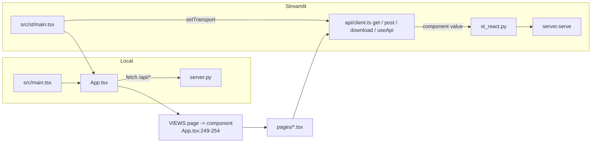

# web/ (React app)

One React + TypeScript app (web/src) built twice: `dist` served by server.py and `dist-st` hosted by Streamlit (web/vite.config.ts:22-24).

## Shell and routing (web/src/App.tsx)

| Piece | Does | path:line |
|---|---|---|
| `PAGES`, `LABEL`, `GROUPS` | 17 page keys, labels, nav groups (answers / admin / detail) | web/src/App.tsx:27-34 |
| `redirect(page, params)` | Old links to new screens; unknown page -> home | web/src/App.tsx:37-91 |
| `read()` / `url()` / `useLoc()` | URL `?page=&data=mine&...` <-> location; pushState / popstate | web/src/App.tsx:103-126 |
| `useTheme()` | light / dark, saved in localStorage | web/src/App.tsx:128-136 |
| `Find` | Top-bar search -> `GET /api/find` | web/src/App.tsx:138-147 |
| `Side`, `DataInfo`, `DataTime` | Side nav, "Data from" box (SQL copy), refresh | web/src/App.tsx:162-247 |
| `VIEWS` | page key -> page component | web/src/App.tsx:249-254 |
| `App` | `GET /api/meta` (web/src/App.tsx:264), `POST mine/load` (web/src/App.tsx:285), `POST reload` page / load (web/src/App.tsx:286-287), rebuild (web/src/App.tsx:289) | web/src/App.tsx:257 |

## API client (web/src/api/client.ts)

- `get()` caches every GET by URL until `clearCache()` (web/src/api/client.ts:9-14, web/src/api/client.ts:35-44).
- `setTransport` swaps fetch for the Streamlit bridge (web/src/api/client.ts:23-26); `post()` (web/src/api/client.ts:46-53); `download()` saves a server CSV (web/src/api/client.ts:56-64).
- `useApi(path, p)` refetches on param change or cache clear; `path=null` skips (web/src/api/client.ts:69-86).
- Errors -> `ApiFail(status, detail, message)` from the JSON body (web/src/api/client.ts:5-7, web/src/api/client.ts:28-33).

## Pages (ui_screen nodes)

| Page key | File | Shows | Endpoints (path:line) |
|---|---|---|---|
| home | pages/Home.tsx | Search, "can X read Y" to Can they?, my access, risks, data protection, recent | home (Home.tsx:66), find (Home.tsx:77) |
| access | pages/Access.tsx | One row per object at highest ladder level; embeds User / Role / ChangeFeed | access (Access.tsx:32) |
| user | pages/User.tsx | User paths | user (User.tsx:14) |
| role | pages/Role.tsx | Role paths | role (Role.tsx:77) |
| object | pages/Object.tsx | Who has access to an object or admin roles (preset=admin) | who (Object.tsx:26), rules (Object.tsx:240), list (Object.tsx:251), object (Object.tsx:253) |
| check | pages/Check.tsx | Can they? Yes / Partly / No, routes, where to cut, nearest ways in | check (Check.tsx:19) |
| graph | pages/Map.tsx | Access graph from table, role or person | map (Map.tsx:23), list (Map.tsx:25-26), graph (Map.tsx:69) |
| see | pages/See.tsx | What they see + role usage | see (See.tsx:19) |
| compare | pages/Compare.tsx | Two people or roles: only A / only B / different / same | compare (Compare.tsx:18) |
| request | pages/Request.tsx | Suggested role, approver, SQL / Terraform / ticket text | request (Request.tsx:18) |
| sensitive | pages/Sensitive.tsx (+ Catalog.tsx) | Sensitive objects, masked columns, readers; catalog tab (client CSV) | sensitive (Sensitive.tsx:37) |
| flow | pages/Flow.tsx | People -> granted role -> sensitive object | flow (Flow.tsx:16) |
| rules | pages/Rules.tsx (+ Risks.tsx) | Risks & fixes, heat grid, rule list, plan panel | rules (Rules.tsx:13), rules.csv (Rules.tsx:21), whatif (Risks.tsx:219) |
| review | pages/Review.tsx (+ ReviewGrid.tsx) | Review rows + CSV; grid with Keep / Revoke | review (Review.tsx:31), review.csv (Review.tsx:34), grid (ReviewGrid.tsx:19) |
| whatif | pages/Whatif.tsx (+ Plan.tsx) | Simulated revokes, who loses what, change plan | list (Whatif.tsx:55), whatif.csv (Whatif.tsx:189), whatif (Whatif.tsx:199, Plan.tsx:135), list (Plan.tsx:22-23) |
| usage | pages/Usage.tsx | Granted vs used (ACCESS_HISTORY) | usage (Usage.tsx:25) |
| changes | pages/Changes.tsx | Gained / lost access, new / fixed findings, watched questions | changes (Changes.tsx:32), list (Changes.tsx:115), check / who (Changes.tsx:156) |

- Pickers search the server: `Pick` -> `GET /api/list?q=&limit=50` (web/src/pages/common.tsx:54-70).
- Page helpers without UI: changeplan.ts, history.ts, signoff.ts, verdict.ts, who.ts, screens.ts (imports at web/src/pages/Plan.tsx:9, web/src/pages/Changes.tsx:11, web/src/pages/Catalog.tsx:7, web/src/pages/Check.tsx:10, web/src/pages/Object.tsx:14, web/src/pages/Map.tsx:9).
- The change plan is saved in this browser (`useSaved`, web/src/pages/Risks.tsx:9) (inferred from name; see changeplan.ts).

## Components (web/src/components)

| File | Role |
|---|---|
| Graph.tsx | Lane graph: ELK layout, React Flow, folds, keyboard / touch (Graph.tsx:1-3) |
| layout.ts | ELK loaded on first graph (layout.ts:54) |
| graphs.ts / tabgraph.ts | Pure lane-graph helpers / tab diagram |
| Legend.tsx | Legend next to each graph |
| PathStrip.tsx / PathText.tsx | A path as node-styled chips |
| DataTable.tsx / table.ts | Sortable, filterable table; CSV |
| Findings.tsx | Rule findings with Fix panel (text only) |
| Grantees.tsx | Who can reach an object, grouped by chain |
| PrivilegeTabs.tsx / tabs.ts | Privileges split in tabs |
| kit.tsx / visuals.tsx / parts.tsx | Small SVG / CSS pieces on `--ae-*` tokens |
| Combo.tsx | Search box for Find and pickers |
| codegen.ts | SQL / Terraform / ticket text |
| theme.ts | Copy of ui.py TOKENS |

## Build outputs

| | `npm run build` -> web/dist | `npm run build:st` -> web/dist-st |
|---|---|---|
| Entry | web/index.html -> src/main.tsx | web/st/index.html -> src/st/main.tsx (web/st/index.html:10) |
| Served by | server.py `spa` (server.py:26, server.py:2319-2329) | st_react.py component (st_react.py:12-13) |
| Assets | inline limit 4096, ELK own chunk | no inlined assets, one JS (inlineDynamicImports) + one CSS (web/vite.config.ts:37-39) |
| Stamp | src-hash.txt of web/src (web/vite.config.ts:10-20), checked by `test_bundles_fresh` (test_server.py:429) | same |

- Both bundles are committed; rebuild both after any web/src change (CLAUDE.md "Two versions, one logic").
- Streamlit protocol: componentReady / setComponentValue / setFrameHeight (web/src/st/protocol.ts:5-7); requests sent as the component value (web/src/st/main.tsx:22).
