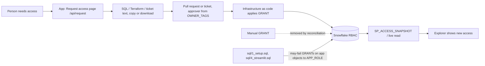

<!-- generated by darshan-singh-meel-knowledge-graph -->
How roles and grants get granted, per the source: real RBAC changes go through infrastructure as code (IaC); the setup SQL grants only the app's own objects; the app itself never grants and only writes request text (Request access page).

## Rules
- App is read-only; never runs GRANT, REVOKE, CREATE, ALTER or DROP; RBAC changes go through IaC; manual grants get removed by reconciliation — CLAUDE.md:6-7.
- Roles and grants are managed as IaC; the app only reads them — README.md:416.
- "Real set-up: schema, roles and grants via infrastructure as code" — sql/1_setup.sql:4; what DEV_ROLE needs "(real set-up: infrastructure as code)" — sql/1_setup.sql:918.
- Grant `APP_ROLE` to people who use the app "through your infrastructure as code" — README.html:650.
- What if prints REVOKE / IaC text, never runs it — CLAUDE.md:64.

## App roles (who needs what)
- `DEV_ROLE`, `APP_ROLE` privileges: see deploy-snowflake.md > Roles and grants needed (README.md:248, README.html:654, sql/1_setup.sql:861-861, sql/4_streamlit.sql:72-83).
- The setup scripts do issue `GRANT ... TO ROLE &APP_ROLE` on the app's own DB/schema/WH/tables/functions/procedure/Streamlit, all `(may fail)` except `GRANT_STREAMLIT` — sql/1_setup.sql:861-916, sql/4_streamlit.sql:72-83. POC note: app role may equal developer role, so they are skipped or no-ops — sql/1_setup.sql:861.
- Developer account-read grants (`IMPORTED PRIVILEGES ON DATABASE SNOWFLAKE`, `SECURITY_VIEWER` + `GOVERNANCE_VIEWER`, or `MANAGE GRANTS`) are given as comments only, not executed — sql/1_setup.sql:918-922.
- Optional admin step `ALTER ACCOUNT SET ALLOW_ID_TOKEN = TRUE` (login reuse ~4 h) — README.md:177, README.html:650.
- Viewers only need `APP_ROLE` — README.md:248.

## Request access page (in-app, text only)
- Answers: which existing role to ask for, who approves, what text goes in the PR or ticket — README.html:324-325.
- Person: `GRANT ROLE x TO USER u`; role: `GRANT ROLE x TO ROLE r` with too-broad and rule 1 warnings; database role: skeleton or why not — README.html:331-332.
- Approver from the object's owner tag (`OWNER_TAGS`), else blank; expiry and reason go into comments; output is SQL, Terraform or ticket text, never run — README.html:335-338.
- API: `GET /api/request` uses `a.need_privs`, `a.suggest`, `a.approver`, `a.object_stats`; text built in `codegen.ts` — web/API.md:491-508.

## Unclear
- The IaC tool/repo and reconciliation job are not in this repo (unclear which tool; Terraform text is offered — README.html:338).
- No approval workflow is defined in source beyond the approver field.
