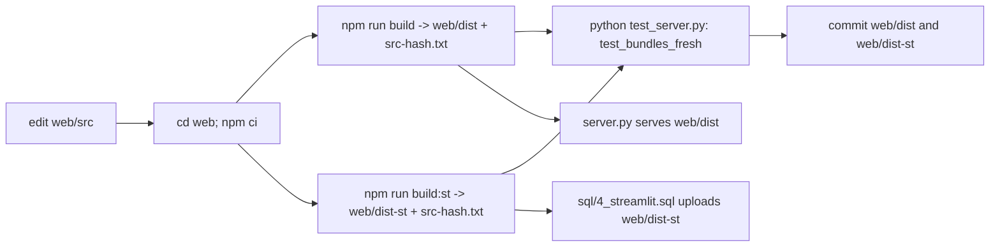

<!-- generated by darshan-singh-meel-knowledge-graph -->
Rebuild the React bundles after any `web/src` change: `npm run build` (web/dist, local SPA) and `npm run build:st` (web/dist-st, Streamlit component), then commit both.

## Steps
- Needs Node 20+; `cd web; npm ci; npm run build; npm run build:st`, then commit — README.md:131.
- Rule: after any change in `web/src`, rebuild both and commit them; users only run Python — CLAUDE.md:33-34.
- Scripts: `dev` = vite, `build` = `vite build`, `build:st` = `vite build --mode st`, `typecheck` = `tsc --noEmit`, `test` = `vitest run` — web/package.json:6-12.
- Dependencies pinned exactly: @xyflow/react, elkjs, react, react-dom — web/package.json:13-18.

## vite.config.ts
- `build` -> `dist/` (local SPA served by server.py); `build:st` -> `dist-st/` (relative paths, no CDN, no worker, no data: URLs, one JS + one CSS) — web/vite.config.ts:22-24.
- st mode: root `web/st`, `assetsInlineLimit 0`, `inlineDynamicImports`, strips `crossorigin` — web/vite.config.ts:26-39.
- Each build writes `src-hash.txt` (sha256 of non-test `.ts/.tsx/.css` in web/src) — web/vite.config.ts:8-20.
- `test_bundles_fresh` compares `src-hash.txt` of both bundles with web/src — test_server.py:463-475.
- Streamlit entry: `web/st/index.html` -> `web/src/st/main.tsx`; protocol hand-written in `web/src/st/protocol.ts` — web/ST.md:15-17. `web/dist-st/` committed because SiS cannot run npm — web/ST.md:19.
- Deploy expects exactly 4 assets (one JS, one CSS, two fonts) — web/ST.md:12, sql/4_streamlit_verify.sql:10-12.

## Related
- `web/node_modules/` git-ignored — .gitignore:6, web/.gitignore:1.
- Third-party licences bundled in web/dist* — THIRD_PARTY.md:3-11.
- README.html generated parts are a separate build: `python docs/make_readme.py` — docs/make_readme.py:1-4 (see documents/make-readme-py.md).
