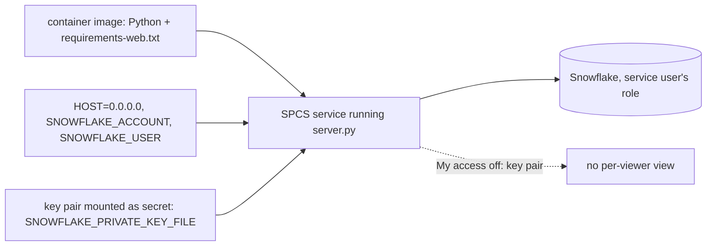

<!-- generated by darshan-singh-meel-knowledge-graph -->
Optional: run the local web app (`server.py`) as a Snowpark Container Services service so a team can use it without installing; documented in prose only, no deploy script in the repo.

## What the source says
- Optional, only to give everyone the local web app; any image with Python and `requirements-web.txt`, `HOST=0.0.0.0` — README.md:340-342, CLAUDE.md:42.
- Login like a shared server: `SNOWFLAKE_ACCOUNT`, `SNOWFLAKE_USER`, key pair `SNOWFLAKE_PRIVATE_KEY_FILE` mounted as a secret; SSO can't work; My access off — README.md:343-344, server.py:146-147.
- Inside detection is by active Snowpark session or `INSIDE=1`, not by a missing `SNOWFLAKE_ACCOUNT` — access.py:29-40 (fix of docs/review-2026-11-09.md:320-327).
- Host allow-list: with `HOST=0.0.0.0` the server also answers machine names/IPs; add others to `ALLOWED_HOSTS` — README.md:279-280, server.py:2295-2299.

## Not defined
- No Dockerfile, service spec, compute pool or SQL for SPCS in the repo (tracked files checked); steps are unclear beyond README.md:340-344.
- SiS container runtime (not SPCS): `sql/4_streamlit.sql` creates only a warehouse-runtime app (no RUNTIME_NAME / COMPUTE_POOL) — sql/4_streamlit.sql:64-70; review finding on this — docs/review-2026-11-09.md:320-327. web/ST.md now says to use the local version if the component is blocked — web/ST.md:50.
