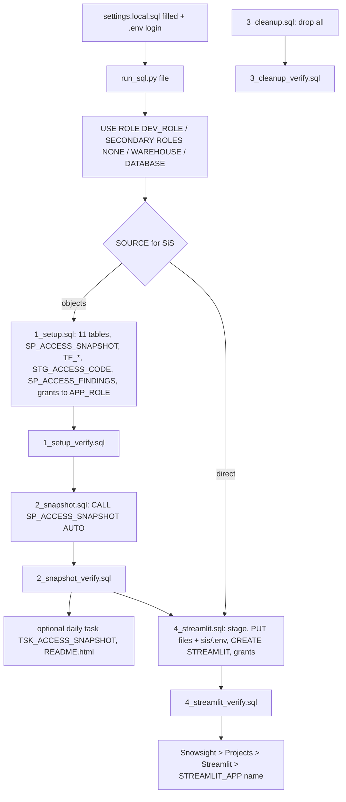

<!-- generated by darshan-singh-meel-knowledge-graph -->
Deploy the Snowflake side: `sql/1_setup.sql` (objects), `2_snapshot.sql` (fill), `4_streamlit.sql` (Streamlit in Snowflake), each checked by its `_verify.sql`, run with `run_sql.py` or SnowSQL; `3_cleanup.sql` removes everything.

## Runner: run_sql.py
- Runs each `-- name:` statement in order; `(may fail)` skipped on error; `_verify.sql` prints OK / MISSING / WRONG / SKIPPED then VERIFIED or NOT VERIFIED — run_sql.py:1-7, run_sql.py:64-82.
- Settings: `settings.local.sql`, else template `settings.sql` — run_sql.py:17; `!define` names parsed from settings.sql first, then settings.local.sql over them, so a name the local file lacks keeps the template value — run_sql.py:18-19; `HERE` = repo folder for PUT — run_sql.py:20.
- Stops on quotes, `$` or backslash in `STREAMLIT_APP` / `QUERY_TAG` — run_sql.py:26-28; on unfilled `<placeholders>` — run_sql.py:29-31; on unknown `&NAME` — run_sql.py:34-39; on missing PUT files (hint for `sis/.env`) before any statement — run_sql.py:42-44, run_sql.py:56-59.
- Session setup: `USE ROLE &DEV_ROLE`, `USE SECONDARY ROLES NONE`, `USE WAREHOUSE &WH`, `USE DATABASE &DB` — run_sql.py:62-63.
- `(expect N)` row-count check — run_sql.py:66, run_sql.py:76.
- Login of `run_sql.py`: the same `.env` login as the app (`sf.connect()`), so PrivateLink needs only `SNOWFLAKE_HOST` (plain account kept) and private DNS — README.md:195, processes/privatelink-login.md. Streamlit in Snowflake uses its own session: no PrivateLink setup — README.md:196.
- SnowSQL alternative: `!source sql/<file>` from the repo folder; each file starts with `!source settings.local.sql` — sql/1_setup.sql:5-6, README.md:280. SnowSQL needs `HERE` filled by hand — settings.sql:14-15 — and every name in settings.local.sql, `STREAMLIT_APP` and `QUERY_TAG` included (no template fallback) — settings.sql:2-3.

## Step 1: sql/1_setup.sql (SOURCE=objects only)
- Purpose: the 10 snapshot tables (TBL_ACCESS_ACTIVITY included) + findings table, snapshot procedure, findings stage/procedure, table functions, app-role read access; safe to rerun — sql/1_setup.sql:1-5.
- Tables `TBL_ACCESS_RUN|GRANT|USER_ROLE|USER|USAGE|TAG|POLICY|STREAM|OBJECT_USE|ACTIVITY|FINDING` — sql/1_setup.sql:12-142.
- `SP_ACCESS_SNAPSHOT(P_SOURCE DEFAULT 'AUTO')`, Python 3.11, `EXECUTE AS OWNER` — sql/1_setup.sql:143-153; its `QUERY_TAG` / `APP_ST` come from `&QUERY_TAG` / `&STREAMLIT_APP` (defaults access-explorer / ST_ACCESS_EXPLORER), so the activity read leaves the app's own queries out — sql/1_setup.sql:179-180.
- `TF_ACCESS_OF` / `TF_WHO_CAN` / `TF_CAN` `(may fail)` — sql/1_setup.sql:676-786.
- `STG_ACCESS_CODE` + `PUT access.py` + `SP_ACCESS_FINDINGS` importing it — sql/1_setup.sql:794-811.
- Grants to `APP_ROLE` (all `may fail`) — sql/1_setup.sql:866-921.
- Verify: `python run_sql.py sql/1_setup_verify.sql` — TABLES expect 11, procedures, functions, stage, function calls, ACCOUNT_USAGE readability probes, SHOW STREAMS, DEV_ROLE grants — sql/1_setup_verify.sql:4-65.

## Step 2: sql/2_snapshot.sql
- `CALL &DB.&SCHEMA.SP_ACCESS_SNAPSHOT('AUTO')`; `AUTO` / `ACCOUNT_USAGE` / `SHOW`; ACCOUNT_USAGE lags ~2 h — sql/2_snapshot.sql:1-12.
- Verify: last run OK, one run in data, counts per table, OBJECT_USE and ACTIVITY (may fail) — sql/2_snapshot_verify.sql:4-42.
- Freshness: daily task `TSK_ACCESS_SNAPSHOT` (`USING CRON 0 6 * * * UTC`, then `ALTER TASK ... RESUME`) — README.html:654-656; not in any sql/ file (only dropped in 3_cleanup.sql:17-18). Or rerun 2_snapshot.sql / **Rebuild snapshot** button — README.md:271.

## Step 3 (numbered 4): sql/4_streamlit.sql
- Two options: `SOURCE=objects` (run 1 + 2 first) or `SOURCE=direct` (this file only; owner role needs IMPORTED PRIVILEGES) — sql/4_streamlit.sql:2-7.
- Prereq `sis/.env` (required, git-ignored, template `sis.env.example`): `mkdir sis; copy sis.env.example sis\.env` — README.md:331-340, sql/4_streamlit.sql:9-10, .gitignore:8.
- Stage `STG_ACCESS_APP` — sql/4_streamlit.sql:19-20.
- PUT `app.py`, `access.py`, `cache.py`, `server.py`, `sf.py`, `st_react.py`, `ui.py` — sql/4_streamlit.sql:22-41.
- PUT `environment.yml` — sql/4_streamlit.sql:48-49; `.streamlit/config.toml` not uploaded — sql/4_streamlit.sql:44.
- PUT `web/dist-st/index.html`, `REMOVE` old assets `(may fail)`, PUT assets — sql/4_streamlit.sql:51-59.
- PUT `sis/.env` as the app's `.env` — sql/4_streamlit.sql:61-62.
- `CREATE OR REPLACE STREAMLIT &DB.&SCHEMA.&STREAMLIT_APP ... MAIN_FILE='app.py' QUERY_WAREHOUSE=&WH`; `STREAMLIT_APP` is a setting, default `ST_ACCESS_EXPLORER` (settings.sql:16-17) — sql/4_streamlit.sql:64-72. Set the same name as `STREAMLIT_APP` in `sis/.env` and `.env` (sis.env.example:16-18, .env.example:33-35).
- Grants to `APP_ROLE`: USAGE on DB/schema/WH `(may fail)`, USAGE on the Streamlit — sql/4_streamlit.sql:72-83.
- Safe to rerun; rerun after every `git pull` — sql/4_streamlit.sql:11, README.md:349.
- Verify: Streamlit exists (expect 1), stage files, exactly 4 assets, grants on the app — sql/4_streamlit_verify.sql:3-15.
- Upload list checked against `app.py` imports by `test_sis_upload` — test_access.py:698-705, web/ST.md:54-55.
- Manual check in Snowsight: hint disappears, Home shows data, no CSP errors — web/ST.md:45-50.

## Roles and grants needed
| Role | Needs | Evidence |
|---|---|---|
| `DEV_ROLE` (owner) | USAGE on DB, schema, WH; CREATE TABLE / PROCEDURE / FUNCTION / STAGE on schema; CREATE STREAMLIT (SiS); CREATE TASK + account EXECUTE TASK (task) | README.md:271, README.html:658 |
| `DEV_ROLE`, read whole account | `IMPORTED PRIVILEGES ON DATABASE SNOWFLAKE`, or DB roles `SECURITY_VIEWER` + `GOVERNANCE_VIEWER`, or `MANAGE GRANTS` for SHOW | sql/1_setup.sql:923-927 |
| `DEV_ROLE`, SiS direct | must hold IMPORTED PRIVILEGES itself (USE SECONDARY ROLES refused inside) | README.md:339-340, sql/4_streamlit.sql:5-7 |
| `APP_ROLE` | USAGE DB/schema/WH; SELECT on 10 `TBL_ACCESS_` tables; USAGE on `TF_*`; USAGE on `SP_ACCESS_SNAPSHOT` (rebuild button) | sql/1_setup.sql:866-866, README.html:658 |
| `APP_ROLE`, SiS | USAGE on the Streamlit `&STREAMLIT_APP` (default `ST_ACCESS_EXPLORER`) (+ DB/schema/WH) | sql/4_streamlit.sql:72-83 |
- How these grants are given in practice: see access-requests.md.

## Rollback / removal
- No step-wise rollback is defined. Only full removal: `python run_sql.py sql/3_cleanup.sql` drops the Streamlit `&STREAMLIT_APP` (sql/3_cleanup.sql:12), app stage, task, both procedures, 3 functions, code stage and the `TBL_ACCESS_` tables with data; schema stays; "Cannot be undone" — sql/3_cleanup.sql:1-69.
- Verify removal: `sql/3_cleanup_verify.sql` (every check expect 0) — sql/3_cleanup_verify.sql:3-25.
- Redeploy of the app = rerun 4_streamlit.sql (replaces app) — sql/4_streamlit.sql:11. Previous app version is not kept (inferred from `CREATE OR REPLACE`, sql/4_streamlit.sql:65).

## Unclear / inconsistent
- Grants created by 1_setup.sql / 4_streamlit.sql are not revoked by 3_cleanup.sql (inferred: dropping the objects removes their grants; DB/schema/WH USAGE grants remain) — sql/3_cleanup.sql:11-69.
- Grants are applied by these scripts as `(may fail)` statements, while the project rule says real roles and grants go through IaC — sql/1_setup.sql:4, CLAUDE.md:6-7. Which wins in a given account is unclear.
