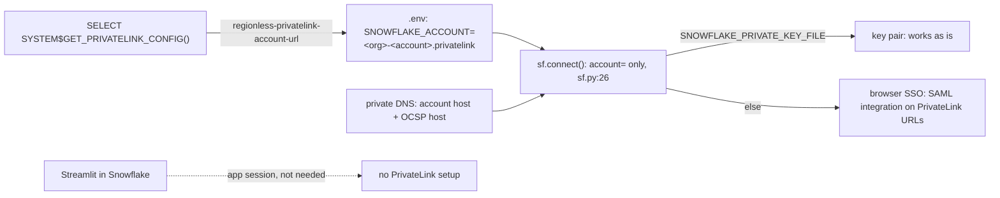

<!-- generated by darshan-singh-meel-knowledge-graph -->
Log in over private connectivity (AWS PrivateLink, Azure Private Link, GCP Private Service Connect): no code change, only the account value in `.env` and private DNS on the machine — README.md:179-196, README.html:645.

## Steps
- Account value: `SNOWFLAKE_ACCOUNT=<org>-<account>.privatelink` — README.md:182-184; it is `regionless-privatelink-account-url` (or the older `privatelink-account-url`) from `SELECT SYSTEM$GET_PRIVATELINK_CONFIG();` without `.snowflakecomputing.com` — README.md:186-187.
- Private DNS: the machine resolves the `<org>-<account>.privatelink` account host (with the Snowflake domain) and the OCSP host (`privatelink-ocsp-url`) to the private endpoint (VPN or company network) — README.md:188-189; a missing OCSP record shows as a hang or a certificate error on connect — README.md:190.
- Key pair (`SNOWFLAKE_PRIVATE_KEY_FILE`): works as is — README.md:191.
- Browser SSO: the SAML integration must use the PrivateLink URLs (`SAML2_SNOWFLAKE_ACS_URL`, `SAML2_SNOWFLAKE_ISSUER_URL`), else the identity provider returns the login to the public URL and it fails; fallback is a key pair — README.md:192-193.
- Check: `python sf.py "select current_user(), current_role(), current_account()"`; `run_sql.py` and both apps use the same login — README.md:194.
- Streamlit in Snowflake needs none of it (the app's own session) — README.md:195, sf.py:20-22.
- Shared server: same `.privatelink` value and private DNS on the server — README.md:303.

## In the code
- `sf.connect()` has no PrivateLink code: it passes `account=os.environ["SNOWFLAKE_ACCOUNT"]` to `snowflake.connector.connect` as given — sf.py:26. The connector builds the host from that value.
- Same path for the web app, Streamlit locally, `run_sql.py` and the `sf.py` CLI (all call `sf.connect()`) — see modules/sf.md.

## Relates to
- processes/setup-local.md (`.env`), processes/run-local.md, processes/deploy-snowflake.md (`run_sql.py` login), processes/container-services.md, modules/sf.md, documents/readme-md.md, documents/readme-html.md.
