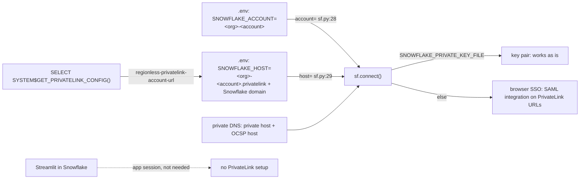

<!-- generated by darshan-singh-meel-knowledge-graph -->
Log in over private connectivity (AWS PrivateLink, Azure Private Link, GCP Private Service Connect): keep the plain account in `SNOWFLAKE_ACCOUNT`, set the private host in `SNOWFLAKE_HOST`, and give the machine private DNS — README.md:181-198, README.html:646.

## Steps
- Settings: `SNOWFLAKE_ACCOUNT=<org>-<account>` stays as it is, `SNOWFLAKE_HOST=<org>-<account>.privatelink` + Snowflake domain; the connector then connects to that host instead of the public address — README.md:184-188.
- The host is `regionless-privatelink-account-url` (or the older `privatelink-account-url`) from `SELECT SYSTEM$GET_PRIVATELINK_CONFIG();` — README.md:189-190.
- Private DNS: the machine resolves `<org>-<account>.privatelink` + Snowflake domain and the OCSP host (`privatelink-ocsp-url`) to the private endpoint (VPN or company network) — README.md:191-192; a missing OCSP record shows as a hang or a certificate error on connect — README.md:193.
- Key pair (`SNOWFLAKE_PRIVATE_KEY_FILE`): works as is — README.md:194.
- Browser SSO: the SAML integration must use the PrivateLink URLs (`SAML2_SNOWFLAKE_ACS_URL`, `SAML2_SNOWFLAKE_ISSUER_URL`), else the identity provider returns the login to the public URL and it fails; fallback is a key pair — README.md:195-196.
- Check: `python sf.py "select current_user(), current_role(), current_account()"`; `run_sql.py` and both apps use the same login — README.md:197.
- Streamlit in Snowflake needs none of it (the app's own session) — README.md:198, sf.py:20-22.
- Shared server: the same `SNOWFLAKE_HOST` and private DNS on the server — README.md:314.
- Settings row: `SNOWFLAKE_HOST`, default unset — README.md:214; `.env.example` has it commented — .env.example:36-37.

## In the code
- `sf.connect()` passes `account=os.environ["SNOWFLAKE_ACCOUNT"]` (sf.py:28) and `host=os.environ.get("SNOWFLAKE_HOST")` (sf.py:29) to `snowflake.connector.connect`; unset values are dropped (sf.py:43), so without `SNOWFLAKE_HOST` the connector builds the public host from the account.
- Same path for the web app, Streamlit locally, `run_sql.py` and the `sf.py` CLI (all call `sf.connect()`) — see modules/sf.md.

## Relates to
- processes/setup-local.md (`.env`), processes/run-local.md, processes/deploy-snowflake.md (`run_sql.py` login), processes/container-services.md, modules/sf.md, documents/readme-md.md, documents/readme-html.md, documents/env-example.md.
