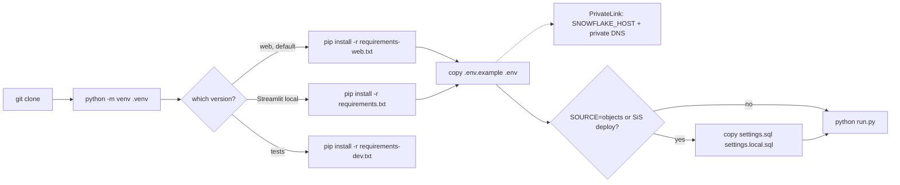

<!-- generated by darshan-singh-meel-knowledge-graph -->
Set up a local machine once: Python venv, pip requirements, `.env` from `.env.example`, and (objects mode / Snowflake deploy only) `settings.local.sql` from `settings.sql`.

## Steps
- Needs Python 3.10+ and git, no Node or npm (web app comes built) — README.md:73, README.md:144.
- Create and activate venv: `python -m venv .venv; .venv\Scripts\activate` — README.md:148. Execution-policy hint if `activate` is blocked — README.md:151.
- Install the web version: `pip install -r requirements-web.txt` — README.md:149.
- Update later: `git pull; pip install -r requirements-web.txt` — README.md:152.
- Try without Snowflake: `python run.py --fake` — README.md:79.

## Requirements files
| File | For | Contents (pinning) |
|---|---|---|
| `requirements-web.txt` | local web version, also shared server — requirements-web.txt:1 | snowflake-connector-python `>=3.12,<6`, fastapi `==0.135.3`, uvicorn `==0.46.0`, duckdb `>=1.0` (rule-check role walk and the SQL copy) — requirements-web.txt:2-5 |
| `requirements.txt` | Streamlit version (`run.py streamlit`) — requirements.txt:1 | streamlit `>=1.50,<2`, snowflake-connector-python, duckdb `>=1.0` — requirements.txt:2-4 |
| `requirements-dev.txt` | tests — requirements-dev.txt:1 | `-r requirements.txt`, `-r requirements-web.txt`, httpx `==0.28.1` — requirements-dev.txt:2-4 |
| `environment.yml` | Streamlit in Snowflake only, uploaded by sql/4_streamlit.sql — environment.yml:1 | channel `snowflake`, `streamlit=1.52.*` pinned, `snowflake-snowpark-python`, `duckdb` (the rule checks' role walk; without it they walk in Python, slower) — environment.yml:4-10 |

- duckdb is in both requirements files and environment.yml: the rule checks over every user and role walk role path counts in it (`access.duck`), and the SQL copy `.cache/access.duckdb` needs it; without it the app runs, slower on big accounts, and notes why there is no SQL copy — requirements-web.txt:5, requirements.txt:4, environment.yml:10, CLAUDE.md:11-13, CLAUDE.md:80.

## `.env` (from `.env.example`, git-ignored)
- Copy: `copy .env.example .env` — README.md:172. `.env` is git-ignored — .gitignore:3.
- Rules: `NAME=value`, no comment after a value; empty/missing name falls back to env var; a shell variable wins — .env.example:1; loader uses `os.environ.setdefault` — access.py:26-33.
- Names only (values never stored here):
  - Source/data: `FAKE`, `SOURCE`, `ACCESS_SNAPSHOT`, `CACHE_HOURS` — .env.example:4-10.
  - Runner: `APP`, `WEB_PORT`, `STREAMLIT_PORT` — .env.example:12-14.
  - Shared server: `HOST` (comment), `ALLOWED_HOSTS`, `MY_ACCESS` — .env.example:15-18.
  - Login: `SNOWFLAKE_ACCOUNT` (`<org>-<account>`, README.md:180), `SNOWFLAKE_USER`, `SNOWFLAKE_ROLE`, `SNOWFLAKE_WAREHOUSE`, `SNOWFLAKE_DATABASE`, `SNOWFLAKE_SCHEMA` — .env.example:21-27; `SNOWFLAKE_HOST` (commented; PrivateLink host) — .env.example:36-37; `CSV=0` (commented) turns every CSV export off — .env.example:38-39, server.py:2510-2511; read by sf.connect() — sf.py:27-36.
  - Secret refs: `SNOWFLAKE_PRIVATE_KEY_FILE`, `SNOWFLAKE_PRIVATE_KEY_PWD` (key pair; else browser SSO) — .env.example:28-29, sf.py:37-42.
  - Optional: `ROLE_PREFIXES` (and others listed in README.html > Settings) — .env.example:31-32.
- Missing `SNOWFLAKE_ACCOUNT` outside Snowflake raises "copy .env.example to .env" — sf.py:23-25.
- Private connectivity (AWS PrivateLink, Azure Private Link, GCP Private Service Connect): keep the plain account, set `SNOWFLAKE_HOST=<org>-<account>.privatelink` + Snowflake domain, private DNS for that host and the OCSP host, key pair as is, browser SSO only with the SAML integration on the PrivateLink URLs (`SAML2_SNOWFLAKE_ACS_URL`, `SAML2_SNOWFLAKE_ISSUER_URL`); check with `python sf.py "select current_user(), ..."` — README.md:184-201, README.html:677; sf.connect() passes it as `host=` — sf.py:29. Steps: processes/privatelink-login.md.
- Settings table with defaults — README.md:203-226.

## `settings.local.sql` (from `settings.sql`, git-ignored)
- Needed only for `run_sql.py` / SnowSQL (objects setup, SiS deploy) — settings.sql:1-2, README.md:274.
- Names: `DB`, `SCHEMA`, `WH`, `DEV_ROLE`, `APP_ROLE`, `HERE` (SnowSQL only; run_sql.py fills it) — settings.sql:6-15, run_sql.py:20; `STREAMLIT_APP` (default ST_ACCESS_EXPLORER) and `QUERY_TAG` (default access-explorer), same values as in `.env` and `sis/.env` — settings.sql:16-19.
- git-ignored — .gitignore:4.
- run_sql.py falls back to settings.sql if no local file, and per name for names the local file lacks; it stops on quotes, `$` or backslash in `STREAMLIT_APP` / `QUERY_TAG`, then if any `<placeholder>` is left — run_sql.py:17-19, run_sql.py:23-34.

## Local-only files
- `.cache/` (git-ignored) holds the pickled data, the read parts `reads/<key>/*.parquet`, the kept rule results `<key>.rules.pkl` and `access.duckdb` — .gitignore:7, CLAUDE.md:9-15.
- `.streamlit/config.toml`: local runs only, not uploaded to SiS — .streamlit/config.toml:1-10, sql/4_streamlit.sql:44.
- `local.ps1` is git-ignored — .gitignore:5; its purpose is unclear (no tracked file describes it).
