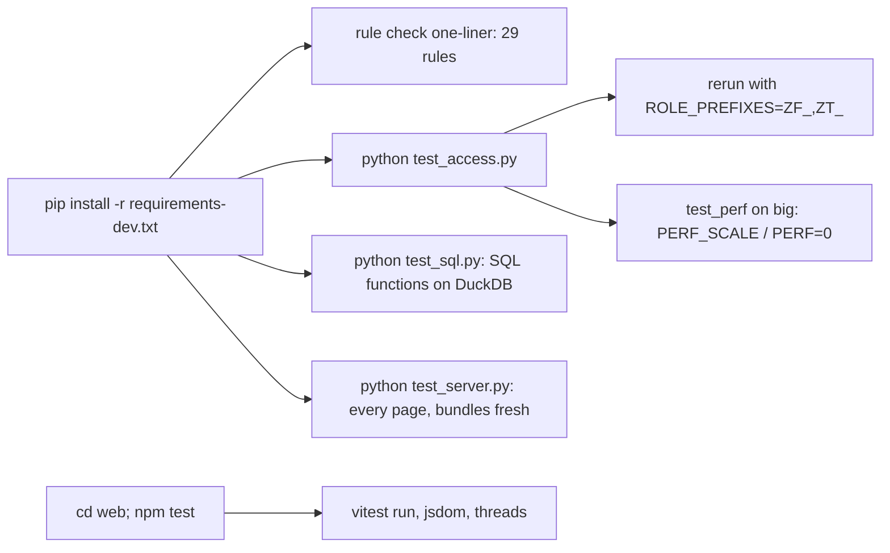

<!-- generated by darshan-singh-meel-knowledge-graph -->
Verify before calling work done: the 29-rule check on fake data, `test_access.py`, `test_sql.py`, `test_server.py` and the web vitest suite; all Python tests force `FAKE=1`.

## Commands (from CLAUDE.md "Verify before saying done")
- Rule check: `.venv\Scripts\python -c "import access as a; a.build(a.fake()); print(sorted({c[0] for c in a.checks()}, key=int))"` must list all 29 rules — CLAUDE.md:105-113.
- `python test_access.py` and `python test_sql.py` green — CLAUDE.md:114-115.
- Spot-check paths: user via group role, role reached through 2 paths, an admin holder — CLAUDE.md:116.
- `python access_queries/test_queries.py` green: query files and `functions.sql` equal to `access.py`, notebook current — CLAUDE.md:117 (modules/access-queries.md > Test).
- `test_pages` (app.py hands every page to the component) and `test_server.py` (what each page answers) — CLAUDE.md:118-119.
- Test packages: `requirements-dev.txt` — CLAUDE.md:115, requirements-dev.txt:1-4.
- README version incl. `python test_server.py` and `cd web; npm test` and `python access_queries/test_queries.py` — README.md:481.

## test_access.py
- Forces `FAKE=1` — test_access.py:14.
- Runs every `test_` function, reports all failures, then reruns itself with `ROLE_PREFIXES=ZF_,ZT_` (drops `BUILD_ROLES`) — test_access.py:2499-2518.
- `test_perf`: budgets × `PERF_SCALE` (default 1), best of runs; `PERF=0` skips — test_access.py:1562-1621.
- Named tests: `test_live` (live() in step with SP_ACCESS_SNAPSHOT) — test_access.py:614, CLAUDE.md:22; `test_pages` — test_access.py:1038; `test_sis_upload` — test_access.py:1071; `test_counted` — test_access.py:1306; `test_readme_rules` (README.html generated parts up to date) — test_access.py:2400-2410.
- Missing data never fails: `test_missing_names`, `test_empty_reads`, `test_none_fuzz` (test_access.py:913-1035); the DuckDB walk equals the Python walk: `test_duck_reach` (test_access.py:1277-1303).
- What changed made at refresh time from the replaced set still built equals a fresh diff, its rules not checked again: `test_diff_kept` (test_access.py:2273-2290).

## test_sql.py
- Forces `FAKE=1`, imports `duckdb` (so requirements-web.txt / dev needed) — test_sql.py:13-15, requirements-dev.txt:3.
- Loads a data set into DuckDB as the `TBL_ACCESS_` tables — test_sql.py:33, test_sql.py:82.
- Main runs `test_demo`, `test_cap_and_admin`, `test_edges`, `test_findings`, `test_streams`, `test_object_use`, `test_activity`, `test_show_fallback`, `test_run_overlap`, `test_usage_extra`, `test_object_use_weeks`, `test_same_queries`, `test_proc_settings`, `test_history_shared` — test_sql.py:831-835.
- Keeps `TF_*` / `SP_ACCESS_FINDINGS` equal to access.py — CLAUDE.md:83-84; runs the exact setup SQL text on DuckDB — sql/1_setup.sql:1238.

## test_server.py
- Forces `FAKE=1` — test_server.py:10; runs every `test_` in globals, prints "test_server green" — test_server.py:1968-1973.
- Examples: `test_read_only` (only reads + SP_ACCESS_SNAPSHOT CALL) — test_server.py:602, CLAUDE.md:47-48; `test_streamlit_bridge` — test_server.py:480; `test_same_site` — test_server.py:784; `test_bundles_fresh` — test_server.py:824.
- Load stages and refresh: `test_parts` (parts, `--build`, `--export --fresh`), `test_background` (refresh in a thread), `test_kept_rules` (rule results across restarts), `test_changes_kept` (What changed compared at refresh, `.diff.pkl` after a restart, paged feed), `test_pages_empty` (every page on empty / NULL data) — test_server.py:1300-1611; `test_lost_session` (a Direct load that loses its session or has no warehouse stops with the message, nothing kept) — test_server.py:715-733.
- Big accounts: `test_paged` (privileges and Access entries a page at a time, lazy graph boxes through `graph?group=`), `test_big_lanes` (folded people lanes, grantees / held by / role privileges paged, map node detail), `test_rules_paged` (Risks & fixes findings paged, `/api/finding`) — test_server.py:103-150, test_server.py:206-246, test_server.py:1032-1061 ([flows/paged-tables.md](../flows/paged-tables.md), [flows/lazy-graph-box.md](../flows/lazy-graph-box.md)).
- Changes since the last map: snapshot reads and inventory `test_inventory`, `test_type_spelling` (test_access.py:762, test_access.py:747), procedure copy `test_objects` (test_sql.py:469); Object activity `test_object_activity` (test_access.py:2226), `test_objuse` (test_server.py:1223); Can they? `test_check_inside`, `test_check_narrow` (test_server.py:283, test_server.py:275); graph focus `test_graph_focus`, `test_focus_keeps_way_in`, `test_crowded_lane` (test_server.py:936, test_server.py:249, test_server.py:259); risk strip `test_risks` (test_server.py:1919); Access type filter `test_access_type` (test_server.py:267).
- Uses FastAPI TestClient via httpx — requirements-dev.txt:4.

## Web (vitest)
- `npm test` = `vitest run` — web/package.json:11; jsdom, `pool: "threads"` (forks pool times out on Windows) — web/vite.config.ts:43-44.
- Test files: `web/src/components/*.test.ts(x)` (codegen, combo, graphfocus, helpers, loadlog, namelist, nulls, paged, pager, render, review1110, risks, visuals), `web/src/pages/*.test.ts(x)` (adminrows, answerfirst, blocked, changeplan, fixes, history, homedata, homeview, oldmap, rules, screens, signoff, verdict, whatif, who), `web/src/api/client.test.tsx` and `web/src/app.test.tsx` (the App shell during a load) — repo file list.
- `npm run typecheck` = `tsc --noEmit` — web/package.json:10.

## Unclear
- No CI config is tracked (no workflow files among the tracked files); tests run by hand.
