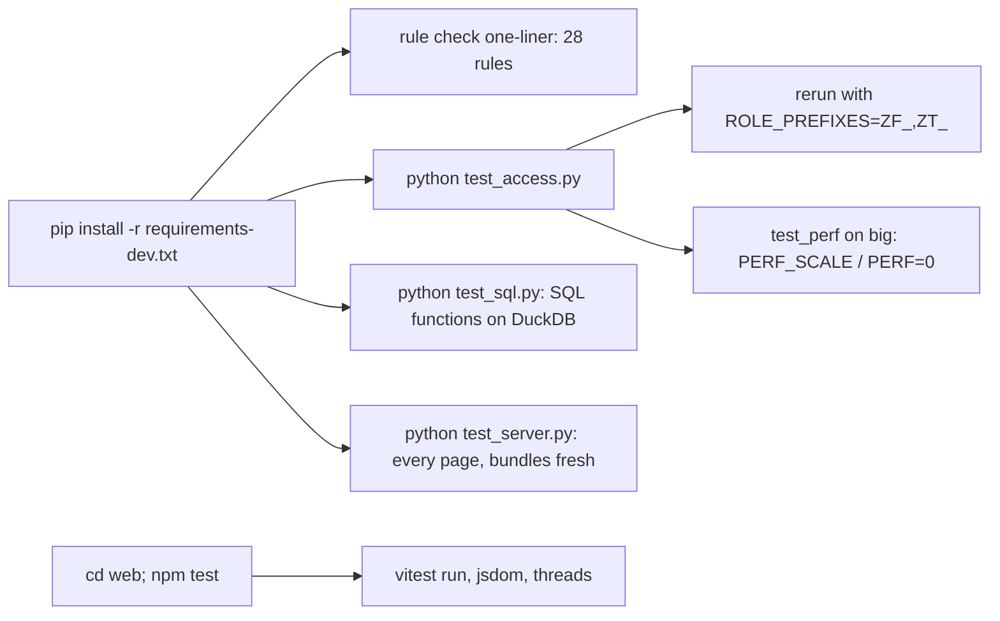

<!-- generated by darshan-singh-meel-knowledge-graph -->
Verify before calling work done: the 23-rule check on fake data, `test_access.py`, `test_sql.py`, `test_server.py` and the web vitest suite; all Python tests force `FAKE=1`.

## Commands (from CLAUDE.md "Verify before saying done")
- Rule check: `.venv\Scripts\python -c "import access as a; a.build(a.fake()); print(sorted({c[0] for c in a.checks()}, key=int))"` must list all 28 rules — CLAUDE.md:102-110.
- `python test_access.py` and `python test_sql.py` green — CLAUDE.md:111-112.
- Spot-check paths: user via group role, role reached through 2 paths, an admin holder — CLAUDE.md:113.
- `python access_queries/test_queries.py` green: query files and `functions.sql` equal to `access.py`, notebook current — CLAUDE.md:114 (modules/access-queries.md > Test).
- `test_pages` (app.py hands every page to the component) and `test_server.py` (what each page answers) — CLAUDE.md:115-116.
- Test packages: `requirements-dev.txt` — CLAUDE.md:112, requirements-dev.txt:1-4.
- README version incl. `python test_server.py` and `cd web; npm test` and `python access_queries/test_queries.py` — README.md:395.

## test_access.py
- Forces `FAKE=1` — test_access.py:12.
- Runs every `test_` function, reports all failures, then reruns itself with `ROLE_PREFIXES=ZF_,ZT_` (drops `BUILD_ROLES`) — test_access.py:1798-1817.
- `test_perf`: budgets × `PERF_SCALE` (default 1), best of runs; `PERF=0` skips — test_access.py:1110-1128.
- Named tests: `test_live` (live() in step with SP_ACCESS_SNAPSHOT) — test_access.py:466, CLAUDE.md:22; `test_pages` — test_access.py:657; `test_sis_upload` — test_access.py:690; `test_counted` — test_access.py:880; `test_readme_rules` (README.html generated parts up to date) — test_access.py:1767-1777.

## test_sql.py
- Forces `FAKE=1`, imports `duckdb` (so requirements-web.txt / dev needed) — test_sql.py:12-14, requirements-dev.txt:3.
- Loads a data set into DuckDB as the `TBL_ACCESS_` tables — test_sql.py:32, test_sql.py:72.
- Main runs `test_demo`, `test_cap_and_admin`, `test_edges`, `test_findings`, `test_streams`, `test_object_use`, `test_show_fallback` — test_sql.py:469-473.
- Keeps `TF_*` / `SP_ACCESS_FINDINGS` equal to access.py — CLAUDE.md:81-82; runs the exact setup SQL text on DuckDB — sql/1_setup.sql:640.

## test_server.py
- Forces `FAKE=1` — test_server.py:7; runs every `test_` in globals, prints "test_server green" — test_server.py:773-778.
- Examples: `test_read_only` (only reads + SP_ACCESS_SNAPSHOT CALL) — test_server.py:328, CLAUDE.md:47-48; `test_streamlit_bridge` — test_server.py:267; `test_same_site` — test_server.py:423; `test_bundles_fresh` — test_server.py:463.
- Uses FastAPI TestClient via httpx — requirements-dev.txt:4.

## Web (vitest)
- `npm test` = `vitest run` — web/package.json:11; jsdom, `pool: "threads"` (forks pool times out on Windows) — web/vite.config.ts:43-44.
- Test files: `web/src/components/*.test.ts(x)` (codegen, helpers, render, visuals) — repo file list.
- `npm run typecheck` = `tsc --noEmit` — web/package.json:10.

## Unclear
- No CI config is tracked (no workflow files in the 189 tracked files); tests run by hand.
